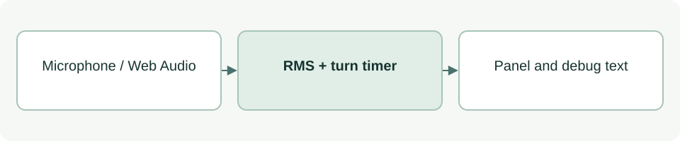

# Speaking-duration feedback

[Source: app.js](app.js)

Turns microphone volume into glanceable GOOD, LAND IT and STOP signals. This is a browser prototype of duration feedback; it does not identify the speaker or judge answer quality.

## Responsibilities and collaborators

Owns audio sampling, detected-turn timing, display state, explicit capture cleanup, the server response readout and the proposed-answer card and details.

- [index](index.md): Provides the cue band, Focus, Live, answer and details elements plus data-state controls.
- [Capture worklet](poc/audio-worklet.md): Supplies PCM packets independently of the UI timer.
- [Local server](poc/server.md): Receives audio and returns transcript, state, agent responses and proposed answers through `/session`, and answers `/health`.

## Interface and data

`STATES` maps `good | land | stop` to text/background/foreground. `mic` holds status:string, level:number, speaking:boolean, turnStart:number|null and lastVoice:number; timestamps use performance.now() milliseconds.

| Callable or interface | Contract |
| --- | --- |
| `setState(name: 'good' \| 'land' \| 'stop'): void` | Updates the cue word and the cue band's colors; other names are invalid. |
| `renderDebug(durationS: number): void` | Renders mic state, elapsed seconds and RMS level. |
| `tick(analyser: AnalyserNode, buf: Float32Array): void` | Reads samples, updates mic state, ends turns after silence, and renders feedback. |
| `startListening(): Promise<void>` | Requests audio access, resumes AudioContext, schedules tick every 100 ms and starts server connection setup. |
| `connectServer(resources, source): Promise<void>` | Sends ordered PCM after server readiness; renders transcript and increasing answer revisions. Errors preserve local audio feedback. |
| `stopListening(): void` | Invalidates the capture generation, stops tracks/timers, closes AudioContext and sockets; ignores late callbacks. |
| `renderServer(): void` | Renders connection/agent status, server audio counts, transcript and reply using textContent, then the question panel. |
| `renderControls()` / `renderAnswer()` | Start is disabled while listening, before `/health` answers and while recognition is unavailable; the reason line shows the reason or the live status. The answer card and details show the seven states (LB-1 to LB-7) with the reason lines, as plain text. |
| `applyProposed(message): boolean` | Applies a `proposed` or `answer` message's `proposed` only with a higher `proposedSeq` and the displayed Focus version; a new Focus shows Preparing at once. |
| `markLastKnown()` | On Stop or disconnect keeps content as last known; an interrupted Preparing keeps none. |
| `readHealth()` | One `/health` request on load; only `service` and `configured` are used, and anything else makes Start unavailable (no key, or no service). |
| `renderQuestion(): void` | Shows Focus, Live with its tag (or the submitted wording while a confirmation is pending), feedback, the disabled-Confirm hint and button availability. |
| `applyState(state): boolean` | Copies Focus, its version, Live and reply only when the revision is newer than displayed; clears old feedback when Live changes. |
| `confirmHint(live): string` | The reason Confirm is disabled, in the design's order, or empty when it is enabled. |
| `resetLive(): void` | Sends `question.reset` with a new `requestId`. |
| `confirmQuestion(): void` | Sends `question.confirm` for Live exactly as rendered; when uncertain, resends that same request. |
| `questionResult(message): void` | Offers its state to `applyState`, then settles only the matching pending request or latest Clear live. |

## Effects and failure behavior

The DOM must exist before this script runs. RMS must exceed 0.02; short pauses count toward elapsed time. LAND IT begins above 25 s, STOP above 35 s; silence ends a turn above 2500 ms. Manual states may be overwritten by the next tick.
The local analyser runs independently of OpenAI requests. Audio transmission starts only after server readiness; a two-second send backlog stops transmission with visible degraded status.
Stop preserves the displayed reply, labelled stopped. A new Start resets remote results and counters. Capture generation checks prevent an older permission request or socket from updating a newer session.
Focus changes only from a `confirmed` result. Confirm needs `ready`, no unsettled request, and Live text that differs from Focus; a hint names the missing condition. While pending, the submitted wording stays on screen and a note marks newer Live wording. After 5000 ms without a result the page says the confirmation is uncertain and offers an identical retry; it never assumes approval.
The first event on a socket fixes `remote.sessionId`; events naming another session are ignored. A disconnect or Stop marks Focus "last known, not live" and reports an unanswered confirmation as possibly unsaved. A new Start clears question memory and pending requests; nothing is replayed.
`acknowledgeRender(state)` sends `rendered` after the next paint for every newly applied state or answer, with the Live id and version when Live is displayed and the answer's `answerFocusVersion` and `answerStatus`; it records display, not consent.
A status of `OpenAI authentication failed` makes recognition unavailable (key rejected) and Start stays disabled until the page is reloaded. See [question controls](poc/docs/04.1-question-controls.md).

## Example

Run `bash poc/start.sh`, open http://127.0.0.1:3000 and press Start listening. See [POC results](poc/RESULTS.md) for observed synthetic-browser behavior and physical-microphone limitations.

## Automatic focus (18 November 2026)

The Confirm and Clear live buttons and `confirmHint` are unchanged and stay visible as an optional second tool. `GENERAL_REASONS` gains `not-covered`, and the empty answer wording no longer mentions confirming.
