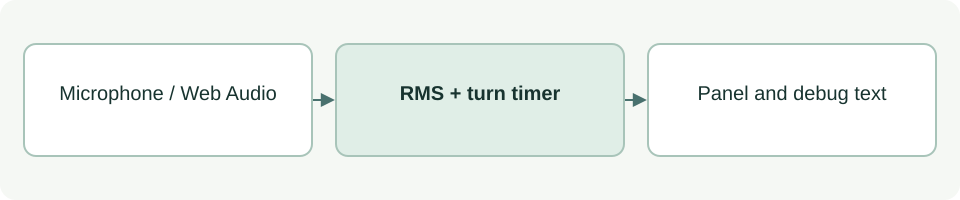

# Speaking-duration feedback

[Source: app.js](app.js)

Turns microphone volume into glanceable GOOD, LAND IT and STOP signals. This is a browser prototype of duration feedback; it does not identify the speaker or judge answer quality.

## Responsibilities and collaborators

Owns audio sampling, detected-turn timing, display state, explicit capture cleanup and the server response overlay.

- [index](index.md): Provides panel, debug and listen elements plus data-state controls.
- [Capture worklet](poc/audio-worklet.md): Supplies PCM packets independently of the UI timer.
- [Local server](poc/server.md): Receives audio and returns transcript, state and agent responses through `/session`.

## Interface and data

`STATES` maps `good | land | stop` to text/background/foreground. `mic` holds status:string, level:number, speaking:boolean, turnStart:number|null and lastVoice:number; timestamps use performance.now() milliseconds.

| Callable or interface | Contract |
| --- | --- |
| `setState(name: 'good' \| 'land' \| 'stop'): void` | Updates panel text and colors; other names are invalid. |
| `renderDebug(durationS: number): void` | Renders mic state, elapsed seconds and RMS level. |
| `tick(analyser: AnalyserNode, buf: Float32Array): void` | Reads samples, updates mic state, ends turns after silence, and renders feedback. |
| `startListening(): Promise<void>` | Requests audio access, resumes AudioContext, schedules tick every 100 ms and starts server connection setup. |
| `connectServer(resources, source): Promise<void>` | Sends ordered PCM after server readiness; renders transcript and increasing answer revisions. Errors preserve local audio feedback. |
| `stopListening(): void` | Invalidates the capture generation, stops tracks/timers, closes AudioContext and sockets; ignores late callbacks. |
| `renderServer(): void` | Renders connection/agent status, server audio counts, transcript, retained question and reply using textContent. |

## Effects and failure behavior

The DOM must exist before this script runs. RMS must exceed 0.02; short pauses count toward elapsed time. LAND IT begins above 25 s, STOP above 35 s; silence ends a turn above 2500 ms. Manual states may be overwritten by the next tick.
The local analyser runs independently of OpenAI requests. Audio transmission starts only after server readiness; a two-second send backlog stops transmission with visible degraded status.
Stop preserves the displayed reply, labelled stopped. A new Start resets remote results and counters. Capture generation checks prevent an older permission request or socket from updating a newer session.

## Example

Run `bash poc/start.sh`, open http://127.0.0.1:3000 and press Start Listening. See [POC results](poc/RESULTS.md) for observed synthetic-browser behavior and physical-microphone limitations.
