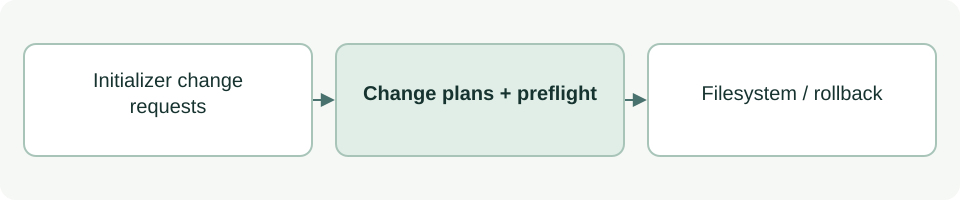

# Conservative file transactions

[Source: cli_files.py](cli_files.py)

Lets initialization prepare a group of file changes, detect conflicts before writing, and undo its own writes after ordinary failures.

## Responsibilities and collaborators

Owns managed-path checks, bounded reads, immutable change plans and local file replacement.

Works directly with the standard library and filesystem; callers retain ownership of scope and authorization.

## Interface and data

`Conflict(ValueError)` reports unsafe or conflicting resources. Frozen `Change` carries root:Path, relative:Path, before:bytes|None, after:bytes and mode:int; its path property validates the destination.

| Callable or interface | Contract |
| --- | --- |
| `safe_path(root: Path, relative: str \| Path) -> Path` | Returns a Path after rejecting absolute/traversing relative names, symlinks and invalid intermediate directories. |
| `read_bytes(path: Path) -> bytes \| None` | Returns file bytes or None when absent; rejects non-files and files above 4 MiB. |
| `plan(root: Path, relative: str \| Path, data: bytes, *, replace: bool=False, mode: int=420) -> Change \| None` | Returns Change or None for identical bytes. Existing content requires replace=True; existing permissions are retained. |
| `atomic_replace(path: Path, data: bytes, mode: int) -> None` | Writes and fsyncs a temporary file, applies mode and atomically replaces the destination. |
| `apply(changes: list[Change]) -> list[str]` | Preflights before-bytes, creates directories, applies changes and returns written absolute paths; rolls back only its own unchanged results on failure. |

## Effects and failure behavior

Raises Conflict or filesystem errors. Atomic replacement is per file; the group is not crash-safe or protected against hostile concurrent writers. Callers must have write authorization.

## Example

Use `plan(root, 'notes.md', b'# Notes\n')`; pass its non-None result to `apply([change])`.
