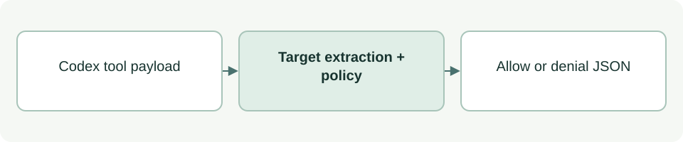

# Tool-call guard

[Source: cli_hook.py](cli_hook.py)

Translates a proposed tool call into a read-only allowance or a check against the active implementation scope.

## Responsibilities and collaborators

Extracts patch targets, recognizes a conservative shell allowlist and returns Codex hook denial JSON when validation fails.

- [cli_status](cli_status.md): Provides authoritative facts and permission.
- [cli_files](cli_files.md): Validates paths used by read-only commands.

## Interface and data

Input payload dict contains tool_name, tool_input and optional cwd. Patch tool_input.command contains apply_patch syntax; shell input contains command/cmd and optional workdir.

| Callable or interface | Contract |
| --- | --- |
| `implementation_decision(root: Path, paths: list[str], override: str \| None=None) -> tuple[bool, str]` | Returns (bool, reason) using project status and every target, adding next-action guidance when blocked. |
| `shell_read_only(root: Path, cwd: Path, command: str) -> bool` | Returns whether a shell command matches the narrow supported read-only grammar; it is not a general shell analyzer. |
| `decision(root: Path, payload: dict) -> tuple[bool, str]` | Dispatches patch/shell/unknown payloads to validation and returns (allowed, reason). |
| `main(root: Path) -> int` | Reads one JSON payload from stdin, prints denial JSON when blocked and returns 0; exceptions fail closed. |

## Effects and failure behavior

Unknown tools and arbitrary shell programs are denied. Payload/input errors become denial responses. The process exit code alone does not indicate allowance; a deny response can accompany exit 0. Installed hooks still need runtime trust.

## Example

The installed scripts/hook.py calls main with its own repository root; payload data cannot choose that root.
