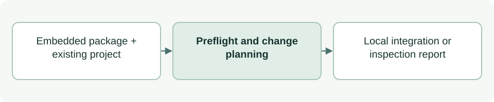

# Initialize and inspect an embedded project

[Source: cli_project.py](cli_project.py)

Installs project-local ASDG integration while preserving existing work and state, and reports whether that integration remains structurally consistent.

## Responsibilities and collaborators

Owns initialization preflight, managed file plans, discovery-template copying, stage scaffolds and structural inspection.

- [cli_files](cli_files.md): Plans/applies conservative writes.
- [cli_model](cli_model.md): Supplies identities, catalogue, JSON and hashes.
- [cli_sprint](cli_sprint.md): Validates existing sprint state.
- [cli_status](cli_status.md): Validates lifecycle rules/state through local imports.
- [documentation](documentation.md): Counts source lines and records document hashes.
- Stage introductions in `asdg/scaffolds/stages/`: generic human explanations and embedded diagrams, copied only when the client README is absent.

## Interface and data

Inputs are project/repository Paths and optional project_state (`new`, `defining`, `defined`). Reports are dicts; initialization includes planned_files, changed_files, unchanged, dry_run and sprint_started:false. Initialization creates stage introductions only; numbered evidence and plan files are added when needed. Structural inspection requires stage READMEs, not perspective directories.

| Callable or interface | Contract |
| --- | --- |
| `distribution(repo)` | Reads and validates embedded metadata; returns its dictionary. |
| `stage_readme(repo, slug) -> bytes` | Reads a packaged stage introduction; rejects missing files or documents over 50 nonblank lines. |
| `hook_config(root, repo=REPO)` | Returns JSON bytes for the configured guard and lifecycle logging hooks; does not establish trust. |
| `merge_block(old, block, begin, end, name)` | Returns preserved/extended bytes for a managed text block; rejects edited or incomplete blocks. |
| `binding(root, catalog_hash)` | Validates project identity/catalogue/layout; returns the binding dict or None for a fresh area. |
| `template_files(repo)` | Returns relative template paths and bytes; rejects symlinks and unexpected destination roots. |
| `preflight_package(repo)` | Checks role sources, adapters and all thirteen focus templates; returns agents and catalogue digest. |
| `initialize(root, repo=REPO, project_state=None, dry_run=False)` | Plans integration and documentation writes; dry_run returns plans only, otherwise applies changes and review receipts. |
| `inspect(root, repo=REPO)` | Returns structure_ok, missing items, binding/version details and sprint state; does not mutate the project. |

## Effects and failure behavior

Conflicts stop initialization rather than overwriting edited integration. Existing lifecycle/sprint records are preserved. New setup records an inactive sprint; it grants no implementation permission.
The managed instruction bridge points explicit human sprint requests to the start/close utilities; installation itself performs no transition and does not widen specialist authority.

## Example

From the client root: `python3 asdg/scripts/init.py --dry-run` previews writes.
