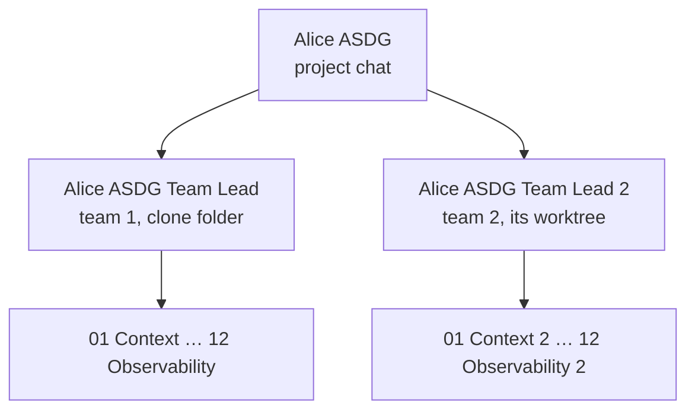

# Create confirmed missing team chats

Use only within [Create team](SKILL.md), after project and reuse verification.

The rules on this page apply to both clients. The tool names in this first part are Codex's; [Claude sessions](#in-claude) gives the equivalents.
Use native `create_thread` for each confirmed missing role, in small batches, with the verified project ID and local environment.
Omit model and reasoning overrides; honor any explicit user preferences. Do not create subagents or cloud tasks, and no worktree except a later team's under [numbered teams](numbered-teams.md).
Let each new chat compose its title through [the current title contract](../asdg-focus/rename-chat.md): short role, optional focus, optional attitude; keep the project binding in its receipt.
Each initial prompt must explicitly request `$asdg-focus` with its verified absolute path and that chat's catalogue role ID; no per-role picker skill is needed.
State the project root and request only activation, its required read-only opening/status, a brief role confirmation, then waiting for the user; a Claude team lead first creates its own team, as [the team tree](#the-team-tree) says.
New chats start with subject NoFocus and attitude NoAttitude unless the user explicitly assigns them; never copy the caller's attitude or overwrite a reused chat's fields.
State that team setup assigns no documentation or application work; preserve role boundaries, existing files, approvals and sprint state.
A new chat has no inherited conversation history: pass relevant explicit user constraints with provenance, not a fabricated approval.
Do not ask the new chats to create peers, message this chat, run a project task or continue autonomously, apart from that team lead creating its own team.
Retain each returned thread ID and host. After dispatch, use bounded `wait_threads` calls for up to eight targets, at most 60 seconds per wait.
Creation success is not focus activation: confirm the returned progress/receipt or report activation pending or failed.
For an uncertain creation outcome, inspect native inventory before retrying; never blindly create a duplicate.
Stop further creation after a shared permission or service failure; retain successes and report remaining roles.

## In Claude

Use this part only when the current surface offers native session tools; the Claude desktop app does, a plain terminal does not. Discover them and use their current schemas.
The project is the verified repository folder. List its sessions for reuse candidates and inspect a candidate's own record for an explicit Focus selection; a title alone never confirms a role.
Verify `.claude/skills/asdg-focus/SKILL.md` and each role's sources before creating anything. State how many chats will be created.
Start chats as [the team tree](#the-team-tree) below says, each in its team's folder: the clone for team 1, the team's own worktree for a [numbered team](numbered-teams.md).
Each is a fresh conversation, not a copy of this one, and never gets a worktree of its own unless the user asks.
Each initial prompt names the project root, asks the session to follow the canonical Focus workflow at `asdg/skills/asdg-focus/SKILL.md` for its catalogue role ID, to confirm the role briefly, and then to wait for the user. A team lead's prompt also carries the user's request, as the team tree says.
Retain every returned session identifier. A started session is not an activated role: confirm its first report shows the role loaded, or report activation pending or failed.
Create in the batches the surface accepts. A refusal for a limit on sessions running at once is not a failure.
The desktop app also refuses starts on a turn it began itself, such as one prompted by a started chat's report, so name the roles still missing and ask the user to say go to start them. On 25 November 2026 a test chat started ten of twelve and needed that second go.
After the roster is confirmed, follow [ordering in Claude](ordering.md#in-claude): one offered sort by name, changed only with approval, and the titles the team tree gives. Group, pin or move Claude sessions only on the user's request.
What a surface actually did is reported per run; this page promises no session creation on a surface where it has not been observed.

### The team tree

A chat is listed in the sidebar under the chat that started it, and archiving a chat archives those under it. So a project's chats form one tree:

*One project chat at the top, one lead per team under it, and each team's twelve role chats under its lead.*

1. **The project chat** is the chat where the user asks for Create team while the project has none. It keeps role 00 Governance with the [project chat title](../asdg-focus/rename-chat.md#team-lead-title) and leads no team itself.
2. **For each new team it starts only that team's lead**, in the team's folder. The lead's prompt passes the project nickname and team number, and quotes the user's Create team request word for word with its date. The lead activates 00 Governance with the team lead title, then creates its own team's 01–12 under itself.
3. **If the app refuses any of those starts**, as it did on an automatic follow-up turn in a test on 25 November 2026, the lead names the roles still missing and asks the user to say go in its chat. A chat's first turn, begun by the chat that started it, was seen starting a chat the same day. A lead completes only its own team and sends the user to the project chat for a new one.
4. **The project chat reports the new lead's title.** The lead reports its twelve as created, pending or refused.
5. **Any other chat asked for a new team** while a project chat exists tells the user to continue there. A project whose team 1 lead was set up at the top before this rule uses that lead as its project chat.
