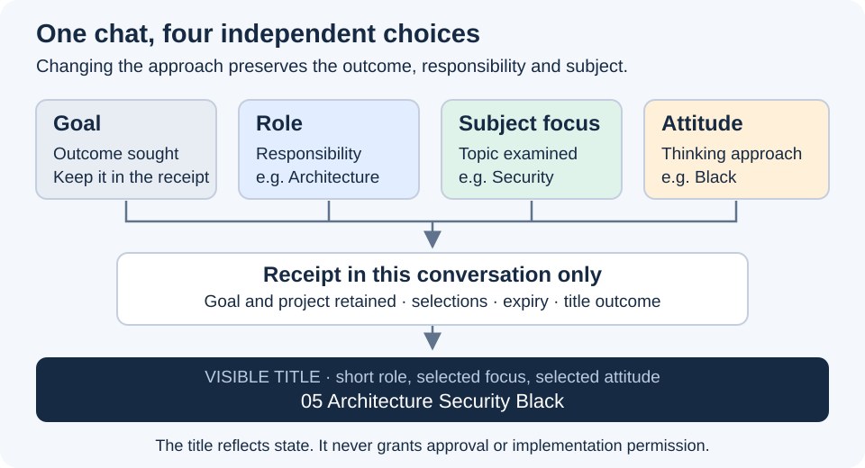

# Four independent parts of a session

Goal is the outcome; role is the responsibility; subject focus is the topic; attitude is the thinking approach.
Changing one does not silently change the others or the verified project binding.
The existing Focus command still selects roles. Its explicit `subject` form changes only the topic.

## Conversation receipt

Keep this record in the current conversation or a supported conversation checkpoint, never a shared active-state file.
Use plain language or an equivalent structured record; this is a receipt shape, not a new persistence service.

| Field | Record |
| --- | --- |
| Project / thread | Verified root, display name and stable native thread ID when supplied by the runtime. |
| Goal | User's intended outcome, current assignment and limits; Unknown if unrecoverable. |
| Role | Catalogue ID, native name and short label; None or Unknown are distinct. |
| Role evidence | Explicit selecting request, successful required reads, source paths and versions actually observed. |
| Subject focus | Full selected topic; NoFocus when deliberately unset, or Unknown when history is missing. Only selected topics appear in titles. |
| Attitude | White, Red, Green, Yellow, Black, Blue, NoAttitude, or Unknown. |
| Scope / expiry | Session-until-changed, one answer, or a named review with an observable endpoint; include the prior attitude to restore. |
| Change | User instruction, changed field(s), prior/resulting values, expiry or cancellation and retained goal. |
| Title | Computed/requested title, last observed title if known, actual native outcome and any unresolved mismatch. |

A genuinely new chat begins with role None, subject NoFocus and attitude NoAttitude unless explicitly assigned.
A retained pre-attitude role receipt remains valid; where history establishes no attitude or subject selection, record NoAttitude/NoFocus without reactivating the role.
Normalize legacy Off to NoAttitude and a known unset subject None to NoFocus; unknown history still means Unknown.
Otherwise recover each field independently from an unambiguous receipt or supported session metadata.
Missing attitude history means Unknown, not an invented NoAttitude; missing subject history does not erase a verified role.
A title, folder name, another chat's receipt or role-file inspection cannot recover authority.
If required role guidance is unavailable, retain a known role but block work needing that guidance; never substitute a different role.

## Updates and replies

Only an explicit role request changes role; only an explicit subject request changes subject; only an explicit attitude request changes attitude.
A role change or clear preserves goal, subject and attitude. Flag an out-of-role subject without silently erasing it.
Reading, mentioning, quoting, a recommendation, a topic drift or a status request changes none of these selections.
Normal assignments can update the user-stated goal; this increment adds no goal-management skill or inferred approval.
Role, subject and attitude selection/clear and attitude expiry use [the title contract](rename-chat.md); a failed rename never rolls back valid state.
NoFocus and NoAttitude remain receipt/status values and accepted clear aliases; neither appears in a session title.
Begin substantive replies with `Role: <verified label> | Focus: <subject/NoFocus/Unknown> | Attitude: <value and temporary scope>`.
Keep this declaration brief; it is context, not an extra role tutorial. Show the actual current state after any expiry.
For an expired one-answer override, say `Attitude: NoAttitude (restored; this answer used Black)`, substituting the actual values.
Status reports these fields separately; Role still explains responsibility. Preserve necessary evidence and uncertainty under every attitude.

## Isolation and recovery

Two chats may share role and project while holding different subjects, attitudes and goals.
Do not write to or message a peer merely to synchronize state. Discover candidates only for an authorized routing/setup task.
Verify project, role receipt, subject and stable thread ID before routing; a matching title is only a clue.
When multiple candidates remain plausible, report the ambiguity and ask which chat; never pick the first or newest title alone.
On resume/compaction retain the receipt, unresolved expiry and title outcome; do not claim native recovery was tested without an actual event.
The earlier [concern/session proposal](../../docs/proposals/roles-concerns-and-focus/05-session-contract.md) remains historical; this bounded pilot governs these fields.
