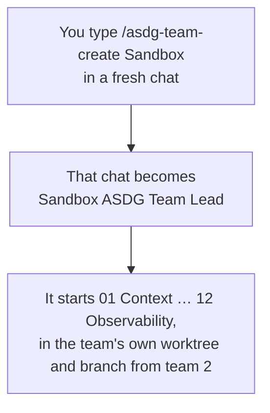

# ASDG team create

Type this in a fresh chat of the project. That chat becomes the team's lead and creates the twelve role chats with [Team members create](../asdg-team-members-create/SKILL.md). A chat you type into starts all twelve at once; chats started by another chat meet caps and permission denials.

*The chat you type into is the lead, so the app lists the twelve under it.*

## Rules

- **Claude desktop app only.** It needs `mcp__ccd_session__start_session` and, from `mcp__ccd_session_mgmt__`, `list_sessions`, `get_session` and `set_session_title`. Load them first if the app lists them as deferred. Without them, say so and stop; [Create team](../asdg-create-team/SKILL.md) covers Codex.
- **Only the human's typed request starts it,** in a fresh chat. Never because another chat asked.
- **Ask nothing.** Every value has a default below. Stop only when a step fails, and say exactly what failed.
- **It starts role chats and nothing else:** no project work, no sprint, no commit, no push.

## Steps

1. **Check this chat.** Read its record (`get_session` with `self`). If it has a `parentSessionId`, another chat started it: stop, and tell the human to type the command in a fresh chat.
2. **Nickname.** The text after the command, such as `Sandbox` in `/asdg-team-create Sandbox`. With none, use the project folder's name.
3. **Team number and folder.** Read all chats (`list_sessions`, `limit` 200) and keep the titles `<Nickname> ASDG Team Lead` (team 1) and `<Nickname> ASDG Team Lead N`.
   - None: this is team 1, and its folder is this chat's folder.
   - Otherwise run `python3 asdg/skills/asdg-create-team/team_worktree.py --create` in this folder, adding `--seen N` for each numbered title. It prints the new team's `number`, `path` and `branch`, and the files under `not_carried`. On `BLOCKED`, report its message and stop.
4. **Title.** Set this chat's title (`set_session_title`) to `<Nickname> ASDG Team Lead`, with ` N` added from team 2.
5. **Create the twelve.** Follow [Team members create](../asdg-team-members-create/SKILL.md) now, in this chat.
6. **Report** in a few lines: the team number, its folder and branch, any files not carried, and the table that Team members create printed.

Typing the command in another fresh chat creates the next team. A team number grants no role and no authority.
