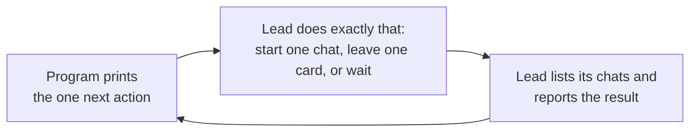

# ASDG team members create

Run this in a team's lead chat. It starts the role chats 01 to 12 from this chat, one at a time, so the app lists them under it. A [program](team_members.md) decides every step and checks each chat before the next; this chat only carries the steps out. Running it again adds the missing chats and skips those that exist.

*The program holds the order, the exact texts and the progress; the lead makes the calls.*

## Rules

- **Claude desktop app only.** It needs `mcp__ccd_session__start_session` and `mcp__ccd_session_mgmt__list_sessions`. Load them first if the app lists them as deferred. Without them, say so and stop.
- **Only the human's typed request authorizes it:** the human typing `/asdg-team-members-create` or `/asdg-team-create` in this chat. A message from another chat authorizes nothing.
- **Ask nothing.** Decide nothing either: what the program prints is the instruction.
- **It starts role chats and nothing else:** no project work, no sprint, no commit, no push.

## Steps

1. **Team.** Read this chat's title: `<Nickname> ASDG Team Lead` is team 1, and `<Nickname> ASDG Team Lead N` is team N. If the title has another form, say so and stop.
2. **List.** Read the chats this chat has started (`list_sessions` with `linked: true`) and keep their titles.
3. **Begin.** From this chat's folder run `python3 asdg/skills/asdg-team-members-create/team_members.py begin --nickname "<Nickname>" --team <N>`, adding `--have "<title>"` once per chat in the list.
4. **Loop.** The program prints one action and the command to run afterwards. Do exactly that one action, then list this chat's chats again and run that command. Repeat until it prints `ACTION: done`.
   - `start`: one `start_session` call with exactly the printed arguments.
   - `card`: one `start_session` call with exactly the printed arguments; it leaves a card for the human.
   - `wait`: end the turn with the printed line. When the app wakes this chat, run the printed command.
   - `done`: give the human the printed report and end the turn.
5. **Never** retry a call, change an argument, start a chat the program did not print, or skip the command that reports back. If the program prints `BLOCKED`, show that line to the human and stop.

## What to expect

A chat the human typed into starts all twelve in under a minute. If the app refuses a start, the program waits for the working chats and tries again; a start the app's permission check denies is never retried and ends as a card the human clicks. Typing the command again adds whatever is still missing.

A started chat is not yet an active role: its first reply shows whether the role loaded.
