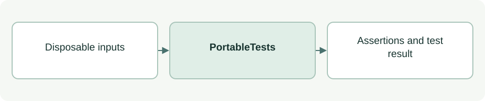

# Portable integration tests

[Source: test_portable.py](test_portable.py)

Exercises initialization, relocation, preservation, permission boundaries, logging and advice/report handling in disposable Git repositories.

## Responsibilities and collaborators

Owns deterministic regression fixtures and assertions for the behavior described below.

- [cli](../scripts/lib/cli.md): Commands invoked through subprocesses.
- [cli_files](../scripts/lib/cli_files.md): Transaction and rollback behavior.
- [cli_advice](../scripts/lib/cli_advice.md): Prompt/environment checks without a model call.
- [cli_advice_report](../scripts/lib/cli_advice_report.md): Controlled report writes.

## Interface and data

PortableTests extends unittest.TestCase. Test methods use per-test state; simulated decisions never modify real project acceptance.

| Callable or interface | Contract |
| --- | --- |
| `snapshot(root: Path) -> dict[str,str]` | Hashes files outside .git to compare before/after content. |
| `setUp() -> None` | Copies the package to a disposable client, initializes Git and seeds app files; registers cleanup. |
| `run_cli(*args, entry='cli.py', expect=0, cwd=None) -> CompletedProcess` | Runs the local entry with a timeout and asserts the expected exit code. |
| `init(*args, **kw) -> CompletedProcess` | Convenience wrapper around run_cli with init.py. |
| `active() -> None` | Starts the fixture's S1 sprint scoped to app.js. |
| `hook(payload, event='PreToolUse', cwd=None) -> dict` | Runs the fixture's configured hook with JSON input and parses its response. |
| `payload(paths) -> dict; denied(payload) -> None` | Constructs patch inputs and asserts hook denial. |

The [test case guide](test_portable-cases.md) lists every `test_*` method and the behavior it checks.
`test_dry_run_then_init_repeat_is_byte_identical` also checks portable stage introductions, embedded diagrams, empty Context recognition, absence of perspective directories and preservation on repeat setup.

## Effects and failure behavior

Tests invoke Python, Git and configured shell hooks and write disposable fixture files. Snapshot comparisons protect unrelated content. Test success is not native UI/hook-trust evidence.

## Example

From the project root: `TMPDIR=/private/tmp python3 -B -m unittest discover -s asdg/tests -p 'test_portable.py'`.
