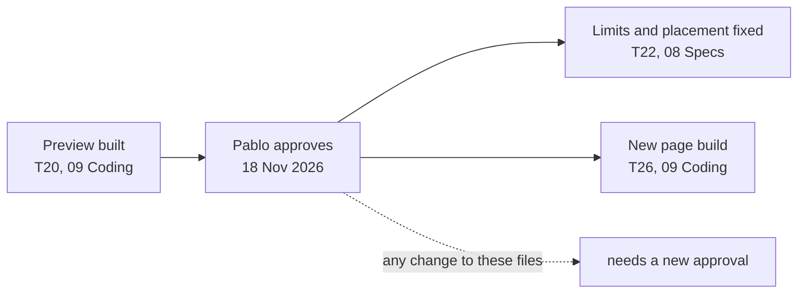
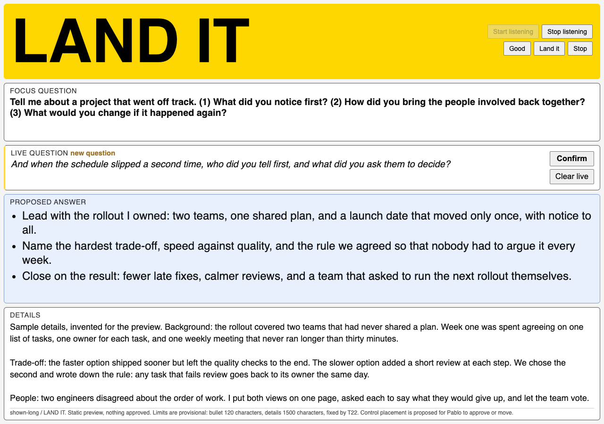

# SPRINT-003 layout preview: Pablo's approval (T21)

Pablo, the only user of Alice, approved the layout preview so that the build of the new page can start. It is a record of his decision, relayed in this conversation by 00 Governance, and it names the approved files by hash as specification rule PV-6 requires.

*The approval unlocks T22 and the page build; it covers only the three files below.*

*Representative view: the preview, Shown with the longest content, captured by 09 Coding. Invented sample text.*

## The decision

| Item | Value |
| --- | --- |
| Decision | "Approve", in answer to "Approve, change or reject the preview?" |
| Date and time | 18 November 2026, 19:09 UTC |
| Decided by | Pablo, as relayed by 00 Governance in the conversation |
| Address | `http://127.0.0.1:3000/preview`, served from `poc/preview/` |

## Approved files

| File | SHA-256 |
| --- | --- |
| `poc/preview/index.html` | `24ee034e6763af81f0d66e23d8333a44cd8ad302c4e2739ef11afa29743f08ab` |
| `poc/preview/preview.css` | `f493b9a41f956229382ee8bae3c4296423c8a462506323b423e401a6e9dd8d45` |
| `poc/preview/preview.js` | `d20f82cb22910796fa602d1e6d54e6f8f7c7b1e0a7b214d6188bb451815b5681` |

Governance recomputed these three hashes just before writing this page; they matched the files on disk, and `index.html` and `app.js` were unchanged.

## What it covers, and what it does not

- **Covers:** the layout "B, cue first" as shown, including the proposed place of Clear live, Start and Stop listening, the manual cue buttons and the status panels (C9), as he saw them. He moved nothing.
- **Does not cover:** the exact bullet and details lengths, label wording and heights, which stay provisional until T22 fixes them from this preview. It approves no specification page and no document hash, and it is not a review of the running page.
- **Not verified when he decided:** browsers other than Chrome, a real phone and the formal page checks PC-17 and PC-18. They remain tasks.
- **Staleness:** any change to the three files, or an approval naming different hashes, needs a new approval. `index.html` may change only while the hashes above equal the files' current bytes.

Return to the [Governance index](README.md).
