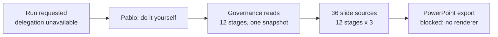

# Project status report run a6f650dc: Governance self-authored, source complete, PowerPoint not built

Pablo asked 00 Governance to run the project status report on 23 November 2026, and then said "please do it yourself". In this Claude integration the Governance workflow stops, because there are no named ASDG role adapters to dispatch the twelve stage workers. At Pablo's explicit instruction 00 Governance read each stage's evidence and wrote all 36 slides in one pass. This is therefore **not** an independent specialist report.

*Governance authored every section itself; no worker packet exists to validate.*

## Run snapshot

| Item | Value |
| --- | --- |
| Run ID | `a6f650dc-30d3-41de-97ce-4440199f1ff9` |
| As of | 2026-11-23, authored in the live clone `~/git-projects/alice.good.meetings` |
| Role and invocation | `ASDG-COORDINATOR` (00 Governance), `/asdg-report-project-status`, then Pablo's instruction to do it directly |
| Git | `main` at `673c3bd` (merge of PR #6), equal to `origin/main`; working tree clean apart from `.DS_Store` |
| Sprint | None active (`.asdg/sprint.json` inactive); SPRINT-003 and SPRINT-004 closed unfinished |
| Project and release | project `new` (recorded), release none |
| Tests | `node --test poc/poc.test.mjs`: 145 pass, 0 fail, run for this report; offline, no OpenAI call |

## Outcome

- **Coverage:** 12 of 12 stages, 3 slides each, 36 in total, by one author. No worker was dispatched, so there are no packets, worker IDs or return times (all null).
- **Source readiness:** complete. The illustrated index, 36 numbered folders with `slide.svg` and `speaker-notes.md`, and 36 SVGs checked as well-formed XML. All cited source paths were checked to exist.
- **Export:** PowerPoint not built. No reviewed provider presentation builder is installed here (`asdg/skills/asdg-presentation` is absent and `cairosvg` is not importable). The workflow says to deliver the checked source tree and mark only the export blocked.
- **Packet checker:** `report_packets.py` was not run. It validates delegated worker packets, and this run has none.
- **Visual check:** a sample of four slides was rendered with macOS Quick Look and looked correct. The rest were not viewed.
- **Role chats:** the twelve specialist chats were not used or messaged.
- **Document-review receipts:** no AI modification receipt was appended to `.asdg/document-reviews.json`; I found no safe recording command, so that gap remains.

## Findings worth acting on

1. `docs/asdg/07-planning/README.md` and `docs/asdg/07-planning/proposed-sprint.json` still call SPRINT-004 active. It closed on 22 Nov. The sprint-status display reads the JSON.
2. The 02 Purpose README says no acceptance is recorded, while `.asdg/lifecycle.json` records Pablo's acceptance on 21 Nov.
3. The 08 README says no implemented behavior is documented, which is out of date.
4. Stage 08 was accepted on 22 Nov at 19:19Z, and the SPRINT-004 closeout (23:09Z) lists it as stale; hashes were not recomputed here.
5. The Review verdict (CHANGE_REQUIRED) is for revision `57aebd0`, not the current `673c3bd`.
6. The planned SPRINT-006 touch strip still carries GOOD, LAND IT and STOP buttons for the manual cue that SPRINT-004 removed.

## Limits

- Figures taken from other documents were not re-verified: the 7-question, 8.6 s speed baseline, and the SPRINT-004 criteria results come from the SPRINT-005 draft and the closeout.
- The live session and the statement check on final file bytes remain unrecorded at the current revision.
- This receipt approves nothing, changes no sprint, approval or hook trust, and starts no work.

Open the [illustrated index](presentation/README.md). Return to the [Governance index](../../README.md).
