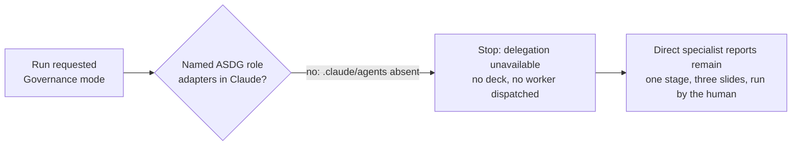

# Project status report run ee39375c: blocked, delegation unavailable

Pablo asked 00 Governance to run the project status report on 18 November 2026. In this Claude integration Governance mode cannot run, so this run stopped before dispatching any specialist and produced no status deck. This receipt records why and what remains possible.

*The skill stops Governance reporting in Claude and keeps direct specialist reporting.*

## Run snapshot

| Item | Value |
| --- | --- |
| Run ID | `ee39375c-c041-4be6-bdf9-850358945cb6` |
| As of | 2026-11-18T20:57:17Z |
| Role and invocation | `ASDG-COORDINATOR` (00 Governance), invoked by Pablo with `/asdg-report-project-status` |
| Git | Branch `sprint-03`, HEAD `80c0b3033ef51cdf0dd14a42f314b34b2ede92df`; 54 uncommitted paths (37 modified, 17 untracked), none staged |
| Sprint | SPRINT-003 active, snapshot `.asdg/sprint.json` SHA-256 prefix `90d6dab6bb3d43b1` |
| Status CLI | `structure_ok` true, implementation permission `ALLOWED_WITHIN_SCOPE`, project status `new` (recorded) |

## What was checked and the outcome

- `.claude/agents/` does not exist, so the Claude integration has no named ASDG role adapters. `.codex/agents/` does exist, but only Codex can use it.
- The skill's rule for this case: stop Governance reporting with a delegation-unavailable receipt. It also says not to create or repurpose persistent team chats as workers, so the twelve existing specialist sessions were not used.
- Dispatched workers: none. Packets collected: none. Slides authored: none. Build outcome: not attempted.
- Coverage: no stage covered. This is not a partial deck; it is a blocked run.

## What remains available

- **Direct specialist reports:** in a specialist chat, Pablo can run `/asdg-report-project-status` himself. That specialist then reports only its own stage as three slides (Intended, Actual, Planned) and delivers the editable sources and a PowerPoint. It must be started by him; Governance cannot invoke it.
- **The pre-code review deck:** a separate skill, `asdg-pre-code-review`, was run on 18 November 2026 and covers stages 01 to 08 in one deck. It is not this report.
- A full 36-slide status deck needs Codex named-role dispatch or a future Claude role adapter. Nothing here grants either.

This receipt approves nothing, changes no sprint state and starts no work. Return to the [Governance index](../../README.md).
