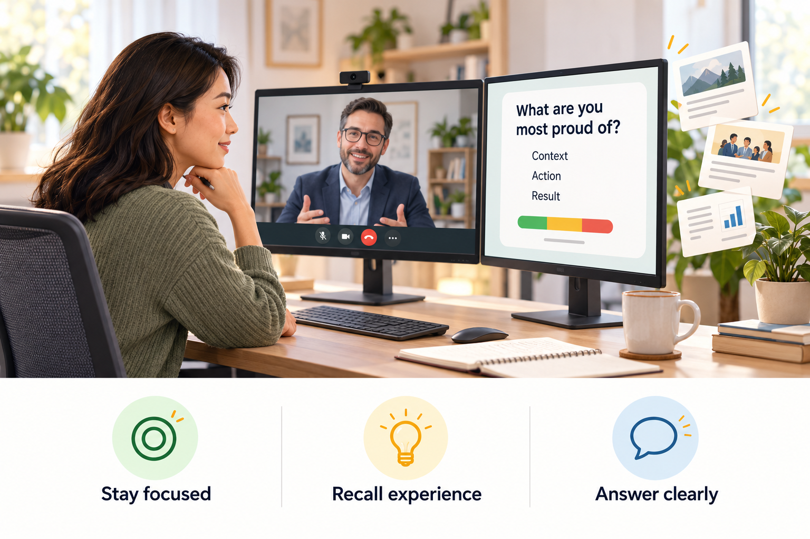

# Purpose of Alice.Good.Meetings

Alice.Good.Meetings helps User stay focused, recall relevant experience, and give clear, structured answers during interviews and meetings.
It follows the conversation and offers brief, immediately understandable visual cues that he can absorb while continuing to listen and speak.

Concept illustration of the desired experience, including future capabilities; this is not a screenshot of the current application.

## Desired outcomes

- Regulate delivery: recognize when to slow down, pause or conclude an answer.
- Stay on topic: retain the question and organize an answer around a few relevant points.
- Recall experience: bring relevant accomplishments, résumé details, documents and previous meeting context to mind.

## Constraints and non-goals

Preserving attention takes precedence over providing more advice.
Guidance should be understandable at a glance on a second screen or phone, with clear signals and short text.
Spoken coaching previously interrupted User's thinking; visual guidance should avoid recreating that disruption.
The helper supports User in forming his own answer. Choosing architecture or committing implementation scope is outside this purpose definition.

## Proposed answers and personal material: boundaries

Decided by User on 18 November 2026, as relayed by 00 Governance from his reply "Accept all"; the exact page version is not yet approved.

- A proposed answer prompts his own answer and never presents invented experience as his: it states nothing about his experience that his preparation package does not contain. Without a package, its points are general and say so.
- Longer supporting details may sit below the glanceable guidance for reference; they never crowd or replace the cue, the question or the short points. Attention to them is checked in the live session.
- So that answers can draw on his real experience, User chose to send an interview preparation package, with his résumé and other documents he prepares, to OpenAI together with the question. Only material he placed in that package leaves his Mac, the package never holds benchmark recordings, evaluator labels or reference answers, and interviews come first: other meetings need their own decision. The [prepared context decision](03.2-sprint-003-prepared-context-proposal.md) lists the five boundaries.

[Planned improvements](03-planned-improvements.md) describes the outcome these boundaries bound.

## Source and decision status

Source: User's Purpose interview in a Codex conversation, 20 October 2026, and his direction of 16 November 2026 as relayed in the Stage 07 [brief addendum](../07-planning/03.6.3-sprint-003-brief-addendum.md).
In October User agreed with the intended purpose and reported-current-value synthesis, then clarified and confirmed the next outcome.
This is stakeholder agreement on direction, not measured effectiveness or approval of the exact saved document; no acceptance of this exact version is recorded; it goes through the Approve flow.
