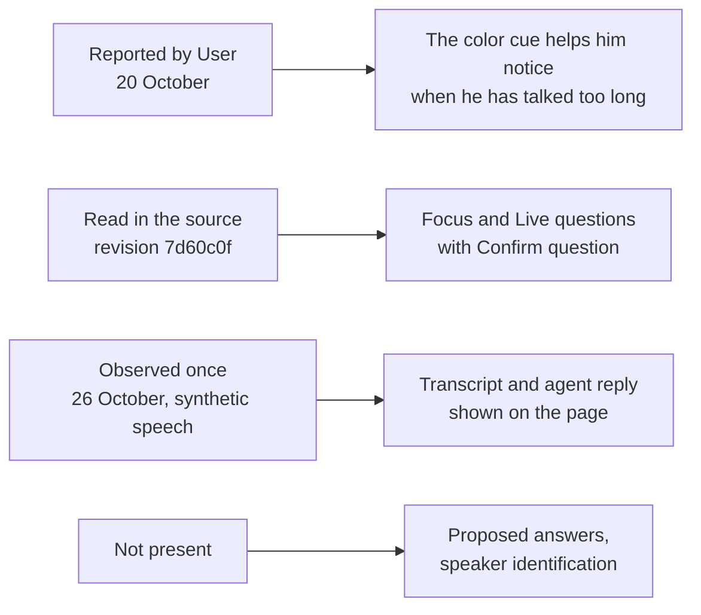

# Current capabilities of Alice.Good.Meetings

Alice.Good.Meetings today times User's speaking turns with a color cue, and keeps the interview question he confirmed in view. It does not yet propose answers. This page separates what he reports, what the source shows and what has been observed running.

*Each capability with the strength of its evidence. Only the first row is User's own experience of the product.*

## Reported experience

User reports difficulty staying focused in interviews, recalling key ideas and maintaining a structured answer.
He tried conversational coaching through a phone and headphone. Advice helped, but spoken interruptions sometimes derailed him.
He reports that the simple green/yellow/red display changes with speaking duration and helps him notice when he has talked too long.
He normally uses two screens and can also place a phone where visual cues are easy to see.

## What the page does at revision 7d60c0f

Read in `index.html` and the [POC README](../../../poc/README.md) on 16 November 2026; nothing was run for this page.

- The page shows the GOOD, LAND IT and STOP cue with its timer, computed locally.
- A local service sends microphone audio to OpenAI for transcription and passes selected transcript text to an agent; the key stays in the service.
- The page has a Focus question, a Live question, and the Confirm question and Clear live buttons described in [UC-04](../03-system-model-and-use-cases/01.4-confirm-current-question.md).
- The POC README lists speaker identification as not implemented. No proposed answer exists; it is the [next improvement](03-planned-improvements.md).

## Observed running

On 26 October 2026 a browser check with synthetic speech showed a transcript and an agent reply on the page while the cue kept working; see the [observed results](../../../poc/RESULTS.md).
UC-04 records that on 4 November 2026 User confirmed a question in a live session and later speech replaced it. The Focus and Live design answers that defect; no later live session is recorded in the pages read here.

## Evidence limits

The reported experience comes from User's account of 20 October 2026: a stakeholder report, not a measured result.
The source reading shows what the code contains, not that it behaves that way in an interview.
Whether the visible question keeps him on topic, and whether richer prompts preserve his attention, remain open validation questions.
The sprint record calls the product Alice; these pages keep the name Alice.Good.Meetings until User says which name they should use.
This page is a draft of 16 November 2026 and no acceptance of it is recorded.

See [purpose](01-purpose.md) for the desired outcomes and [planned improvements](03-planned-improvements.md) for the selected direction.
