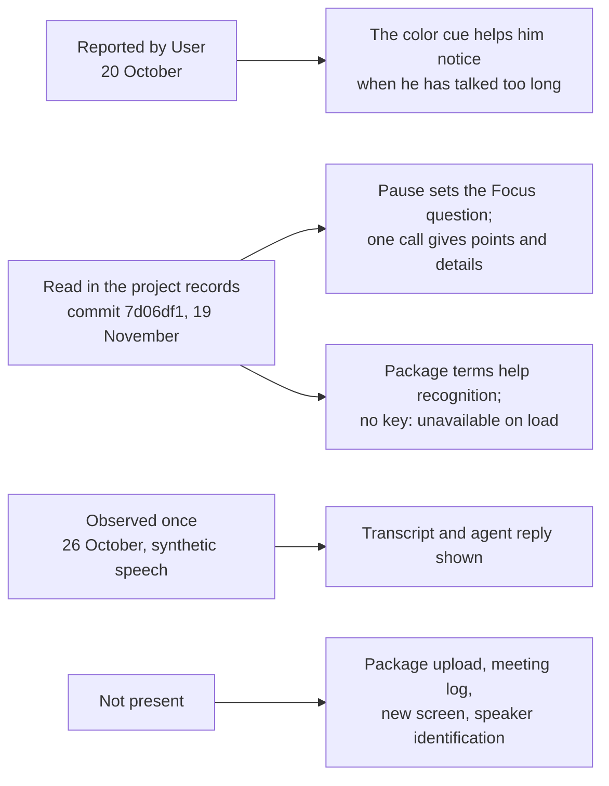

# Current capabilities of Alice.Good.Meetings

Alice.Good.Meetings today times User's speaking turns with a color cue, listens to the meeting, reads the question he was asked after each speech pause and proposes a few short points and supporting details from his preparation package. This page separates what he reports, what the source and project records show and what has been observed running.

*Each capability with the strength of its evidence. Only the first row is User's own experience of the product.*

## Reported experience

User reports difficulty staying focused in interviews, recalling key ideas and maintaining a structured answer.
He tried conversational coaching through a phone and headphone. Advice helped, but spoken interruptions sometimes derailed him.
He reports that the simple green/yellow/red display changes with speaking duration and helps him notice when he has talked too long.
He normally uses two screens and can also place a phone where visual cues are easy to see.

## What the product does at commit 7d06df1

Read in the [POC README](../../../poc/README.md), the 18 November handoff note and Git history on 19 November 2026; nothing was run for this page. SPRINT-003 was closed as unfinished and no sprint is active, so this is what the committed build contains, not an accepted result.

- The page shows the GOOD, LAND IT and STOP cue with its timer, computed locally.
- A local service sends microphone audio to OpenAI for transcription. A turn is sent only after a speech pause, 0.8 seconds by default.
- After each pause one model request reads the question and returns a few short points and supporting details, shown under the Focus question. There is no Confirm step; Confirm and Clear live remain optional ([UC-04](../03-system-model-and-use-cases/01.4-confirm-current-question.md)). If no clear question is heard the last answer stays.
- Names and terms picked locally from the preparation package in `poc/context/interview/` help recognition (a vocabulary hint) and help read the question. The package text is read from that folder when a session starts.
- Without an OpenAI key the page loads and says that recognition and answers are unavailable.
- A monitor line shows whether audio arrives, the speaking time and the last words heard.
- The POC README lists speaker identification as not implemented, and the package cannot yet be loaded from the page.

## Observed running

On 26 October 2026 a browser check with synthetic speech showed a transcript and an agent reply on the page while the cue kept working; see the [observed results](../../../poc/RESULTS.md).
UC-04 records that on 4 November 2026 User confirmed a question in a live session and later speech replaced it. The Focus and Live design answers that defect; no later live session is recorded in the pages read here. The 18 November handoff reports that the app ran end to end on one machine, with 77 offline tests passing; that is the build author's report, not a Purpose acceptance.

## Evidence limits

The reported experience comes from User's account of 20 October 2026: a stakeholder report, not a measured result.
The source reading shows what the code contains, not that it behaves that way in an interview.
Whether the visible question keeps him on topic, and whether richer prompts preserve his attention, remain open validation questions.
The sprint record calls the product Alice; these pages keep the name Alice.Good.Meetings until User says which name they should use.
This page is a draft refreshed on 19 November 2026 and no acceptance of it is recorded.

See [purpose](01-purpose.md) for the desired outcomes and [planned improvements](03-planned-improvements.md) for the selected direction.
