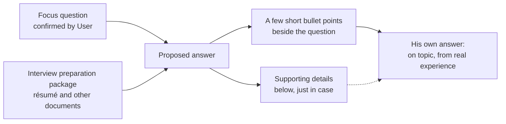

# Planned improvements to Alice.Good.Meetings

## Next improvement: a proposed answer beside the Focus question

When User confirms an interview question, Alice.Good.Meetings proposes an answer to it: a few short bullet points beside the Focus question, and supporting details in a separate area below, in case the interviewer wants more.
The purpose is to help him organize his own answer and recall his real experience without taking his attention from the conversation.
The answer draws on the Focus question and on an interview preparation package that he prepares, with his résumé and other documents. Other kinds of meeting come later.
User gave this direction on 16 November 2026 for SPRINT-003. It reached this page as relayed in the Stage 07 [review brief](../07-planning/03.6-sprint-003-review-brief.md) and its [addendum](../07-planning/03.6.3-sprint-003-brief-addendum.md); the sprint record stays the authority for what is committed.

*Intended outcome for SPRINT-003, not implemented behavior. The delivery cue and the question keep first place on the page.*

## Outcome boundaries

- The delivery cue and the Focus question stay the first things he sees, and the bullet points are short enough to take in at a glance.
- The details area is reference material. He can ignore it, and nothing in it is needed to read the cue, the question or the bullet points.
- A proposed answer supports his own answer. It states nothing about his experience that is not in the material he supplied.
- An answer belongs to its Focus question. Any change to that question, including a confirmed rewording, brings a new answer, and an answer never replaces the question.
- It appears on its own once a Focus question is set, and quietly: no sound, and nothing that demands a look.
- When no answer is available the page says so briefly, and the cue and timer keep working.

## What changed since 20 October

The earlier next improvement, keeping the interviewer's question visible, is now on the page as the Focus and Live questions of [UC-04](../03-system-model-and-use-cases/01.4-confirm-current-question.md). Whether it helps him stay on topic has not been measured.
The earlier boundary, "Defer suggested answers based on résumé, accomplishments or other context to a later increment", is lifted for interviews by his 16 November direction.

## Acceptance questions

- Do the bullet points help him organize his own answer around a few relevant points?
- Can he take them in at a glance, without reading them out or losing the conversation?
- Do the details help when the interviewer wants more, and stay out of the way when not?
- Is everything said about his experience found in his preparation package?
- Does each answer stay tied to its Focus question, and change when the question changes?
- Is the page still useful when no answer is available?

## Uncertainties and review points

Decided by User on 16 November 2026, as relayed: without an OpenAI key the page, timer and cue still work, which is the last boundary above; at most three bullet points; details are read on demand, not at a glance.
Also decided: the preparation package is kept in the project, in the Git-ignored folder `poc/context/interview/`, which also syncs to his Google Drive. The answer delay is learned in the live session, with no experiment before building.
Not known: what the package contains, and what happens to an answer that arrives after he has started speaking. Use Cases and Architecture own those answers.
One live session can show that the feature works for him once. It does not measure whether it helps.
The details area and the preparation package are S003-DETAILS and S003-CONTEXT in the addendum. User chose to keep the sprint record as it is: its seven criteria stay, and these two are tracked in the alignment report, the plan and the specifications.
Still awaiting his review of the exact words: the three draft boundaries in [purpose](01-purpose.md), the "quietly" in the fifth boundary above, and the product name.
This page is a draft of 16 November 2026: no acceptance of these words is recorded, and saving it approves nothing.

Source: User's Purpose discussion of 20 October 2026 and his direction of 16 November 2026, as relayed. See [purpose](01-purpose.md), [current capabilities](02-current-capabilities.md) and the earlier [SPRINT-003 review](03.1-sprint-003-purpose-review.md).
