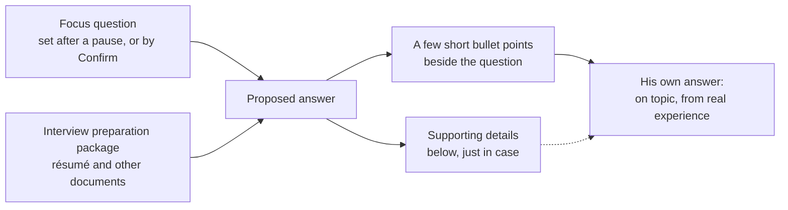

# Planned improvements to Alice.Good.Meetings

## Next improvement: a proposed answer beside the Focus question

When a clear interview question is set as the Focus question, Alice.Good.Meetings proposes an answer to it: a few short bullet points beside the Focus question, and supporting details in a separate area below, in case the interviewer wants more.
The purpose is to help him organize his own answer and recall his real experience without taking his attention from the conversation.
The answer draws on the Focus question and on a preparation package that he prepares (an interview preparation package at first), with his résumé and other documents. From SPRINT-004 the scope is every meeting, not interviews first.
User gave this direction on 16 November 2026 for SPRINT-003. It reached this page as relayed in the Stage 07 [review brief](../07-planning/03.6-sprint-003-review-brief.md) and its [addendum](../07-planning/03.6.3-sprint-003-brief-addendum.md); the sprint record stays the authority for what is committed.

*Intended outcome for SPRINT-003, not implemented behavior. The delivery cue and the question keep first place on the page.*

## Outcome boundaries

- The delivery cue and the Focus question stay the first things he sees, and the bullet points are short enough to take in at a glance.
- The details area is reference material. He can ignore it, and nothing in it is needed to read the cue, the question or the bullet points.
- A proposed answer supports his own answer. It states nothing about his experience that is not in the material he supplied. Without a preparation package the points are general and say so.
- An answer belongs to its Focus question. Any change to that question, including a confirmed rewording, brings a new answer, and an answer never replaces the question.
- It appears on its own once a Focus question is set, and quietly: no sound, and nothing that demands a look.
- When no answer is available the page says so briefly, and the cue and timer keep working. Without an OpenAI key it also says that question recognition is unavailable.

## Direction of 18 November 2026: automatic question, more input tools

Pablo's purpose is unchanged; only how the question is set and read changes, as relayed by 00 Governance. A clear question followed by a speech pause sets the Focus question automatically, read with the help of the preparation package; Confirm and Clear live stay as an optional manual tool. Alice is also meant to become multimodal: speech cues now, later gestures, video, buttons or other devices, and every input tool stays. Each added input or cue keeps the constraint above: brief, glanceable, and never interrupting his thinking. Use Cases, Evaluation and Architecture own the detail; the decisions of 18 November above on "confirmed" are superseded where they say the trigger is Confirm.

## SPRINT-004 direction, 19 November 2026

Pablo wants to use Alice in every meeting he can, so the most practical stories come first, as relayed by 00 Governance: upload his preparation package from the page (several `.md` or `.txt` files), see the package status before Start, download a complete time-stamped log of each meeting for his own review, and work from a clearer screen with one very big question and "Alice suggests" and "What I hear" columns. Security is deferred.
The details area is not part of SPRINT-004: the model is no longer asked for details, and the earlier details wording on this page is history. The purpose is unchanged. "Brief, glanceable visual cues" still governs: the new screen keeps the cue the strongest signal and adds no motion, sound or crowding. The [record and upload boundary](03.4-sprint-004-record-and-upload-boundary.md) holds what Pablo settled on 19 November: the log is kept in `poc/logs/`, Git-ignored, until he deletes it; other people's speech is kept, local only; the log never copies the package files, but the answers shown may quote them; the scope is every meeting, not interviews first; and "no persistent storage" no longer holds. The earlier decision of no package notice before Start is superseded by package status before Start. A small silent animated avatar, a secondary client-side state signal beside the cue colour, is bounded in the [avatar assessment](03.6-avatar-purpose-assessment.md). This is a draft.

## What changed since 20 October

The earlier next improvement, keeping the interviewer's question visible, is now on the page as the Focus and Live questions of [UC-04](../03-system-model-and-use-cases/01.4-confirm-current-question.md). Whether it helps him stay on topic has not been measured.
The earlier boundary, "Defer suggested answers based on résumé, accomplishments or other context to a later increment", is lifted for interviews by his 16 November direction.

## Acceptance questions

- Do the bullet points help him organize his own answer around a few relevant points?
- Can he take them in at a glance, without reading them out or losing the conversation?
- Do the details help when the interviewer wants more, and stay out of the way when not?
- Is everything said about his experience found in his preparation package?
- Does each answer stay tied to its Focus question, and change when the question changes?
- Is the page still useful when no answer is available?

## Uncertainties and review points

Decided by User on 16 November 2026, as relayed: without an OpenAI key the page, timer and cue still work, which is the last boundary above; at most three bullet points; details are read on demand, not at a glance.
Also decided: the preparation package is kept in the project, in the Git-ignored folder `poc/context/interview/`, which also syncs to his Google Drive. The answer delay is learned in the live session, with no experiment before building.
Decided since: the package is plain text or Markdown of up to 20,000 characters in that folder, and a late answer is shown silently. Decided 18 November 2026 ("Accept both", relayed by 00 Governance): the page gives no package notice before Start, because the data statements say package text leaves the Mac on a confirmed question; a missing key shows only the unavailable state on load, before Start; the details area scrolls inside itself with no collapse control. Still open: the delay, which the live session measures. Use Cases and Architecture own those answers.
One live session can show that the feature works for him once. It does not measure whether it helps.
The details area and the preparation package are S003-DETAILS and S003-CONTEXT in the addendum. The sprint record was later amended to add both: it now has nine criteria, restarted on 18 November 2026.
Decided on 18 November 2026 (his "Accept all", relayed by 00 Governance): the boundaries in [purpose](01-purpose.md), the details area outside the glance path with attention checked in the live session, no delay limit in advance with one service retry, and the product name Alice.Good.Meetings in documents, "Alice" where the sprint record is quoted. The "quietly" in the fifth boundary above was not named separately in that relay.
This page is a draft updated on 18 November 2026: no acceptance of this exact version is recorded, and saving it approves nothing.

Source: User's Purpose discussion of 20 October 2026 and his direction of 16 November 2026, as relayed. See [purpose](01-purpose.md), [current capabilities](02-current-capabilities.md) and the earlier [SPRINT-003 review](03.1-sprint-003-purpose-review.md).
