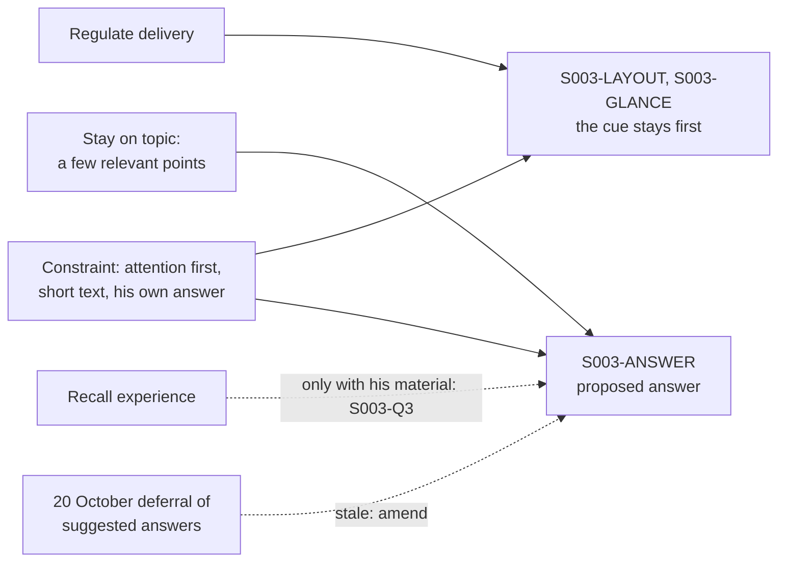

# SPRINT-003 seen from Purpose: why a new layout and a proposed answer matter

SPRINT-003 gives Alice.Good.Meetings, called Alice in the sprint record, a new page layout and a proposed answer to the Focus question. This first-pass review checks the eight commitments of the [review brief](../07-planning/03.6-sprint-003-review-brief.md) against the Purpose pages, before any code is written. The sprint goal serves the product purpose, but one Purpose page still defers suggested answers and must be amended. Pablo is the project owner and today's User; the decisions named here are his.

*Solid arrows are supported by the Purpose as written. Dotted arrows depend on an open question or on a page that must change.*

## Baseline and sources

Read on 16 November 2026: the brief (SHA-256 `3a1a60483061…`), its direction page (`1d12fda94108…`) and sources page (`a8bf687090d6…`); the sprint record (`c81510f030ff…`); Git revision `7d60c0f` on branch `sprint-03`.
The four Purpose pages match the hashes listed in the sources page: [purpose](01-purpose.md) `2b288e476d33…`, [current capabilities](02-current-capabilities.md) `50164f379a17…`, [planned improvements](03-planned-improvements.md) `5319c35ac926…` and the [README](README.md) `f621d153fddb…`.
Read as upstream context, with matching hashes: the root `AGENTS.md`, `index.html`, `poc/README.md`, and use cases UC-03 and UC-04. No other stage's SPRINT-003 report was read.
Decision status: the lifecycle record registers no Purpose artifact and no review event covers these bytes. The pages record agreement on direction on 20 October 2026, not acceptance, so the Intended baseline is a draft.

## The eight commitments

| ID | Why it matters, from the Purpose pages | Finding |
| --- | --- | --- |
| S003-LAYOUT | "Preserving attention takes precedence over providing more advice": the delivery cue stays the largest signal and the new text takes second place. | Supported. No change. |
| S003-PREVIEW | The person whose attention is at stake judges the layout before it replaces a display he reports as useful. | Supported. A preview shows legibility, not attention in a real conversation; that is S003-LIVE. |
| S003-GLANCE | "Understandable at a glance on a second screen or phone, with clear signals and short text." | Supported, with a gap: the criterion omits the proposed answer, the longest new text, and names no viewing surface. |
| S003-ANSWER | "Organize an answer around a few relevant points"; "the helper supports User in forming his own answer". | Supported as an aid to his own answer. It contradicts the deferral in planned improvements: amendment 1. |
| S003-NOKEY | The delivery cue is the value he reports today and must not depend on the new capability. | Supported. "Still works" is undefined; Purpose reads it as: the cue and timer continue. |
| S003-TESTS | Technical. Guards "never overwrites the question", the anchor the Purpose asks to preserve, after the replacement defect UC-04 records for 4 November. | No Purpose content needed. |
| S003-RUN | Technical. Shortens the existing `bash poc/start.sh` workflow at Pablo's request; no product outcome is claimed. | No Purpose content needed. |
| S003-LIVE | Current capabilities leaves open "whether richer visual prompts preserve attention"; only a live session can answer it. | Supported. What counts as a pass is not stated: amendment 2 supplies the questions. |

## What is contradictory, stale or missing

- **Contradictory:** planned improvements says "Defer suggested answers based on résumé, accomplishments or other context to a later increment." Pablo's 16 November direction is newer and explicit, so it prevails and the page is stale. If S003-Q3 is answered "the question alone", the deferral still holds for résumé and other context, and only narrows.
- **Stale:** the same page names "keep the interviewer question visible" as the next improvement and says no Stage 07 item exists. The page at this revision already shows a Focus and a Live question, and SPRINT-003 is active. Current capabilities, dated 20 October, mentions neither the local service nor those two questions.
- **Missing:** no Purpose page says what a proposed answer is for or bounds it. None says it must not present invented experience as his, although UC-03 already says "do not invent events, actions or results". None addresses which personal material may leave the Mac.

## Proposed amendments, not applied

1. `03-planned-improvements.md`: replace the next-improvement section and the deferral with the SPRINT-003 outcome, a proposed answer that helps him organize his own answer. Cite Pablo's direction and the Stage 07 brief, and keep whatever part of the deferral his answer to S003-Q3 leaves in place.
2. The same page, new acceptance questions. Does the proposed answer help him organize his own answer around a few points? Can he take it in at a glance without reading it out or losing the conversation? Does it stay tied to the Focus question? Is everything it says about his experience true to material he supplied? Is the page still useful when no proposal is available?
3. `01-purpose.md`, one sentence under constraints: a proposed answer prompts his own answer and never presents invented experience as his. This is a new boundary and needs Pablo's agreement.
4. `02-current-capabilities.md` and `README.md`: point to the evidence of what the page does today, say that the sprint record calls the product Alice, and update the README link text. This can wait for sprint closeout.

## The three open questions

| Question | What the Purpose pages imply | Blocks the verdict? |
| --- | --- | --- |
| S003-Q1 Form | A few short points: "short text" and "a few relevant points". Fuller wording would strain the glance constraint and invite reading an answer out; choosing it means amending `01-purpose.md`. | No |
| S003-Q2 Trigger | Not settled by these pages. Either choice fits if the answer arrives in a fixed card without motion or alert, and costs him neither a new action nor a new interruption. Criterion 3 reads as automatic; "on request" would need its wording changed. | No |
| S003-Q3 Inputs | The question alone supports "stay on topic" only. "Recall experience" names résumé and documents and needs his material; sending that to OpenAI is a boundary no Purpose page covers. | No, but it sets the wording of amendments 1 and 3 |

## Verdict: CHANGE_REQUIRED

The sprint goal is consistent with the product purpose and its constraints, so no commitment has to change for Purpose reasons. The Purpose pages do: amendments 1 and 2 are required, 3 is recommended and 4 can follow. Each amended page is a new version that needs its own readiness review and acceptance.
No open question blocks this verdict. Two answers would widen it: fuller wording (Q1) or personal material sent to OpenAI (Q3) would each change a constraint in `01-purpose.md`, which only Pablo can decide.
For later stages: Use Cases should say when a proposal is useful, such as the pause after Confirm, and what happens for an experience question without his material. Evaluation should judge the glanceability of the answer itself, on the surface he uses. Architecture should state exactly what is sent to OpenAI.
Not established: Pablo's words reached this review only as relayed in the brief; whether Alice names the product or the agent; how the diagram above renders, since only its source was checked. Return to [Purpose](README.md).
