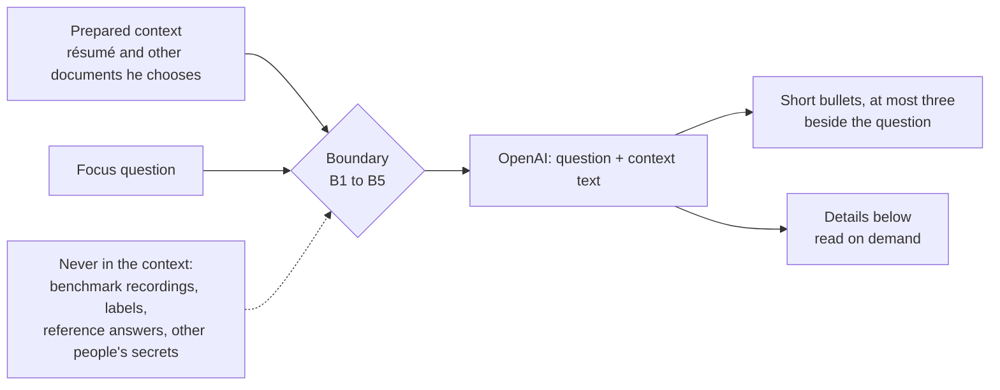

# SPRINT-003 decision: a boundary for the prepared context and the details area

**Decided on 18 November 2026:** Pablo, the project owner and today's User, replied "Accept all" to the recommended defaults below, as relayed by 00 Governance. This page was proposed by Purpose; the exact page version is not yet approved. It answers conflicts C12 (personal material sent to OpenAI) and C17 (a details area against "short text"), and prepares the wording for C13 (no invented experience). Saving the page approves nothing.

*Intended boundary for the prepared context. Decided intent, not implemented behavior.*

## Baseline

Read on 18 November 2026 in this checkout: [purpose](01-purpose.md), [planned improvements](03-planned-improvements.md), [current capabilities](02-current-capabilities.md), the Stage 07 [brief addendum](../07-planning/03.6.3-sprint-003-brief-addendum.md), [amendments](../07-planning/03.7.3-sprint-003-amendments.md) and [conflicts](../07-planning/03.7.2-sprint-003-conflicts.md).
Already in the Purpose pages before this round, unaccepted drafts: the SPRINT-003 outcome and acceptance questions (A02-1, A02-2), three draft boundary sentences in `01-purpose.md`, and the "what the page does today" section (A02-4).
Pablo's decisions of 16 November, as relayed: the answer uses the question plus a prepared context; at most three bullets; details on demand; always replace on a changed question; the package sits in the Git-ignored `poc/context/interview/`.

## N1: proposed boundary for the prepared context

| # | Proposed boundary | Why Purpose proposes it |
| --- | --- | --- |
| B1 | Only material Pablo placed in the preparation package, for a meeting he prepared it for, may be sent to OpenAI with the question. | He chose to send it; the choice should be limited to what he supplied. |
| B2 | The page tells him, before a session, that the package text will leave his Mac, and a session without a package says so rather than guessing. | The current data statements cover audio and transcript only. |
| B3 | The package never holds benchmark recordings, evaluator labels or reference answers. | Matches the project constraint on evaluation material. |
| B4 | Nothing is sent that he did not put in the package: no files from elsewhere, no earlier sessions' transcripts. | Keeps what leaves the Mac predictable. |
| B5 | The package covers interviews first; other meeting kinds need their own preparation and their own decision. | His words: "not all meetings are interview, but let focus on interview first". |

Purpose does not choose where the package is stored or how it is sent; that is Architecture and Detailed Design. The two data statements in the root `AGENTS.md` and `poc/README.md` have no Purpose owner; Purpose only states the outcome they must reflect.

## C17: does a details area fit "short text"?

Purpose's constraint is that guidance is understandable at a glance. The details area can fit it only if it is outside the glance path:

- it sits below the cue, the question and the bullets and is never needed to read them;
- it is read on demand, which Pablo has decided, and is allowed to be long;
- it causes no motion, sound or alert when it fills, and never pushes the cue or bullets out of place.

On those terms Purpose finds it consistent with the constraint, with one open risk that only a live session can show: whether a second text area, even ignored, draws his eyes. Purpose proposes recording that as a live-session question for Stage 04 rather than settling it here.

## A02-3 wording

Proposed sentence for `01-purpose.md`: "A proposed answer prompts his own answer and states nothing about his experience that his preparation package does not contain."
Accepted on 18 November 2026 and now the first boundary in `01-purpose.md`, replacing the earlier draft sentence.

## Decisions (accepted 18 November 2026)

| # | Decision | Outcome |
| --- | --- | --- |
| 1 | Accept boundaries B1 to B5 for the prepared context. | Accepted. |
| 2 | Accept the A02-3 sentence above, or change it (C13). | Accepted. |
| 3 | The details area stays outside the glance path as stated, with attention checked in the live session (C17). | Accepted; Stage 04 adds the live question. |
| 4 | Product name in these pages: Alice or Alice.Good.Meetings (C15). | Decided: Alice.Good.Meetings in documents, "Alice" where the sprint record is quoted. |
| 5 | Exact words of the three draft boundaries in `01-purpose.md` and the "quietly" in planned improvements. | Settled in `01-purpose.md` on the relay; his own one read of the exact words is still to be confirmed through Approve. |

## Pages ready to cite

For Stage 03 and others: [planned improvements](03-planned-improvements.md) holds the SPRINT-003 outcome and boundaries and is ready to cite as the Purpose draft. The boundaries in [purpose](01-purpose.md) and this page are decided by Pablo on 18 November 2026; cite them as decided, not as approved page versions. Every page here is a new version with no recorded acceptance until he runs Approve.

Return to [Purpose](README.md).
