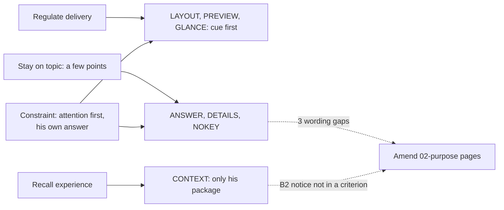

# SPRINT-003 seen from Purpose, version 2: why the amended sprint matters

This first-pass report checks the amended SPRINT-003 baseline against the Purpose pages, read-only. It was written before reading any other stage's new report. It carries no approval, and Pablo is the project owner and today's User.

*Solid arrows are supported by the Purpose as it stands; dotted arrows need a change.*

## Baseline and sources

Sprint snapshot `90d6dab6bb3d…`, Git HEAD `fe3c00edc3ca…`, brief v2 `58a423ee3705…`, branch `sprint-03`; all re-checked on 18 November 2026. Read: the brief and its direction, prior-review and source pages; the nine criteria in `.asdg/sprint.json`.
My five pages match the brief's hashes: [purpose](01-purpose.md) `81ca932ef2ca…`, [current capabilities](02-current-capabilities.md) `1489d6f9980b…`, [planned improvements](03-planned-improvements.md) `5db338cbf61e…`, [package boundary](03.2-sprint-003-prepared-context-proposal.md) `ff708fe968b0…`, [README](README.md) `eb20a373d342…`. Upstream: root `AGENTS.md` and `poc/README.md` data statements. No acceptance of any page is recorded.

## Why the change matters

Outcome: help him stay on topic with a few points and recall real experience, with the cue first ([purpose](01-purpose.md)). Constraint: "attention takes precedence over more advice", short glanceable text, his own answer. The goal serves this purpose: the answer card and details give the second and third outcomes, and the layout keeps the first. Non-goals are thin: only architecture and scope are excluded.

## The twelve commitments

| ID | Purpose finding |
| --- | --- |
| S003-LAYOUT, PREVIEW | Supported: the cue stays strongest, he judges the preview. No change. |
| S003-GLANCE | Supported: criterion 2 now names the points and bars the details from covering them. No change. |
| S003-ANSWER | Supported, with a wording gap: planned improvements says the answer "appears … once a Focus question is set"; criterion 3 says confirmed (A1). |
| S003-NOKEY | Supported: cue and timer continue. Planned improvements says only "says so briefly"; criterion 4 adds recognition (A3). |
| S003-DETAILS | Supported only outside the glance path ([03.2](03.2-sprint-003-prepared-context-proposal.md)); whether an ignored second area draws his eyes is open until S003-LIVE. |
| S003-CONTEXT | Supported by B1 to B5; B2 (the page warns that package text leaves the Mac) is in no criterion, and "general points without a package" is absent from Purpose (A2, D1). |
| S003-LIVE | Supported: glance, cue and "would keep it on" test attention; one session shows it works for him, not that it helps. |
| S003-TESTS, RUN | Technical. TESTS guards the 4 November replacement defect (UC-04); RUN shortens `bash poc/start.sh`. No Purpose content. |
| S003-PAGECHECK | Technical: checks the glance states mechanically and may be dropped; no Purpose content. |
| S003-STATEMENTS | Technical, an honesty invariant: `AGENTS.md` and `poc/README.md` say only audio and transcript go to OpenAI, so they no longer match B1 and B4. |

## Carry-forward of my 17 November review

Confirmed: the goal serves the purpose (LAYOUT, PREVIEW, RUN, TESTS), with TESTS still technical. Correction: the deferral is lifted and the boundaries are decided in `01-purpose.md`, not only drafted; its Q1 to Q3 are answered; its amendments 1 to 3 are applied and 4 only waits for closeout. Its verdict is superseded by this one.

## Missing, contradictory or ambiguous

- Planned improvements, "Not known: what the package contains", predates the decided folder, format and limit; the Google Drive sync of that folder is undisclosed to B1.
- Current capabilities cites revision `7d60c0f`, not HEAD; true until the build, so refresh it at closeout.
- The brief calls `01-purpose.md` boundaries "draft"; they are decided as relayed.

## Required amendments, proposed not applied

A1 planned improvements: say the answer appears when a question is confirmed. A2 same page and `01-purpose.md`: without a package the points are general and say so. A3 no-key line: add that recognition is unavailable too. A4 reword "Not known" to the decided folder and what remains open. A5 current capabilities: revision and date, at closeout.

## Downstream effects and decision

Use Cases and Evaluation already carry the general-points rule; only the Purpose wording lags. Architecture and Specs must own B2 and the Drive disclosure, or Purpose softens B2.
D1 for Pablo: keep B2 as a page notice (new scope) or reduce it to the data statements; recommended: reduce it.

## Verdict: CHANGE_REQUIRED

The goal is consistent with the purpose, and no commitment changes for Purpose reasons. Five small amendments are required and one decision is open.
