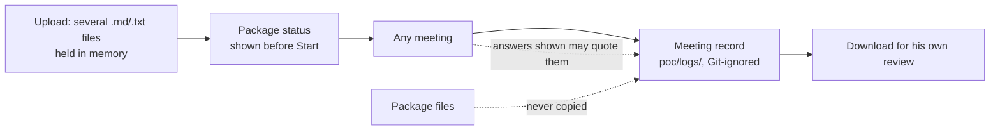

# SPRINT-004 boundary: a stored meeting record and uploading the package

This page is a Purpose draft of 19 November 2026 for Pablo, the project owner and today's User, from the SPRINT-004 direction relayed by 00 Governance and Planning's [working plan](../07-planning/03.14-sprint-004-working-plan.md). He wants Alice in every meeting he can. Nothing here is approved or built, and saving the page approves nothing.

*The record is his own review copy. Dotted arrows are limits.*

## Why it matters

A complete time-stamped record lets him review a meeting and learn what Alice showed and what was said. Uploading from the page removes hand-copying files. Both serve "regulate delivery, stay on topic, recall experience" and add no new coaching.

## Boundary for the stored meeting record

Decided by Pablo on 19 November 2026, as relayed by 00 Governance. Not yet approved as exact page bytes.

| Question | Boundary |
| --- | --- |
| What is kept | A complete time-stamped log: what was heard, including other people's speech, the questions read, Focus changes and their source, the answers shown and pauses. Never the package files, the key or audio. The answers shown may quote the package, because he asked for a complete log. |
| Where | Inside the project in the Git-ignored `poc/logs/`, on this machine, not synced (the Google Drive copy is abandoned). A setting may move it. Alice never sends it anywhere. |
| For how long | Until he deletes it. |
| Who may read it | Only he, through a download from the local page. |
| Why | His own review. It is not a benchmark or an evaluation input. |

The earlier wording "no persistent conversation storage" no longer holds: the log is stored, and the data statements in the root `AGENTS.md` and `poc/README.md` must say so.

## Boundary for uploading the package

- Several `.md` or `.txt` files picked on the page replace the package from the folder.
- The package is held in memory, not written by Alice, and stays after Stop until he removes or replaces it.
- Package status (files, size, terms, source, or "no package") shows before Start. This supersedes the 18 November decision of no notice before Start.
- The data statements say the question, transcript and package text go to OpenAI and only key terms go to transcription.
- Scope is every meeting, not interviews first; this replaces boundary B5 of the [prepared context page](03.2-sprint-003-prepared-context-proposal.md).

## Constraint: the new screen

"Brief, glanceable visual cues" still governs. The new screen (one very big question, "Alice suggests" and "What I hear" columns) keeps the cue the strongest signal and the short points readable at a glance, with no added motion or sound. "What I hear" is long text, so it stays secondary and never pushes the cue, question or points. Every input tool stays reachable.

## Still open

Security is deferred. Whether other people in a meeting must be told it is recorded is not decided, and the log's location setting is not designed.

Return to [Purpose](README.md).
