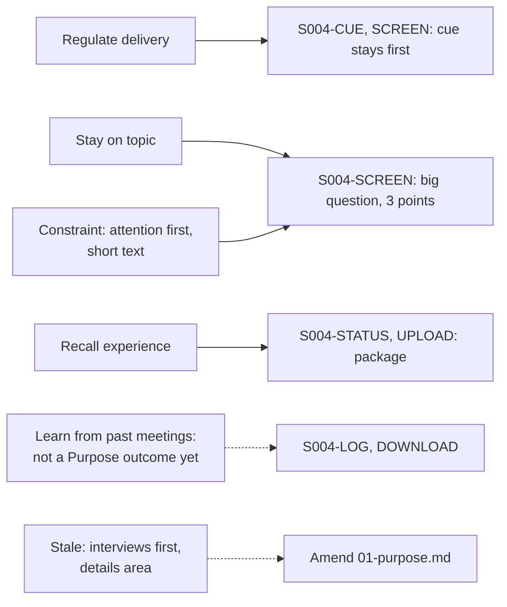

# SPRINT-004 seen from Purpose: why the proposed sprint matters

This first-pass report checks the proposed SPRINT-004 against the Purpose pages, read-only and written before any other stage's report. It carries no approval. Pablo is the project owner and today's User.

*Solid arrows are supported by the Purpose as it stands; dotted arrows need an amendment or a decision.*

## Baseline and sources

Brief `f287d7158e47…`, plan 03.14 `9eed53dbdbc5…` and 03.14.1 `f17b738378f8…` (read as relayed); Git HEAD `7d06df187a04…`; no sprint is active, so there is no snapshot. Purpose pages as read on 19 November 2026: [purpose](01-purpose.md) `fcc0d8b95d8e…`, [capabilities](02-current-capabilities.md) `046f50f00fa3…`, [planned](03-planned-improvements.md) `19a2b0c21af3…`, [03.4 boundary](03.4-sprint-004-record-and-upload-boundary.md) `afabdb05677e…`, [03.2](03.2-sprint-003-prepared-context-proposal.md) `b66e4ba224ce…`. These hashes match the brief's source page; no acceptance of any page is recorded.

## Why the change matters

Pablo wants Alice in every meeting he can, so the practical stories come first. Package status and upload make recall easier to use; the new screen serves attention and the cue; the log is for his own review. Constraint: brief, glanceable cues; his own answer. The goal serves the purpose, except the log, whose benefit is a new outcome.

## The nine commitments

| ID | Purpose finding |
| --- | --- |
| S004-STATUS, UPLOAD | Supported: recall depends on his package and these make it usable; 03.4 states the boundary. The about 130 KB package exceeds the 20,000 limit, so recall is partial this sprint (known; B-04 later). |
| S004-LOG | A boundary exists (03.4) but no outcome: "review a past meeting" is in no Purpose outcome list. Needs amendment A2. |
| S004-DOWNLOAD | Supported by 03.4: only he reads it, via a local download. |
| S004-SCREEN | Supported if "What I hear" stays secondary. Contradicted by two Purpose pages that still describe a details area (A3). |
| S004-CUE | Compatible as an extra input tool. Who presses G, L, S, and why a manual cue holds 10 seconds, is not in Purpose. |
| S004-GUARD | Technical: no request on an idle pause traces to the limit on what leaves his Mac. No Purpose content. |
| S004-STATEMENTS | Technical, an honesty invariant: the data statements must match what is sent and stored. |
| S004-CARRY | Technical: carries SPRINT-003 wording and checks. No Purpose content. |

## Missing, contradictory or ambiguous

- **Contradicted:** `01-purpose.md` says "interviews come first" and "interview preparation package"; the sprint scope is every meeting.
- **Contradicted:** `01-purpose.md`, `03-planned-improvements.md` and the 03.2 decisions keep a details area below the points; criterion 6 stops asking the model for details.
- **Missing:** an outcome for learning from past meetings, and a statement of how others in a meeting are treated when their speech is stored.
- **Ambiguous:** the 10-second manual cue hold, and whether the log's "complete" includes bullets that quote the package.

## Required amendments, proposed not applied

- **A1** `01-purpose.md`: "interview" becomes "meeting", and "interviews come first" is replaced by 03.4's every-meeting scope.
- **A2** `01-purpose.md`: add "review a past meeting" as an outcome and one sentence on the stored record, citing 03.4. Needs Pablo's agreement, as a new boundary.
- **A3** `01-purpose.md`, planned improvements, 03.2: mark the details area as not in SPRINT-004.
- **A4** `02-current-capabilities.md`: refresh at closeout.

## Downstream effects and decision

Use Cases must not describe details as current; Evaluation drops the details checks; Architecture and 08 own the data statements and the participant question. D1 for Pablo: add the review outcome (recommended yes) and say whether others must be told (recommended: deferred with security).

## Verdict: CHANGE_REQUIRED

The goal is consistent with the purpose and its constraints, so no commitment changes for Purpose reasons. Four amendments are required, and one needs his agreement.
