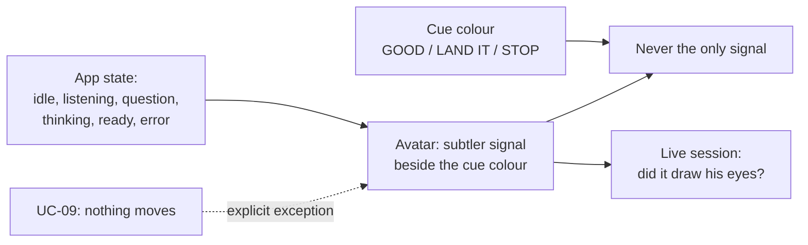

# A small animated avatar of Alice: does it fit the purpose?

This is a Purpose draft of 19 November 2026 answering a question from 00 Governance for Pablo, the project owner and today's User. The proposal is a small silent 3D talking head, a mature woman with silver hair and glasses, whose expression follows the app state. Pablo decided it the same day, as relayed. Nothing is built or approved.

*The avatar is a secondary, client-side state signal; the cue stays the strongest.*

## Why Pablo wants it

In his words: "the talking head is for now a UI feature that changes and moves with the state changes. It's one more element in the colour code, but more subtle because it may react to more things. It's just client side." This answers the first finding: no Purpose outcome named it. It serves "regulate delivery" and "stay on topic" as a second, subtler state signal beside the cue colour, and adds no new coaching.

## Purpose finding

It fits, with conditions. It is silent and visual, so it avoids the spoken coaching that interrupted him. The risk is that a moving face draws the eye away from the cue and the points; only a live session can show whether it does.
UC-09 and 08's specification say nothing moves, flashes or speaks. Purpose cannot waive that rule, and Pablo has now made an explicit exception for the avatar.

## Pablo's decisions, 19 November 2026

- An explicit exception to "nothing moves" for the avatar.
- **On by default**, against Purpose's advice to start off.
- Blinking when idle, and a short expression or nod on a state change.
- A visible toggle and the key A; it is off when the system asks for reduced motion.
- A free CC0 model first.

## Conditions that still apply

| Item | Condition |
| --- | --- |
| Never the only signal | The cue and the text stay complete without it. |
| Sound | None; it never speaks. |
| Size | Clearly smaller than the cue and the question, never the largest thing on screen. |
| Place | At the edge, never between the question and the points and never covering them. |
| Motion limits | Within his decision: blinking and a short, slow change on a state change; no flash, bounce or continuous head movement. |
| Error | Neutral; "mild concern" must not read as alarm. |
| Client side | Assets are local, nothing is sent out, and it works with no network. |

## Replaced by his decisions

"Starts off" is replaced by on by default. "No idle blinking loop" is replaced by blinking when idle. The off switch becomes the visible toggle and key A. The reduced-motion rule is kept.

## Risk and checks

Because it starts on, the first live session must ask whether it drew his eyes from the cue or the points and whether he keeps it on; the toggle makes it easy to remove. Evaluation (04) adds that question, Architecture (05) checks the library loads locally, and Use Cases (03) and 08 write the exception into UC-09.

Return to [Purpose](README.md).
