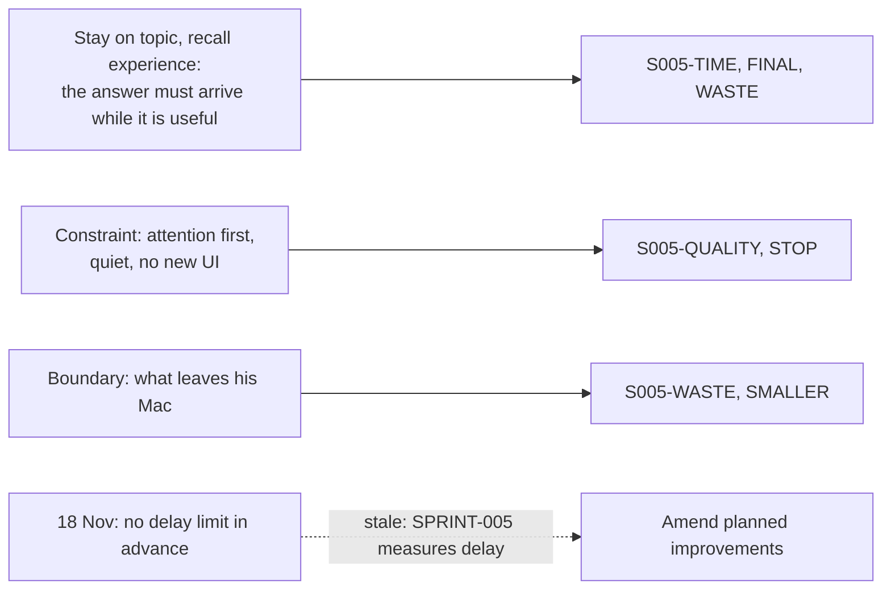

# SPRINT-005 seen from Purpose: why a faster Alice matters

This first-pass report checks SPRINT-005 against the Purpose pages, read-only and written before any other stage's report. It carries no approval. Pablo is the project owner and today's User.

*Solid arrows are supported by the Purpose as it stands; the dotted arrow needs a wording change.*

## Baseline and sources

Sprint snapshot `f17247ac1a64…`, brief `e9f5613ad213…`, plan 03.18 `79d69c59ce52…`, branch `sprint-05` from main `673c3bd7d465…`; re-checked on 22 November 2026. Purpose pages read: [purpose](01-purpose.md) `b72ce946cb00…`, [planned improvements](03-planned-improvements.md) `783093aebcea…`, [capabilities](02-current-capabilities.md) `046f50f00fa3…`, [03.4 boundary](03.4-sprint-004-record-and-upload-boundary.md) `afabdb05677e…`. No Purpose acceptance is claimed here.

## Why the change matters

A proposed answer helps him stay on topic and recall experience only while the question is fresh; a late one is ignored. Pablo asks to be "faster and more efficient", "without local LLM or anything special". The goal serves the purpose and adds no new cue: the non-goals (no local models, no two-lane redesign, no new UI) fit "attention first".

## The seven commitments

| ID | Purpose finding |
| --- | --- |
| S005-TIME | Supported: speed serves usefulness. But planned improvements says the delay has "no limit in advance", learned live; a before and after pass rule now measures it (A1). |
| S005-FINAL | Technical: fewer wrong early readings means fewer on-screen changes and replacements, which helps attention. |
| S005-WASTE | Technical: a call that shows nothing still sends his transcript and package to OpenAI; fewer of them honours "only what he chose leaves his Mac". |
| S005-SMALLER | Technical: unused reply fields (details) were already dropped in SPRINT-004. Purpose needs the same text sent, only less waste; the package stays complete. |
| S005-QUALITY | Supported: speed bought with worse answers fails the purpose. Pablo's mark should use the existing acceptance questions: on topic, true to the package, short. |
| S005-STOP | Technical: traces to the complete log in 03.4 (what was said is kept). |
| S005-CARRY | Supported: the live session also answers SPRINT-004's open question on whether the avatar draws his eyes. |

## Missing, contradictory or ambiguous

- **Contradictory:** planned improvements still says "no delay limit in advance" (decided 18 November); S005-TIME sets a pass rule against 8.6 s. His newer direction prevails; the page is stale.
- **Ambiguous:** two arrival moments (the Question, then the first bullets) are two on-screen changes. Purpose needs both quiet and stable, with no new motion or sound.
- **Not Purpose:** the log-before-change order is 04, 08 and 09's to settle.

## Required amendments, proposed not applied

- **A1** `03-planned-improvements.md`: replace "delay learned in the live session" with "SPRINT-005 measures the delay before and after; 04 sets the pass rule; Pablo's marks decide quality".
- **A2** `02-current-capabilities.md`: refresh at closeout with the measured results.
- **A1 applied** on 22 November 2026 after reconciliation, with the wording above, in `03-planned-improvements.md`; A2 still waits for closeout.

## Downstream effects

04 checks that S005-QUALITY uses the three acceptance questions and that the live session asks the avatar question. 05 and the statements stay unchanged unless what is sent changes. Use Cases needs no new scenario.

## Verdict: CHANGE_REQUIRED

The goal is consistent with the purpose and constraints, and no commitment changes for Purpose reasons. One decision-free wording amendment (A1) is required and A2 waits for closeout.
