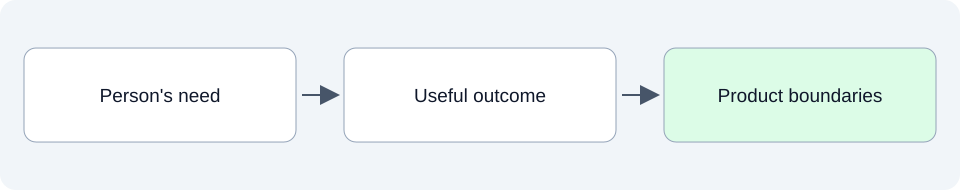

# Purpose: why Alice.Good.Meetings should exist

This folder explains the benefit Alice.Good.Meetings should provide and the boundaries that keep it useful. It connects product choices to the person's needs before we choose technical solutions.

## Alice.Good.Meetings today

The documented direction is brief visual guidance that supports attention, recall and clear answers during interviews and meetings. Preserving the speaker's attention matters more than delivering more advice.
On 16 November 2026 User chose the next step for SPRINT-003: a proposed answer beside the Focus question, drawn from an interview preparation package he prepares. The sprint record calls the product Alice; these pages keep the name Alice.Good.Meetings until he says which name they should use.

The Purpose discussion took place on 20 October 2026. Review and acceptance status is recorded per exact version in the project lifecycle record, not in this page. That record holds no acceptance of the current pages: they are drafts, and agreement on direction does not approve unseen documents or authorize implementation.

## What belongs here as we develop

Purpose should help us judge whether a proposed capability advances the desired outcome. The current prototype and future aspirations remain distinct.

## Explore

- [Purpose and concept illustration](01-purpose.md): outcomes, constraints and non-goals, with the boundaries decided on 18 November 2026 for proposed answers and personal material.
- [Current capabilities](02-current-capabilities.md): what User reports, what the page does at the current revision, and the limits of that evidence.
- [Planned improvements](03-planned-improvements.md): a proposed answer beside the Focus question, with its boundaries and acceptance questions.
- [SPRINT-003 review](03.1-sprint-003-purpose-review.md): the first-pass check of the sprint against these pages, written before User's answers of 16 November.
- [Prepared context proposal](03.2-sprint-003-prepared-context-proposal.md): the decided boundary for the package sent to OpenAI, the details area against "short text", and the decisions of 18 November 2026, including B2 settled as data statements only.
- [Acceptance process](../../../asdg/02-purpose/types/completion.md): readiness review followed by explicit human acceptance of the reviewed version.

Read files in order: **01 Intended**, **02 Current**, **03 Planned**. Additional topics use dotted numbers such as `01.1` or `03.2`; release and sprint plans identify their horizon in the filename and text.
See the [folder guide](../../../asdg/00-governance/docs/stage-layout.md) for consolidation at cycle closeout. Return to [project documentation](../README.md).
