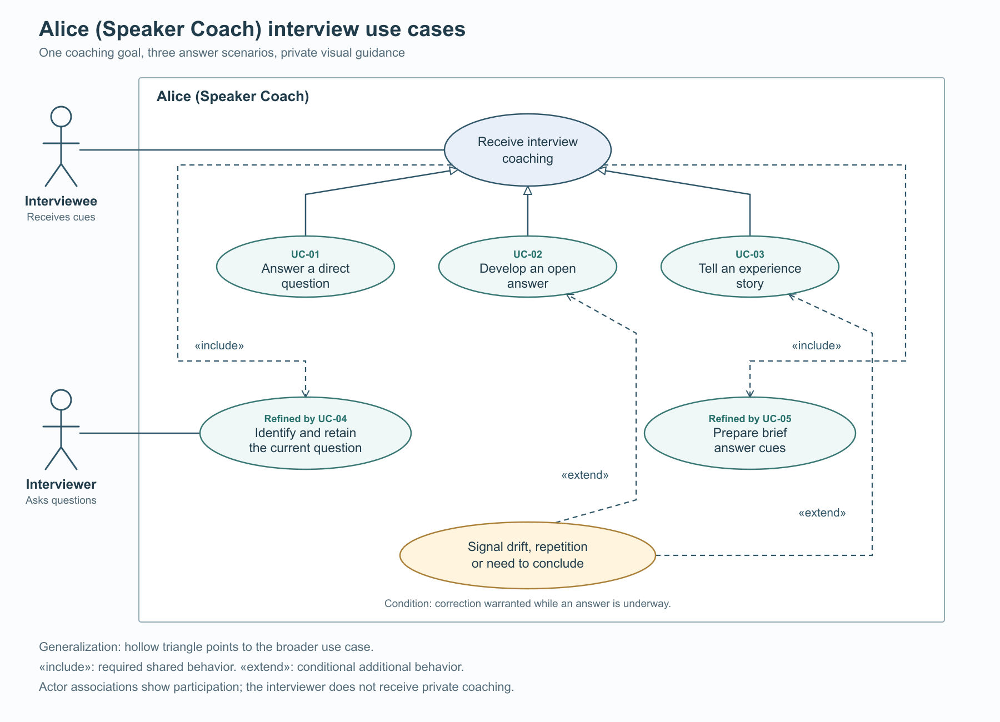

# Alice.Good.Meetings system and UML use cases

Alice.Good.Meetings, which the SPRINT-003 record calls Alice, supports one main use case: help an interviewee answer questions during a meeting through brief private visual coaching.
The model covers intended product behavior from the 20 October 2026 discussion and Pablo's later decisions, without selecting a meeting provider or implementation architecture.

## Actors and system boundary

The interviewee is the primary actor who receives cues and decides what to say. The interviewer is an external actor whose questions and follow-ups enter through the meeting conversation.
Alice.Good.Meetings is the system inside the boundary, rather than another actor. It follows the meeting and presents coaching privately; technical meeting participation is undecided.
Question recognition, question retention and cue preparation belong inside the boundary. Human answers, hiring decisions and the meeting service itself remain outside it.

## UML use case model

[Vector diagram](images/system-use-cases.svg) · [Editable PlantUML source](system-use-cases.puml)

Solid actor associations show participation, not screen access. The interviewer contributes speech; coaching is delivered to the interviewee.
Hollow-triangle arrows point from each specialized scenario to the general coaching use case. Dashed «include» arrows point to shared required behavior.
Dashed «extend» arrows point from conditional corrective guidance to the open-answer and experience-story use cases. Their condition is that correction is warranted while an answer is underway.
The diagram describes behavior and relationships, not execution order, software components or a technical connection to the meeting.

| Scenario | Interviewee goal | Distinctive coach behavior |
| --- | --- | --- |
| [UC-01 Direct question](01.1-direct-question.md) | Give a focused answer. | Offer up to three relevant cues during reflection or answering. |
| [UC-02 Open question](01.2-open-question.md) | Develop a coherent explanation. | Allow elaboration and signal drift, repetition or a suitable conclusion. |
| [UC-03 Experience question](01.3-experience-question.md) | Tell a relevant, genuine story. | Support recall when grounded context exists and track context, personal action and result. |

[UC-04: keep a Focus question and confirm each new one](01.4-confirm-current-question.md), redesigned on 4 November 2026, refines the diagram's shared “Identify and retain the current question” behavior for all three answer scenarios. Two areas stay visible: the Focus question, which changes only when Pablo presses Confirm question, and the Live question, which follows speech automatically. Confirm copies the Live wording into Focus and server-side conversation memory; it is not a fourth answer category.

[UC-05: see a proposed answer for the Focus question](01.5-proposed-answer.md), drafted on 16 November 2026 for SPRINT-003, refines the shared “Prepare brief answer cues” behavior in the same way. When Pablo confirms a Focus question, a few short points appear beside it with supporting details below; both are replaced whenever Focus changes. Its [answer states](01.5.1-proposed-answer-states.md) are the list the layout preview must show.

## Domain model and shared behavior

An interview session contains participants and question-answer exchanges. Each exchange has a current question, the interviewee's developing response and any associated cues.
A question can contain several parts and invite more than one answer flow. A cue is a brief private visual prompt tied to the current exchange; grounded personal context is optional supporting material.
For interviews that context is the interview preparation package Pablo decided on 16 November 2026, with his résumé and other documents. A cue or proposed answer states nothing about him that the package does not contain.
All flows identify and retain the question, allow reflection, prepare brief cues and follow the answer. A pause or restatement helps but is not required to activate support.
The coach should keep the question stable during the interviewee's speech, preserve relevant multipart content and replace stale cues when a genuine follow-up changes the exchange.
Unclear questions, overlapping speech, late cues, unavailable context and mixed flows require graceful fallback. Specific fallback proposals appear in each scenario document.

## Actual evidence and planned work

[The accepted purpose](../02-purpose/01-purpose.md) prioritizes attention, focus, recall and visual guidance. [Current capabilities](../02-purpose/02-current-capabilities.md) record stakeholder reports of duration-based signals; the richer behaviors here remain unverified.
At Git revision `7d60c0f` the page contains the UC-04 Focus and Live panel; Stage 03 read that code on 16 November 2026 and did not run it. Nothing of UC-05 is implemented.
Planned: SPRINT-003, active since 16 November 2026, selects a new page layout and the proposed answer. Its commitments are in Planning's [review brief](../07-planning/03.6-sprint-003-review-brief.md) and [addendum](../07-planning/03.6.3-sprint-003-brief-addendum.md); a sprint is not permission to code.
Review should still resolve exact versus summarized question text, relevance and duration criteria and mixed-flow transitions. These remain candidate decisions with no Stage 07 work item, owner or schedule.

Source: the user's scenario discussion on 20 October 2026, the linked Purpose baseline, the documentation-only authorization and Pablo's SPRINT-003 decisions of 16 November 2026 as relayed by 00 Governance. The UML relationships and fallback details are modeling proposals; saving the package does not record lifecycle acceptance.

[Use-case package](README.md) · [Illustration prompts](images/illustration-prompts.json)
