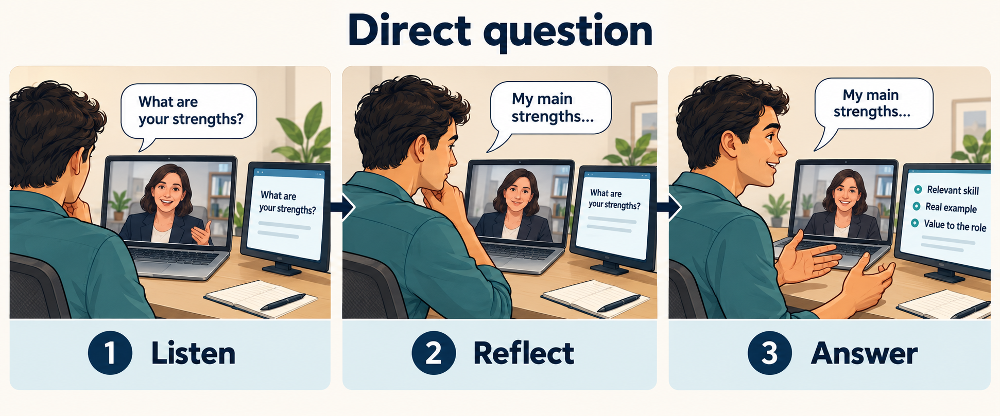

# Direct question coaching

Help the interviewee pause, organize a focused answer and respond in their own words.
This is scenario UC-01 of [the interview-coaching system](01-system-model.md).

Concept illustration of intended behavior, not a screenshot. The pictured strengths question and cues are illustrative.

## Intended interaction

The interviewee receives private visual support; the interviewer asks questions through the meeting conversation.
The coach can follow both speakers and distinguish their speech. Personal recall cues require relevant user-provided context.
The trigger is a focused interviewer question, such as “What are your strengths?”

1. The interviewer asks; the interviewee listens without needing to operate the coach.
2. The coach identifies the question and keeps it visible as the answer's anchor.
3. The interviewee pauses and may restate or clarify the question. The coach uses this reflection time to prepare cues.
4. The coach presents up to three short, relevant points. Three is a preferred maximum, not a quota to fill.
5. The interviewee glances at the cues and answers in their own words; the question stays visible.
6. A follow-up starts a new exchange and retires stale cues.

The coach must also support an immediate answer: pausing or rephrasing is optional, not an activation command.
Cue preparation may begin while listening, but the coach should avoid treating an unfinished question as settled.

## Alternatives and failures

- An ambiguous question calls for clarification; uncertain recognition should not become confident advice.
- Without reliable personal context, offer organizing prompts rather than invented strengths or achievements.
- If cues arrive after the answer has developed, avoid replacing useful guidance with a distracting new set.
- If speakers overlap or a question has several parts, preserve uncertainty and the relevant question parts.

## Observable outcome and review questions

Success means the interviewee addresses the question directly, covers relevant points and retains control of the answer.
Can the question remain stable while the interviewee rephrases it? Are cues timely, readable at a glance and grounded in available context?
The acceptable cue delay and handling of low-confidence recognition remain open decisions.

## Actual evidence and planned work

[Current capabilities](../02-purpose/02-current-capabilities.md) record user-reported benefit from duration-based visual signals; contextual answer cues have not been demonstrated.
[The selected next improvement](../02-purpose/03-planned-improvements.md) is keeping the interviewer question visible. Cue generation is a candidate later capability, without a committed sprint or schedule.

Source: the user's three-scenario discussion on 20 October 2026, interpreted against [the accepted purpose baseline](../02-purpose/01-purpose.md). Saved-document acceptance remains separate.

[Next scenario: open question](01.2-open-question.md) · [System model](01-system-model.md)
