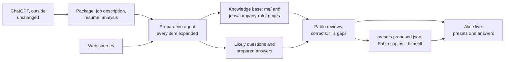

# Prepare a meeting with Alice: from package to knowledge base and presets

UC-10 describes how Pablo prepares for an interview with Alice taking "a more active role in the preparation". ChatGPT, on his own account, still makes the package from the job description, his résumé and its analysis, and that stays unchanged. He uploads it to `poc/context/interview/`; a preparation agent, an agent skill in this repository that he runs in Claude Code before the meeting, expands it into a knowledge base of Markdown documents and a proposal of ten presets; he reviews it, fills gaps and copies the presets and digest into the package folder himself. Aligned on 22 November 2026 with 08's [preparation skill specification](../08-low-level-design/03.10-sprint-006-preparation-skill-specification.md). Draft of 22 November 2026 for SPRINT-006, from Pablo's words relayed by 00 Governance. Not approved.

*Preparation happens before the meeting; live use is [UC-05](01.5-proposed-answer.md) and [UC-09](01.9-new-screen.md). Concept of intended behavior; nothing here is built.*

## Actors and conditions

Pablo is the primary actor. The **preparation agent** is a skill Pablo runs in Claude Code, outside the Alice page; 08 specifies it (KS-1). **ChatGPT** and **web sources** are outside the boundary: ChatGPT is untouched, and web pages are read, never changed. **Alice live** is the system of UC-05 and UC-09 using the result. The knowledge base grows over time: "Alice is going to become an expert in me".

## Main scenario

1. Pablo uploads the package as in [UC-07](01.7-load-preparation-package.md) and runs the skill. It checks the inputs and that the knowledge folder is Git-ignored, and stops with a message if the job description or résumé is missing.
2. The agent lists every requirement of the job description and every claim of the résumé, groups them into topics, researches public web sources, and writes a page per topic: what he did in `me/`, and the job's questions in `jobs/<company-role>/`. Each sentence about him is tagged [R] (résumé) or [P] (his written answer).
3. It foresees reasonable questions, typical, technical and behavioural, with a prepared answer and three bullets each, using only tagged evidence. Example: for his AI-assistant experience it recalls the tools and features in technical depth.
4. It reports counts and topic titles and lists the gaps (at most 15 new ones per run) that only Pablo can answer (see [exceptions](01.10.1-prepare-exceptions-and-live-use.md)).
5. Pablo reviews, corrects and answers the gaps; his edits are the truth. From `presets.proposed.json` ("About me" first, one or two word labels) he chooses the final ten.
6. He copies the presets file and the digest into `poc/context/interview/`; the skill never writes there. The meeting can start.

## The re-run that extends it

When Pablo changes the package, answers a gap or the sources are over 30 days old, he runs the skill again; it says which mode it chose (refresh, answers or research) and touches only the affected topics. It rewrites only its own marked blocks: if he edited inside one, his text stays and the new text goes to a `.proposed.md` file. A topic no longer in the package is marked retired, never deleted. Each document carries its date and its sources, so the base grows over time.

## Out of scope now

Job description only as input; other people using Alice's knowledge of Pablo; replacing ChatGPT; automatic web posting or contact with anyone. All later, in Pablo's words.

Draft, no acceptance recorded. Continue with [exceptions and live use](01.10.1-prepare-exceptions-and-live-use.md). [Package](01.7-load-preparation-package.md) · [Stage index](README.md)
