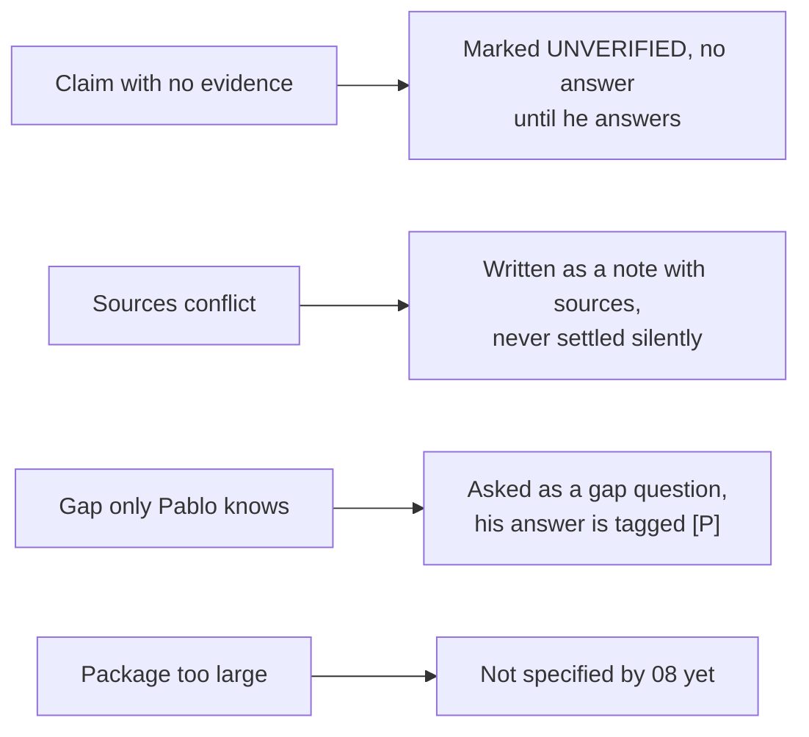

# Preparing a meeting: exceptions, and use while performing

This page belongs to [UC-10](01.10-prepare-a-meeting.md). It says what Pablo sees when preparation meets a problem, and how the result is used live. Draft of 22 November 2026, not approved.

*Each exception ends with Pablo informed and in charge; none ends with an invented fact.*

## Exceptions

| Situation | Expected observation |
| --- | --- |
| **A claim with no evidence**, for example experience in the résumé that no source supports | The topic is marked UNVERIFIED and listed as a gap; it is left out of prepared answers, bullets, digest and presets, with no invented tool, date or result, until Pablo answers |
| **Conflicting sources**, for example the résumé and a web page disagree about a date or product | The conflict is written on the page with its sources and not settled silently; about Pablo only his résumé and answers count, and the web, tagged [W], never says what he did |
| **A gap only Pablo can answer**, for example what he personally did in a project | The agent asks one exact question (at most 15 new per run); he answers in the chat, it is saved to his answers file, and the topic is confirmed and regenerated |
| **A package too large** for one run | **Not specified by 08** (it caps only the live digest, within 20,000 characters minus the package). Proposed: the skill names the parts not processed and why, cuts nothing silently, and he may split the package |
| **No web access, or a source unreadable** | The run says "no research this run" and works from his documents; web facts are never made up. Searches use only public terms such as company, role and technology, never his name or résumé text |
| **A question outside the knowledge base** | Alice live falls back to general points, labelled as general, as in [UC-05](01.5-proposed-answer.md) |

## Use while performing

1. **Presets.** He copied them in himself; Pablo taps a preset (or key 1 to 9, 0). The Question and its prepared bullets show at once, marked "Prepared"; no speech, no Confirm and no model call ([08 presets](../08-low-level-design/03.9.4-s006-presets.md)).
2. **Live answers.** When a question is heard, Alice reads it in the context of the package folder, which holds the digest, and shows at most three bullets. Later the service may pick the matching topic pages; for now the digest must fit the 20,000-character budget. It states nothing about Pablo that the knowledge base does not contain.
3. **Preparing and performing** use the same presets; the pen and touch buttons are separate inputs and nothing is removed.

## Open questions and Stage 04

- Open: Pablo's acceptance that his résumé goes to the skill's model provider, a flow beyond OpenAI that 02 and 05 must record (08 KV-3, Q8); how the live service reaches a base larger than the digest (05, C1); and an input too large for one run. Where the agent runs is answered: Claude Code in this repository, by Pablo.
- **Stage 04 should evaluate:** every claim in an answer traces to a document; an unevidenced claim is marked; conflicts are shown with sources; a re-run keeps his edits and marks what is new; nothing is cut silently; ten presets match the list; no private material enters the log or the page beyond what is shown.

Draft, no acceptance recorded. [UC-10](01.10-prepare-a-meeting.md) · [New screen](01.9-new-screen.md) · [Stage index](README.md)
