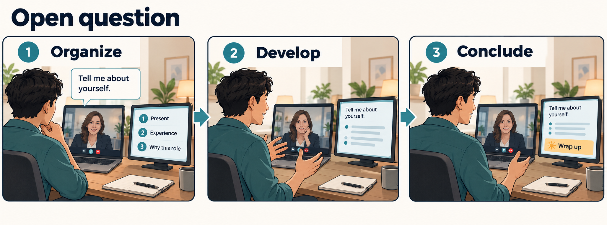

# Open question coaching

Help the interviewee develop a longer answer with a clear direction and a natural conclusion.
This is scenario UC-02 of [the interview-coaching system](01-system-model.md).

Concept illustration of intended behavior, not a screenshot. “Present, experience, why this role” is an illustrative structure.

## Intended interaction

The interviewee receives private visual guidance while the interviewer participates through the meeting conversation.
The coach can distinguish speakers, retain the current question and follow the developing answer.
The trigger is an invitation to explain a broader topic, such as “Tell me about yourself.”

1. The interviewer asks the open question; the coach identifies and displays it.
2. The interviewee may pause or rephrase while the coach prepares up to three brief organizing anchors.
3. The interviewee develops the answer freely, using the anchors if helpful.
4. The coach keeps the question visible and allows relevant explanation to unfold.
5. If the answer drifts, repeats itself or needs a conclusion, the coach gives a short visual cue.
6. The interviewee may adjust, continue or conclude. The next interviewer question establishes a new anchor.

Guidance should preserve attention: stable anchors and occasional corrective cues take precedence over a stream of rewritten advice.
The coach supports the interviewee's judgment; its cue does not take control of the conversation.

## Alternatives and failures

- A longer relevant explanation is allowed; elapsed time alone does not establish that the answer is off topic.
- A follow-up or interruption can legitimately change the topic; update the anchor instead of flagging the old topic as mandatory.
- A mixed question may move into [the experience-story flow](01.3-experience-question.md) without requiring the interviewee to select a mode.
- When relevance is uncertain, avoid a confident off-topic warning; the question itself remains a useful anchor.

## Observable outcome and review questions

Success means the answer develops relevant ideas, stays connected to the question and reaches a recognizable conclusion.
Can a cue help the interviewee recover without interrupting their thinking? Can the coach distinguish elaboration from repetition?
Definitions of drift, excessive length, warning frequency and appropriate conclusion timing remain open decisions.

## Actual evidence and planned work

[Current capabilities](../02-purpose/02-current-capabilities.md) describe reported green/yellow/red duration signals, not demonstrated semantic topic monitoring.
[The selected next improvement](../02-purpose/03-planned-improvements.md) is retaining the interviewer question. Organizing anchors and relevance-based guidance are candidate later capabilities, without a committed sprint or schedule.

Source: the user's three-scenario discussion on 20 October 2026 and [the accepted purpose baseline](../02-purpose/01-purpose.md). The anchor structure and fallback behavior are proposals for review.

[Previous: direct question](01.1-direct-question.md) · [Next: experience question](01.3-experience-question.md) · [System model](01-system-model.md)
