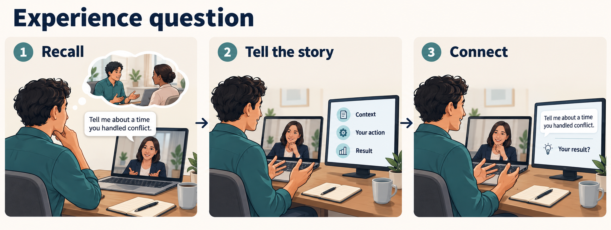

# Experience question coaching

Help the interviewee recall a real experience and explain what happened, what they did and the result.
This is scenario UC-03 of [the interview-coaching system](01-system-model.md).

Concept illustration of intended behavior, not a screenshot. The conflict question is an example, not a claim about the user's experience.

## Intended interaction

The interviewee receives private visual support; the interviewer supplies the question and follow-ups through the meeting.
The coach can distinguish speakers and follow the question. Suggestions of specific experiences require relevant user-provided material.
The trigger is a request for a past example, such as “Tell me about a time you handled conflict.”

1. The coach identifies and keeps the question visible, including the experience or competency requested.
2. The interviewee pauses to recall an example and may clarify what the interviewer wants to hear.
3. If grounded personal context is available, the coach offers a brief reminder of a potentially relevant experience.
4. The interviewee selects the example; the coach offers three proposed story anchors: context, your action and result.
5. The interviewee tells the story. The coach follows it and may flag a missing personal action, missing outcome or loss of relevance.
6. The interviewee explains the outcome and connects the example to the question; a follow-up updates the current exchange.

The three anchors organize a story rather than impose three sentences or a fixed answer length.
Specific experience reminders and the three-anchor structure are proposals, not confirmed product capabilities.

## Alternatives and failures

- Without a relevant example in the available material, provide structure or space to recall; do not invent events, actions or results.
- If the suggested example is unsuitable, the interviewee chooses another genuine example and the coach follows that choice.
- If the result is unresolved or mixed, support an accurate account and learning rather than inventing success or a metric.
- An interruption or follow-up may move to another part of the story; retire cues that no longer apply.

## Observable outcome and review questions

Success means the story addresses the requested situation and makes the interviewee's own contribution and actual outcome clear.
Can a reminder help recall without replacing the interviewee's memory? Can the coach notice a missing result without rushing the story?
The available personal sources, how to identify the right example and when to show a reminder remain open decisions.

## Actual evidence and planned work

[Current capabilities](../02-purpose/02-current-capabilities.md) do not demonstrate personal-experience retrieval or story-aware guidance.
[The selected next improvement](../02-purpose/03-planned-improvements.md) is keeping the question visible. Contextual recall and story guidance are candidate later capabilities, without a committed sprint or schedule.

Source: the user's three-scenario discussion on 20 October 2026 and [the accepted purpose baseline](../02-purpose/01-purpose.md). Saved-document acceptance remains separate.

[Previous: open question](01.2-open-question.md) · [System model](01-system-model.md)
