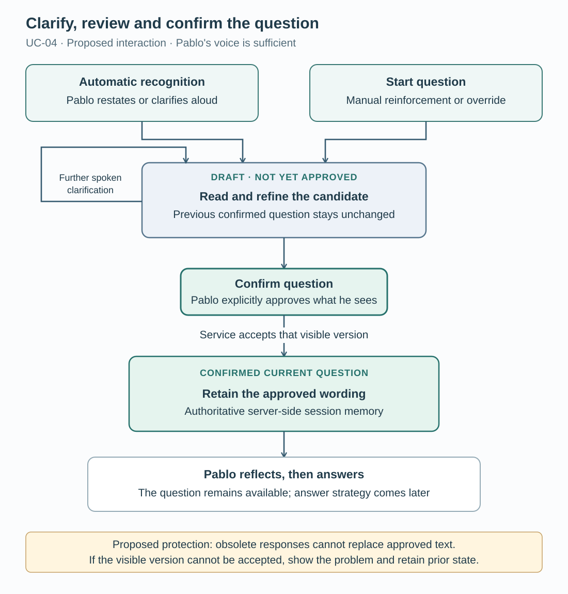

# Clarify and confirm the current interview question

UC-04 helps Pablo turn his spoken restatement into a question he can read, refine and explicitly confirm before answering. His speech remains part of the real interview while also supplying input to SpeakerCoach; the interviewer's audio is not required.

This proposed 28 October 2026 increment refines the shared question-identification behavior in the [overall UML model](01-system-model.md). It supports all three answer scenarios rather than adding a fourth answer category.

Proposed interaction and state behavior, not a screenshot or evidence of implemented controls. [Editable SVG](images/question-confirmation.svg).

## Actors and prerequisites

Pablo is the primary actor, using his own voice and two on-screen controls operable by mouse or keyboard. The interviewer participates in the real discussion and may clarify verbally; Pablo can incorporate that clarification in his next restatement without the coach receiving interviewer audio.

An active listening session must deliver Pablo's speech to the service, and he must be able to read the candidate question. Either automatic recognition of clarification or the manual start control can trigger the flow; no exact spoken password is required.

| Control | Meaning |
| --- | --- |
| Start question | Explicitly signals that Pablo is now stating/rephrasing the important question; reinforces or overrides automatic interpretation. |
| Confirm question | Proposed clearer label for “Finish question / OK”: approves the precise question Pablo currently sees, not merely the end of his speech. |

## Main clarification and confirmation flow

1. Pablo hears the question and may press **Start question**; this button is not a prerequisite for automatic question detection.
2. He says, for example, “I want to clarify the question. The question is …”. His words also address the interviewer.
3. SpeakerCoach promptly shows a clearly identified draft question, preserving intended meaning and relevant parts without adding invented details.
4. Pablo continues restating or includes the interviewer's clarification. The displayed draft follows his corrections until he is comfortable with its wording.
5. Pablo reads the candidate and presses **Confirm question** only when it matches his understanding and the clarification agreed in the discussion.
6. The service accepts the specific visible version. Its acknowledgement allows the page to mark that wording as the user-confirmed current question.
7. Server-side conversation memory retains the question Pablo actually saw and approved, distinct from any evolving draft, and makes it available throughout his subsequent answer.
8. Pablo begins reflecting and then answering. Confirmation alone does not mean his answer has begun; later answer-strategy bullet points remain a separate discussion.

## Draft and confirmed question behavior

Automatic interpretation may open or refine a draft without either button. Within this explicit-confirmation flow, silence, an end-of-speech signal or model confidence never substitutes for **Confirm question**.

A draft remains provisional. If there is already a confirmed question, retain it while a replacement is being clarified and distinguish the two visibly. Only a subsequent explicit confirmation replaces the authoritative current question.

The required memory is server-side session conversation context. Retention across sessions and durable database storage are unspecified; this use case does not select a storage technology.

## Observable acceptance scenarios

The controls, confirmation rules and display timing below are intended behavior to verify; the asynchronous and failure protections are proposed acceptance behavior, not claims about the POC.

| Situation | Expected observation |
| --- | --- |
| Interviewer audio absent; clarification recognized automatically | Pablo's voice alone produces a reviewable candidate without a mandatory Start question press. |
| Automatic interpretation misses his intent | Start question reinforces/overrides that interpretation and lets Pablo state the draft. |
| Pablo corrects or expands a multipart question | The draft reflects his intended corrections and preserves relevant parts without invented details. |
| Pablo stops speaking, or tries to confirm an empty draft | No question becomes user-confirmed; an unavailable or empty candidate receives clear feedback. |
| Pablo confirms the displayed question | Page acknowledgement and server memory identify the same approved wording; reflection is not falsely classified as an answer. |
| A late model response or further answer speech arrives | Proposed protection: it cannot silently replace the confirmed question; deliberate clarification can create a separate draft. |
| A newer, unseen draft exists when confirmation arrives | Proposed protection: accept only the version Pablo saw, or visibly reject it for renewed review; never confirm different wording silently. |
| Confirmation fails or its acknowledgement is uncertain | Proposed fallback: show uncertainty, preserve the previous confirmed question, and avoid treating a retry as approval of different text or a new exchange. |

## Evidence and remaining decisions

Pablo reports that the application can now hear both participants. Inspection of [the POC controller](../../../poc/session.mjs) shows revision-checked, model/evidence-driven question promotion and retention during ANSWER; the inspected page and controller do not establish these two new controls or user-confirmation semantics. No runtime test of UC-04 was performed.

This follows the [Purpose priority](../02-purpose/03-planned-improvements.md) and [candidate/established-question architecture](../05-high-level-design-and-architecture/01.2-interview-state.md). The existing P speaking toggle declares a turn hint, not approval of question wording; it is a separate interaction.

Open choices are final labels, acceptable candidate-display delay, how to keep wording readable while it changes, and distinguishing correction of the current exchange from a genuinely new question. This is a possible-next-sprint use case, not a change to SPRINT-000 or an implementation commitment.

Source: Pablo's 28 October 2026 requirements relayed by Planning, the linked model and architecture, and source inspection. [Direct-question scenario](01.1-direct-question.md) · [Stage index](README.md).
