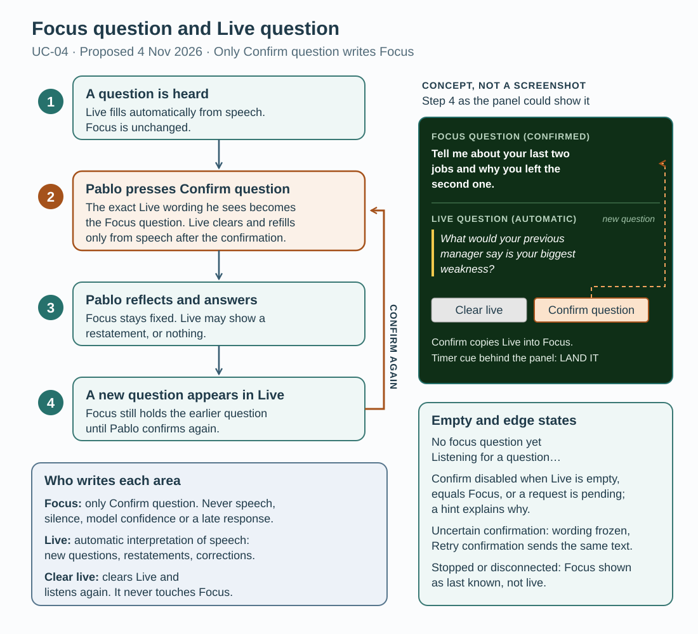

# Keep a Focus question: set after a pause, or confirmed by hand

UC-04 keeps two questions in view while Pablo is in a meeting such as an interview. The **Focus question** is the question he is answering and stays fixed until a new one replaces it. The **Live question** is what Alice currently hears, updated from speech. Since 18 November 2026 (draft) the pause sets Focus by itself; on the [new screen](01.9-new-screen.md) Focus is the big question and Live is the one-line candidate; **Confirm question** and **Clear live** remain as an optional manual tool.

This draft refines the shared "Identify and retain the current question" behavior in the [overall UML model](01-system-model.md) for all three answer scenarios. It replaces the 4 November rule that only Confirm writes Focus; the Confirm path is the manual path below.

Concept drawn on 4 November 2026, not a screenshot; it shows the manual path and is redrawn once Pablo approves the layout preview, where layout "B, cue first" moves the areas without changing these rules. [Editable SVG](images/focus-live-cycle.svg). Panel detail is in the [UC-04 low-level design](../08-low-level-design/03-uc-04-focus-and-live-question.md) (08 Specs).

## Actors and controls

Pablo is the primary actor; he speaks and may use controls by mouse or keyboard. Another participant, such as the interviewer, asks in the real conversation. Other channels are listed in [inputs and future channels](01.6-inputs-and-future-channels.md).

| Element | Meaning to Pablo |
| --- | --- |
| Focus question | The question Alice has taken as his current one, in the package's spelling of names. Empty state: "No focus question yet". |
| Live question | The current reading of speech while he is still talking, with a muted agent tag. Empty state: "Listening for a question…". |
| Monitor line | An audio dot, the current turn time and the last words heard, so he can see what Alice heard. No "report a problem" button is needed. |
| Confirm question, Clear live | Optional. Confirm sets Focus from the Live wording he sees; Clear live drops Live and uses only later speech. |

## Main flow: pause sets Focus

1. The session is ready and both areas show their empty states.
2. Another participant asks, or Pablo restates, a clear question. It is the last thing said before a pause.
3. After a pause of 800 ms (to be fine-tuned) Alice takes the pause as the end of the question. She waits for the final words of the transcript, not the partial ones, so Focus may follow the pause by a moment; the page adds no message while it waits and keeps showing his words in "What I hear". She reads it in the context of the preparation package, so a misheard "BBC" reads "CIBC" when the package is about CIBC, and she adds nothing that was not said.
4. Focus shows the cleaned question and the [proposed answer](01.5-proposed-answer.md) is prepared. The phase stays QUESTION; a confirmed or automatic restatement stays in the same exchange.
5. Pablo reflects and answers; the timer (GOOD, LAND IT, STOP) continues.
6. If the reading is wrong he repeats the question clearly and pauses again: the later pause replaces the earlier reading and its answer.

## Alternatives and failures

| Situation | Expected observation |
| --- | --- |
| No clear question before the pause | Focus and the last answer stay; the page says no question was heard |
| Speech after the pause is not a question | Focus is unchanged; the same note appears |
| He prefers to decide himself, for example online with the laptop in front of him | He presses Confirm on the Live wording; the manual path of the 4 November design applies |
| Live holds the wrong words | He repeats the question and pauses, or presses Clear live |
| A later pause arrives while an answer is pending | The earlier answer is dropped; only the latest reading is shown |
| Session stops or disconnects | Focus shows as last known, not live; a new session starts empty |
| A question is spoken just before Stop | Its last words appear in "What I hear" only; they never set Focus or start an answer. If they cannot be captured, see [the log](01.8-meeting-log-and-download.md) |

## Evidence and open questions

Decided by Pablo on 4 November 2026: Start question relabelled Clear live; a restatement stays in the same exchange; phase stays QUESTION; no keyboard shortcut. Decided on 16 November: any Focus change replaces the answer. Directed on 18 November 2026 (relayed by 00 Governance): pause sets Focus, Confirm and Clear live stay optional, context-aware reading, monitor line.
Stage 03 did not re-read the code after 18 November. Open: whether a misreading that Pablo does not notice is acceptable, how an automatic Focus is told apart from a confirmed one in the monitor line, and the placement of the controls (C9).

Source: Pablo's decisions as relayed by 09 Coding and 00 Governance, [Purpose priority](../02-purpose/03-planned-improvements.md), the [interview-state architecture](../05-high-level-design-and-architecture/01.2-interview-state.md). [Next: proposed answer](01.5-proposed-answer.md) · [Stage index](README.md).
