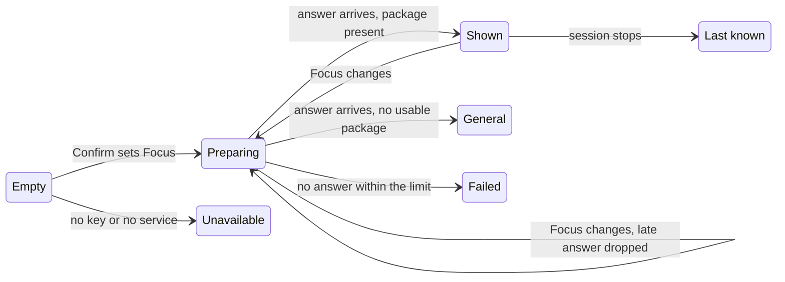

# Answer states: what the proposed-answer area can show

The answer card and the details area of [UC-05](01.5-proposed-answer.md) are always in exactly one of seven states. This is the single list for the layout preview (S003-PREVIEW), for Evaluation's checks and for the Specs design: each state has one name, to be used unchanged elsewhere.

*The states and their main transitions. General and Failed also return to Preparing when Focus changes, and every state with a Focus question becomes Last known when the session stops.*

## The seven states

| State | Answer card | Details area | Entered when | Basis |
| --- | --- | --- | --- | --- |
| **Empty** | A short hint that an answer appears after Confirm | Empty | The session is ready and there is no Focus question | Proposed |
| **Preparing** | A note that an answer is being prepared; no earlier answer | Empty | Focus is set or changed | Decided; wording proposed |
| **Shown** | At most three short points | Supporting details | The answer for the current Focus arrives and a package is present | Decided |
| **General** | General points from the question alone, labelled as general, with the reason when the package was too large, empty or unreadable | General details, or empty | The answer arrives and no usable package is present | Decided |
| **Failed** | A note that there is no proposed answer for this question | Empty | No answer arrives within the limit | Decided |
| **Unavailable** | A message that question recognition and proposed answers are unavailable; Live says the same and Start listening is disabled with that reason | Empty | The page finds no key, or cannot reach the service, on load | Decided 18 November 2026 (C2) |
| **Last known** | The last content marked last known, not live, or a note that none arrived | As it was | The session stops or disconnects | Decided |

## Rules that hold in every state

- The state belongs to the Focus question on screen; content prepared for an earlier Focus is never shown.
- No state changes the cue, the timer, Focus, Live, Confirm question or Clear live.
- A change of state replaces the content in place and complete, with no motion or sound.
- Long details scroll inside the details area, which keeps its size; there is no collapse control, and the points and the cue never move (decided 18 November 2026, C17 and criterion 8).
- Only Shown says anything about Pablo, and only what the preparation package contains.

## For the preview and the checks

The preview should show all seven states, and Shown twice: with the shortest and with the longest content expected. Which cue colors and screen sizes accompany each state is Evaluation's choice; exact wording, sizes and positions belong to Specs and the preview.
Basis follows [UC-05](01.5-proposed-answer.md): Decided is Pablo's decision of 16 November 2026 and his "Accept all" of 18 November 2026, as relayed by 00 Governance, which he can still change at the preview and the specification review. Proposed is this stage's recommendation awaiting his eye: the Empty hint and the Preparing wording.
This list replaces the diagram in the [first-pass review](03-sprint-003-use-case-review.md), adding General. It is a draft, and saving it records no acceptance.

[UC-05](01.5-proposed-answer.md) · [System model](01-system-model.md) · [Stage index](README.md)
