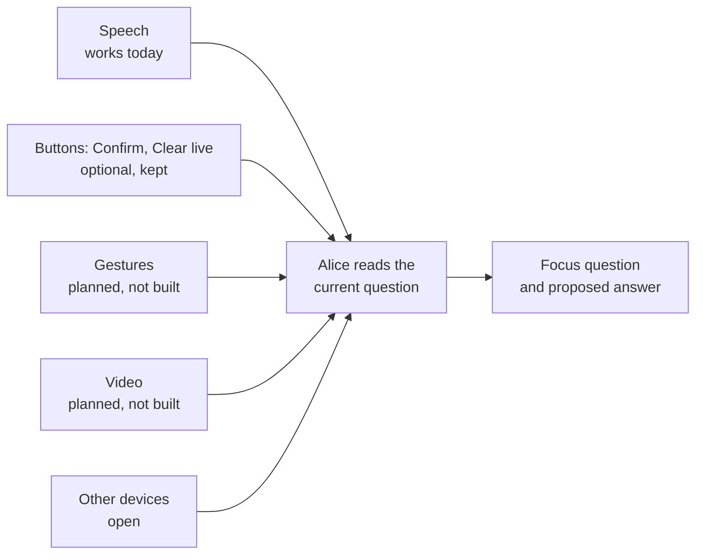

# Input channels: speech now, manual controls beside it, gestures and video later

UC-06 describes how Pablo gives Alice cues. Alice is multimodal: speech is the main channel today, the Confirm and Clear live buttons are an optional manual tool, and gestures and video are planned. A new channel is added beside the others and never replaces one. The rule is Pablo's, of 18 November 2026: "whatever works".

*Every channel is one more signal into the same Focus question. Solid boxes work today; the others are intentions only.*

## Channels and behavior

| Channel | Status | What it does | Rule |
| --- | --- | --- | --- |
| Speech | Built | A pause after a clear question sets Focus ([UC-04](01.4-confirm-current-question.md)) | Main path; monitor line shows what was heard |
| Confirm question, Clear live | Built, optional | Set Focus from the Live wording, or drop Live | Stay available, for example in an online meeting with the laptop in front of him |
| Keys: Space, Esc, G, L, S | Planned for SPRINT-004 | Space confirms, Esc clears, G, L and S set the cue ([UC-09](01.9-new-screen.md)) | Added beside the buttons; whether cue buttons stay is open |
| Gestures | Planned | A deliberate gesture could mean "this is the question" or "ignore that" | Not specified; the gesture set is open |
| Video | Planned | The interviewer's or Pablo's expression or slide could add context | Not specified; privacy and consent are open |
| Other devices | Open | A key, pedal or phone as a manual control | Added only if Pablo asks |

## Scenario: speech and buttons together

1. The interviewer asks a long, two-part question in an online meeting. Alice reads the pause as its end.
2. The monitor line shows the last words heard; Focus holds only the second part.
3. Pablo presses Clear live, repeats the first part and pauses. The later pause replaces Focus, and the answer is prepared again.
4. If he does not trust the reading, he presses Confirm on the Live wording instead. Both routes end in the same Focus and answer.

## Rules and open questions

- No channel is removed when another is added; a signal from any channel may set or replace Focus, and the answer always belongs to the Focus on screen.
- Every channel keeps the attention rule: the cue stays the strongest signal and nothing new speaks or moves.
- Open: how two channels that disagree are ordered (the latest signal wins today); what video or gesture data may leave the Mac, which Purpose and Architecture must decide before any build; whether a manual Confirm should be marked in the monitor line.

This is a draft of 18 November 2026 and records no acceptance. Gestures, video and other devices are planned, not built, and no scenario here is evidence that they work.
[Focus and Live](01.4-confirm-current-question.md) · [Proposed answer](01.5-proposed-answer.md) · [System model](01-system-model.md) · [Stage index](README.md)
