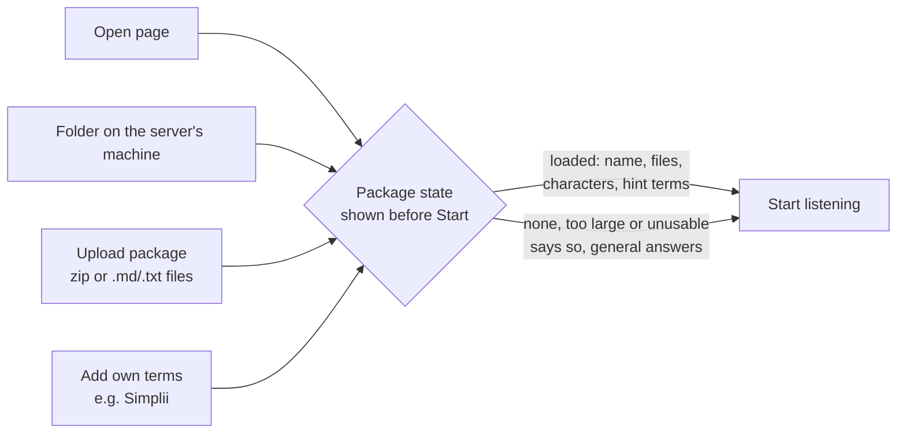

# Load the preparation package from the page

UC-07 lets Pablo give Alice his interview preparation package from the page: he opens it, presses **Upload package**, picks a zip or several `.md` or `.txt` files, sees what was loaded, adds any names the package lacks, then presses **Start listening**. The folder `poc/context/interview/` keeps working; the upload is one more way in, per the multimodal rule of 18 November 2026. Draft of that date, not approved.

*Three ways to supply the package, one visible state, then listening. Concept of intended behavior, not a screenshot; layout is for the preview.*

## Actors and conditions

Pablo is the only actor; the interviewer is not involved. The page and service run on his own machine, so nothing here covers sign-in or a shared server (out of scope for now). Limit: 20,000 characters of plain text or Markdown in total. Package text goes to OpenAI with each question, as in [UC-05](01.5-proposed-answer.md).

## Main flow

1. Pablo opens the page. Before listening it shows the package state: from the folder if one is there, otherwise "no package".
2. He presses **Upload package** and picks a zip or several `.md` or `.txt` files.
3. The page shows what was loaded: package name, number of files, characters used of 20,000, and the terms taken as transcription hints (names and acronyms).
4. If a name the interviewer will say is missing, for example Simplii, he adds it to a **terms list** beside the package. Added terms join the hints and are shown as his own.
5. He presses **Start listening**. The package and terms stay in use until he replaces them or the service stops.

## Alternatives and failures

| Situation | Expected observation |
| --- | --- |
| No package, or the wrong one (the 18 November failure: answers said "Your documents do not cover this question" and nothing on the page said why) | The state says "no package" or names what is loaded, so a wrong package is seen before Start; answers are general and labelled |
| Over 20,000 characters, empty, unreadable or a file type other than `.md`/`.txt` | Nothing is cut short; the page names each file skipped and why; if none is usable the state is "no package" |
| A zip contains other files | They are skipped and listed; the usable text is loaded |
| A second upload | It replaces the first; the state shows the new package |
| Upload while listening | Not allowed; the state says to stop first |
| The package lacks a name | The terms list supplies it; no term, package or otherwise, adds a fact about Pablo |
| Service unreachable or no key | Unavailable on load, as in [UC-05](01.5-proposed-answer.md); upload is not offered |
| Folder and upload both present | Open: which wins |

## Open questions and Stage 04

- Which wins when a folder and an upload both exist, and whether a terms list is kept between sessions or cleared at Stop (default: cleared).
- This reverses the earlier "no package notice before Start" (18 November): Pablo now wants the state visible, so the B2 and data-statement wording need a fresh look.
- **Stage 04 should evaluate:** the state is visible before listening in each case above; skipped files are named; a wrong package is noticed before Start; an added term reaches the hints; nothing is sent before Start; the 20,000 limit is never exceeded.

Draft, no acceptance recorded. [System model](01-system-model.md) · [Proposed answer](01.5-proposed-answer.md) · [Input channels](01.6-inputs-and-future-channels.md) · [Stage index](README.md)
