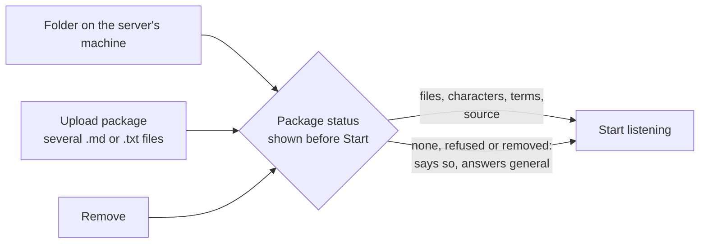

# Load the preparation package from the page

UC-07 lets Pablo give Alice his preparation package for a meeting (for an interview, his résumé and other documents) from the page: he presses **Upload package**, picks several `.md` or `.txt` files, sees what was loaded, then presses **Start listening**. The folder `poc/context/interview/` keeps working; upload is one more way in (multimodal rule, 18 November 2026). UC-01 to UC-03 stay interview scenarios; other meeting types reuse the same flow. Draft of 19 November 2026 for SPRINT-004, trimmed to several files: no zip, no own-terms list (both later). Not approved.

*Two ways to supply the package, one visible status, then listening. Concept of intended behavior, not a screenshot; layout is in the screen specification.*

## Actors and conditions

Pablo is the only actor. Page and service run on his machine; sign-in and a shared server are out of scope. The limit is 20,000 characters in total, plain text or Markdown. Package text goes to OpenAI with each question ([UC-05](01.5-proposed-answer.md)); no route returns it.

## Main flow

1. Pablo opens the page. The package line shows the status at once and after a reload: for example "Package: 3 files, 18,843 chars, uploaded", "Package: 3 files, folder" or "No package".
2. He presses **Upload package** and picks several `.md` or `.txt` files.
3. The line shows what was loaded: file count, characters of 20,000, terms taken as hints. Skipped files are named on the page only.
4. He presses **Start listening**. The package stays in use after **Stop listening**, until he uploads another or presses **Remove** in the package line.

## Scenarios and failures

| Situation | Expected observation |
| --- | --- |
| **Status:** no package, or the wrong one (the 18 November failure: answers said "Your documents do not cover this question" and nothing said why) | The status shows before Start, so a wrong or missing package is seen first; answers are general and labelled |
| **Refused:** over 20,000 characters, too many files, unreadable or empty | The old package stays and the line says why; nothing is cut short |
| **Skipped:** a file that is not `.md` or `.txt`, or a README | Named and skipped; the rest loads |
| **Stop:** Pablo presses Stop listening | The package stays loaded and shown; the next Start uses it |
| **Remove:** Pablo presses Remove | What is loaded now is cleared and the line says "No package"; answers are general. A folder package stays cleared until the service restarts |
| **Remove while listening** | Disabled, like upload, with the reason shown |
| **Service restarts** | An upload was in memory only and is gone; the status shows the folder package, or "No package" |
| **Second upload** | Replaces the first; the status shows the new one |
| **Upload while listening** | Refused with "Stop listening to load a package." |
| **Folder and upload both present** | Upload replaces the folder package for this run (05's recommendation; open) |
| **No key or service** | Unavailable on load, as in [UC-05](01.5-proposed-answer.md); upload is disabled with the cause |

## Open questions and Stage 04

- Open: keep the package after Stop (recommended yes); upload replaces the folder package; a terms list and zip wait for SPRINT-005.
- This supersedes the 18 November "no package notice before Start": the status is now shown, as the SPRINT-004 plan's criterion 1 asks, so B2 and the data statements need a fresh look.
- **Stage 04 should evaluate:** the status is visible before Start and after reload; each refusal keeps the old package and says why; Stop keeps it; Remove clears it; nothing is sent before Start; the 20,000 limit holds; no file text appears on the page.

Draft, no acceptance recorded. [System model](01-system-model.md) · [Meeting log](01.8-meeting-log-and-download.md) · [New screen](01.9-new-screen.md) · [Stage index](README.md)
