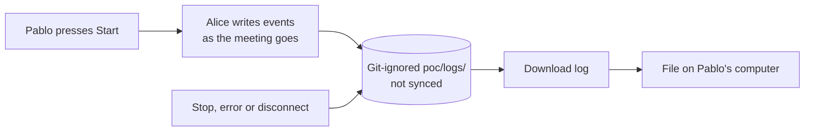

# Keep a meeting log and download it

UC-08 gives Pablo a complete, time-stamped record of what happened in each listening session, so he can review the meeting afterwards. While he listens, Alice writes the log as the meeting goes. He presses **Download log** to save it. Draft of 19 November 2026 for SPRINT-004; not approved. Format and storage belong to 08 Detailed Design ([format](../08-low-level-design/03.7.5-s004-meeting-log.md), [storage](../08-low-level-design/03.7.6-s004-meeting-log-storage.md)).

*One log per listening session, written during the meeting and read only when he downloads it. Concept, not a screenshot.*

## Actors and conditions

Pablo is the only actor; the log holds other people's speech too, because the microphone hears every voice; it is kept, local only. It stays on his machine, in the Git-ignored folder `poc/logs/` inside the project (this copy is not in Google Drive, so nothing syncs), and only a local page may fetch it. It never holds package text, the key, the prompts to OpenAI or audio.

## Main flow

1. Pablo presses **Start listening**. A log for this session begins with the start time.
2. As the meeting goes Alice records, each with its time: what was heard after each pause, the candidate questions, each Focus change and how it was set (pause, Confirm button or Space), each answer shown or failed, and errors.
3. Pablo presses **Download log** at any time. The page saves the log so far to his computer; the session is not interrupted.
4. He presses **Stop listening**, or the session ends. The log is complete and stays available to download.

## Scenarios and failures

| Situation | Expected observation |
| --- | --- |
| Download during the meeting | The log so far is saved, complete lines only, and listening goes on |
| Download after Stop | The log of the session just ended is saved; an earlier session's log is only a file in `poc/logs/` |
| Download before any session | The page says "No meeting log yet." |
| Session ends by error or disconnect | The log holds the end with its reason and can still be downloaded |
| The log cannot be written | The meeting goes on and the monitor line says "log not saved" |
| A second session | It starts a new log; the first is kept |

## Open questions and Stage 04

- Decided by Pablo on 19 November 2026 (relayed by 00 Governance): the folder is `poc/logs/`, inside the project and Git-ignored; logs are kept until he deletes them; the bullets shown are logged; other people's speech is kept, local only; "a meeting" is one listening session; the log applies to every meeting. No question is open.
- Pablo's words: "a complete time-stamped meeting log of each listening session downloadable from the page".
- **Stage 04 should evaluate:** every pause, question, Focus change and answer of a test session is in the log in order with a time; no package text, key or audio appears; the file is in `poc/logs/` and Git-ignored, and the bullets shown are in it; download works during and after a session; a write failure does not stop the session.

Draft, no acceptance recorded. [Load the package](01.7-load-preparation-package.md) · [New screen](01.9-new-screen.md) · [System model](01-system-model.md) · [Stage index](README.md)
