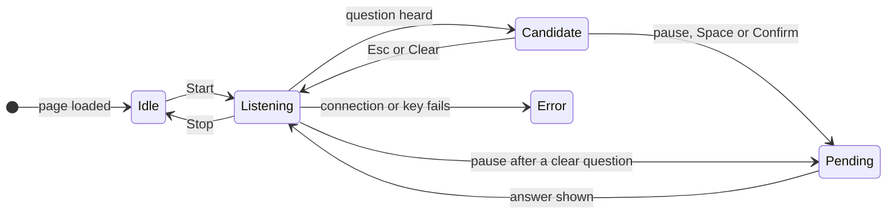

# The new meeting screen: what Pablo sees and does

UC-09 describes the SPRINT-004 screen from Pablo's seat: a slim top bar "Alice Good Meetings" with Start, Stop, Upload package and Download log; one very big bold confirmed question; a one-line candidate question; and two columns, "Alice suggests" (three bold bullets) and "What I hear" (the live transcript, newest words bold). Draft of 19 November 2026; not approved. Areas, sizes and exact wording are in the [08 screen specification](../08-low-level-design/03.7-sprint-004-screen-specification.md); this page gives only the interactions.

*Package missing is a notice on any state, and speaking is the time all of this is read. Concept, not a screenshot.*

## Actors and inputs

Pablo glances at the screen from a second monitor while he speaks; another participant, such as the interviewer, is heard but does not act. Every input stays: speech (a pause sets the question), **Space** or the **Confirm** button to confirm the candidate, **Esc** or the **Clear** button to clear it, the keys **G**, **L** and **S** to set the cue (GOOD, LAND IT, STOP) by hand, and, new, the key **A** and a toggle in the bar to switch the avatar on or off. The three cue buttons leave the screen, by Pablo's decision of 19 November 2026; the keys replace them, and a manual cue holds 10 seconds before the timer resumes.

## Scenarios

Each reads as: Pablo's situation, then what he sees.

| Scenario | What he sees and can do |
| --- | --- |
| **Question confirmed** | The question fills the big box in bold, tagged with its source (pause, Space or button). The candidate line empties; "Alice suggests" prepares the answer |
| **Candidate present** | One line shows the heard wording; Space or the Confirm button makes it the question, Esc or Clear drops it. Until he acts the big question does not change |
| **Answer pending** | The new question is shown, the suggestions say an answer is being prepared and show nothing from the earlier question; the rest of the screen stays usable |
| **Error** | A bold notice names the cause (no service, no key, microphone refused, connection lost). Start and Upload are disabled with the cause; the last question and answer stay, marked last known |
| **Package missing** | The package line says "No package: answers are general." in bold, with the reason (none, too large, unreadable, removed). It is a notice, not an error; Upload stays available. A small **Remove** in the same line clears a loaded package |
| **While speaking** | He reads the bar colour (the cue), the big question and three bullets at a glance. "What I hear" scrolls by itself with the newest words bold. Nothing moves, flashes or speaks, except the avatar (see its scenario); keys G, L and S set the cue |
| **Avatar** | A small picture of Alice, a 56 px logo with the caption "Alice Good Meetings" under the head, sits at the left end of the bar and is on by default; size and place are as 08 sets them (AV-1, SA-3, SA-19). The centre of the bar is left empty, reserved for a future "Alice says" advice area, with nothing shown this sprint. It blinks when idle and shows a short expression or nod when the state changes: Idle, Listening, Question detected (1.5 s), Researching while an answer is pending, Answer ready (2.5 s), and mild concern on Error. It never speaks. A toggle in the bar or key A turns it off and on; it is off when the system asks for reduced motion. If it cannot load or fails, it disappears silently and the page is unchanged |
| **Stopping** | After Stop, Start stays disabled and the page says it is stopping while Alice collects his last words, up to 3 seconds (the page waits about 4). His last words appear in "What I hear" only. Then the session ends and Start is available. The 30-minute limit waits the same way; a lost connection cannot, and loses the last words |
| **Manual cue** | He presses G, L or S; the bar shows that cue for 10 seconds, then the timer takes over from its own count. A second key during the hold wins and restarts the 10 seconds; a new question does not end it. Keys do nothing while a button has focus, and then Space acts on that button |

## Open questions and Stage 04

- Decided on 19 November 2026 (relayed by 00 Governance): the cue buttons stay removed; G, L and S set the cue and it holds 10 seconds. Pablo asked for no more screen ideas for now.
- Decided in 08's record: a small cue word beside the name, the column named "What I hear", three bullets and no details. Still open for 08: whether a Space-confirmed candidate is marked in the monitor line.
- **Stage 04 should evaluate:** each scenario above in the page check, each state readable at a glance from a second monitor, every input reachable with Space, Esc, G, L, S and speech, a manual cue lasting 10 seconds and then handing back to the timer, no earlier answer shown for a new question, and nothing animated except the avatar, which is the one exception to "nothing moves" (Pablo, 19 November 2026, relayed by 00 Governance): on by default, off by toggle, key A or reduced motion, silent on failure, no speech, and it never takes focus or moves the layout.

Draft, no acceptance recorded. [Focus and Live](01.4-confirm-current-question.md) · [Input channels](01.6-inputs-and-future-channels.md) · [Load the package](01.7-load-preparation-package.md) · [Meeting log](01.8-meeting-log-and-download.md) · [Stage index](README.md)
