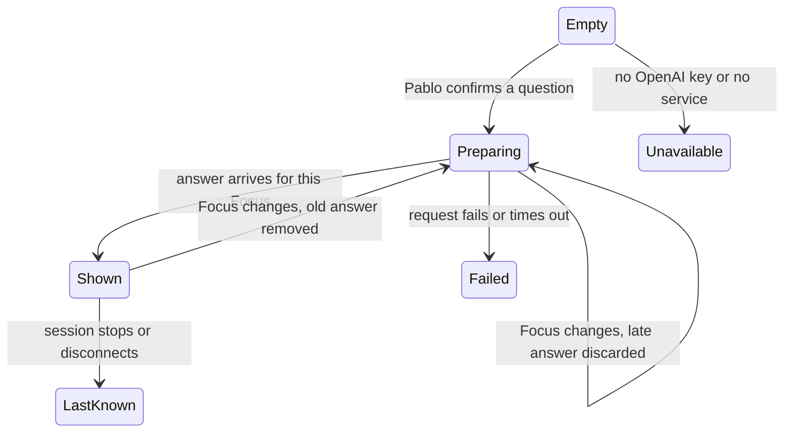

# SPRINT-003 through its interactions: what Pablo does and what he sees

SPRINT-003 gives Alice (Alice.Good.Meetings) a new page layout and a proposed answer for the Focus question. This first-pass review checks its eight commitments against the [use-case package](README.md): who acts, what they observe, and what happens when something goes wrong. The confirm-and-answer cycle and its cue already have scenarios; the proposed answer exists only as an intention, so the states drawn below are not yet described anywhere in this folder.

*Proposed states of the answer card, inferred from criteria 3 and 4 and the existing Focus rules. Empty means no Focus question yet. Only the rule that nothing automatic writes Focus is documented today.*

## Baseline and sources

Reviewed on 16 November 2026 against the [brief](../07-planning/03.6-sprint-003-review-brief.md) (SHA-256 `3a1a604830617a0fb4f570afbea0b685822725b7e9bbb63c92c3e8bad89fefe4`), its [direction page](../07-planning/03.6.1-sprint-003-brief-direction.md) (`1d12fda94108057cda7eb797ff9d93b002713b47f63a4f1b1911ff158d826cda`) and its [sources page](../07-planning/03.6.2-sprint-003-brief-sources.md) (`a8bf687090d661a68744f71c531af8f2b55a01511302ddfb7268b2ae0c767a31`), on branch `sprint-03` at revision `7d60c0f`.
The six Stage 03 documents, the sprint record, the root `AGENTS.md`, `index.html`, `app.js`, `poc/README.md`, `poc/start.sh`, `poc/poc.test.mjs`, the Stage 08 UC-04 design and the three Purpose documents were hashed and match the sources page. `poc/server.mjs` (`0cdb1aa85391db218afd3997de797cbe55222e9f068a8ee28c61a70c84e50386`) was also read and is not listed there. Code was read, not run, and no record accepts these exact Stage 03 bytes.

## Coverage of the eight commitments

| ID | Who does what, and what is observed | In Stage 03 today | Finding |
| --- | --- | --- | --- |
| S003-LAYOUT | Pablo sees the full-screen cue, two cards (Focus question, proposed answer) and a Live bar with Confirm | [UC-04](01.4-confirm-current-question.md) defines both areas, Confirm question and Clear live by behavior, not by position | Behavior is unchanged. The decision does not name Clear live, Start and Stop listening, the manual cue buttons or the status panels; the 4 November decision to keep Clear live carries forward |
| S003-PREVIEW | Pablo, as owner, looks at a preview and approves or rejects it before the page changes | Nothing; this is an acceptance step, not a product use case | No use case needed. The preview should show every state in the diagram, or the approval covers only the happy path |
| S003-GLANCE | While speaking, Pablo reads the cue, Focus and Live at a glance | UC-04 step 5 keeps the timer running; [UC-01](01.1-direct-question.md) asks whether cues are "readable at a glance" | Partly covered. No outcome covers a fourth element, the answer card, competing for attention; that depends on S003-Q1 |
| S003-ANSWER | Pablo confirms a question, Alice shows a proposed answer, and it is replaced when Focus changes | Intent only: UC-01 steps 3 to 6, [UC-02](01.2-open-question.md) step 2, [UC-03](01.3-experience-question.md) steps 3 and 4, and the UML behavior "Prepare brief answer cues" | Missing as a scenario tied to the Focus question; see the next table |
| S003-NOKEY | Pablo uses the page with no key and is told that proposed answers are unavailable | Nothing | Missing. Today `poc/server.mjs` ends the session with "Server needs OPENAI_API_KEY", so Live and Focus stop as well, while the local timer and cue continue |
| S003-TESTS | Technical: the automated checks keep passing | UC-04's alternatives are the behavior today's tests protect, for example the 4 November regression | Traces to an existing quality need. New tests need the expected observations of the missing scenario |
| S003-RUN | Technical: Pablo starts the service with one command | UC-04 step 1, "Pablo's session is ready", is the precondition; `bash poc/start.sh` is today's workflow | Traces to that workflow. No use case and no amendment needed |
| S003-LIVE | Pablo runs one real session and the result is recorded as pass or fail | UC-04 records the 4 November live run as evidence | No use case needed. The session should walk the main flow and at least one replacement |

## The proposed answer, interaction by interaction

| Interaction | Expected observation (proposed) | Stage 03 today |
| --- | --- | --- |
| Pablo confirms a question | Focus shows it; the answer card says an answer is being prepared, then shows it; the cue and timer continue | Missing; UC-04 step 4 ends at "so Pablo can reflect" |
| Focus changes while an answer is pending or shown | The old answer disappears at once; a late answer for the earlier question never appears under the new one | Principle only: UC-01 step 6 "retires stale cues" |
| Pablo confirms a restatement of the same question | Ambiguous: criterion 3 replaces the answer whenever Focus changes, yet UC-04 keeps a restatement in the same exchange and UC-02 asks for "stable anchors" | Contradictory |
| No OpenAI key, or the service cannot be reached | The card says proposed answers are unavailable. "The page still works" needs a definition, because no question can be captured either | Missing |
| The answer request fails or takes too long | A short notice in the card; Focus, Live, Confirm and the cue are unaffected; whether Pablo can retry is undecided | Missing; UC-04 has the pattern for a slow confirmation |
| The answer arrives after Pablo has started answering | Undecided: show it quietly or withhold it | Partial: UC-01 warns against "a distracting new set"; the acceptable delay is still open |
| The session stops or disconnects | The answer stays with its Focus question as last known; a new session starts empty | Missing; UC-04 gives the rule for Focus |
| No personal context is available | Organizing points only; never invented strengths, events or results | Exists in the UC-01 and UC-03 alternatives |

## Proposed amendments, not yet applied

1. Add `01.5-proposed-answer.md`: one illustrated scenario with the flow and alternatives above, linked from the README and the system model.
2. `01.4-confirm-current-question.md`: correct "The two-area panel is not implemented", since `index.html` and `app.js` at `7d60c0f` contain it; say that layout B moves the areas without changing their rules; refresh the concept picture once the preview is approved.
3. `01-system-model.md`, `system-use-cases.puml` and its two images: name Alice, link the new scenario from "Prepare brief answer cues", and replace "no Stage 07 work item" with SPRINT-003.
4. `01.1`, `01.2`, `01.3` and `README.md`: cue generation is no longer "without a committed sprint or schedule"; state what SPRINT-003 selects and what stays deferred.

## The three open questions

- **S003-Q1 Form:** UC-01 step 4 ("up to three short, relevant points") and the three anchors of UC-02 and UC-03 imply short points. Fuller wording would contradict "answers in their own words" and require changing those scenarios.
- **S003-Q2 Trigger:** UC-01 step 1 ("without needing to operate the coach") and the wording of criterion 3 imply automatic on Confirm. On request adds a control and one more state.
- **S003-Q3 Inputs:** both branches are already modelled: the question alone gives structure, and user-provided context gives recall. Purpose still defers résumé-based suggestions, and personal material sent to OpenAI goes beyond the data flow stated today.

## Verdict

**CHANGE_REQUIRED.** The sprint's central behavior has no scenario, and five Stage 03 documents describe planning and implementation states that SPRINT-003 and revision `7d60c0f` have overtaken. None of the three open questions blocks this verdict: each fills one bounded slot in the new scenario, which stays a draft until Pablo chooses. Downstream, Evaluation needs one observation per row of the second table, and Architecture must let the page know that answers are unavailable and tie each answer to the Focus question it was prepared for.
Not established: the page and tests were not run; Pablo's own messages were not seen, only the brief's relay; whether the preview is a picture or a running page; what "the page still works" covers; whether a confirmed restatement replaces the answer; and whether `bash poc/start.sh`, which passes `--env-file=.env.local`, starts at all when that file is absent.
