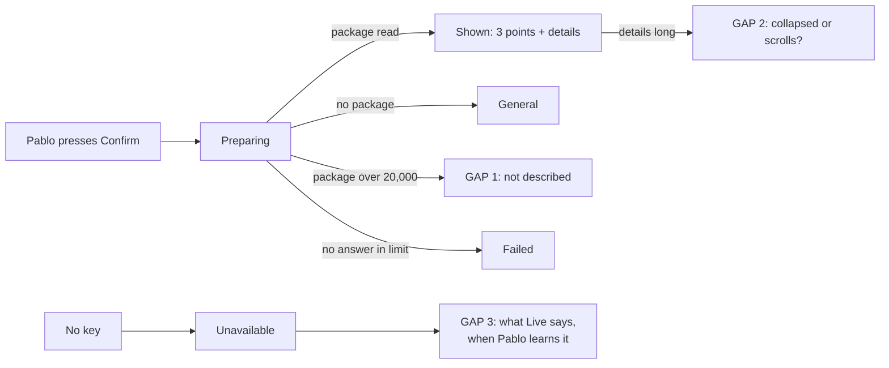

# SPRINT-003 use cases, second pass: the amended baseline

Pablo, the interviewee, confirms a question and Alice shows a few points and details. This first-pass review checks the twelve commitments of the [version 2 brief](../07-planning/03.8-sprint-003-review-brief-v2.md) against the [use-case package](README.md). It replaces nothing: the [17 November review](03-sprint-003-use-case-review.md) keeps its bytes.

*The answer card's path, with the three places where the pages and the amended criteria do not yet agree.*

## Baseline and sources

Sprint snapshot `.asdg/sprint.json`, SHA-256 `90d6dab6bb3d43b1b16d71a153796a27c3c757339a4291682d7d979b05d69131`; Git HEAD `fe3c00edc3ca4008b0b203317593acb6ab87e851`, branch `sprint-03`, 18 November 2026. Read, not run: no code, page or test was executed. I read the brief's five pages, the [record amendment](../07-planning/03.7.4-sprint-003-record-amendment.md) and `reviews.md`, and no other stage's new report.
Relied on, hashes recomputed today, matching the sources page: `01-system-model.md` `126679f3…a3d0`, `01.1` `42dd74ec…6d7e`, `01.2` `01a9939b…02d7`, `01.3` `82565f67…0e6e`, `01.4` `fda14495…6055`, `01.5` `9f960527…cd1cff`, `01.5.1` `c5412634…c33`, the 17 November review `ddacb92f…f23b`. `index.html` and `app.js` are unchanged since `7d60c0f`.

## The twelve commitments

| ID | Stage 03 view | Finding |
| --- | --- | --- |
| S003-LAYOUT | UC-04 rules hold; layout B moves the areas ([01.4](01.4-confirm-current-question.md)) | Placement of Clear live, Start and Stop, cue buttons stays with the preview (C9) |
| S003-PREVIEW | Acceptance step, no use case | The preview must show the [seven states](01.5.1-proposed-answer-states.md) |
| S003-GLANCE | UC-05 outcome: points at a glance, details on demand | Covered; the details rule needs Gap 2 |
| S003-ANSWER | UC-05 steps 2 to 6; "always replace"; one request | Covered, no change |
| S003-NOKEY | Unavailable state | Gap 3 |
| S003-TESTS, S003-PAGECHECK | Trace to UC-05's table and the seven states | Covered: the states are named once and reused |
| S003-RUN | UC-04 step 1 precondition | No Stage 03 change. `poc/alice-run.sh` does not exist yet; that is for Specs and Coding |
| S003-LIVE | UC-05 "observable outcome" gives the expectations | Covered; the script itself belongs to 04 |
| S003-DETAILS | UC-05 step 4, states rules | Gap 2 |
| S003-CONTEXT | UC-05 package paragraph, General state | Gap 1 |
| S003-STATEMENTS | UC-05 says question and package text are sent | No change: the wording belongs to 05 and the statements to Planning |

## Missing, contradictory or ambiguous

1. **Oversized or unreadable package.** Criterion 9 sets 20,000 characters; UC-05 covers an absent package and an irrelevant one, not one over the limit, empty, or unreadable. Pablo would not know why points are general.
2. **Details: collapsed or scrolling.** The pages say long details are collapsed and read on demand (C17); criterion 8 says the area scrolls only inside itself. A collapse control also needs the "no motion" rule.
3. **No key.** Criterion 4 names only the key; UC-05 adds an unreachable service. Not stated: whether Live shows its normal hint "Listening for a question…", whether Start listening does anything, and whether Pablo is told on load or only after Start.
4. **Date wording.** `01-system-model.md` and `README.md` say nothing of UC-05 is implemented; true at `7d60c0f`, but the page can only say it with the revision.

## Required amendments, all in Stage 03 and none applied

- **A1** (`01.5`, `01.5.1`): add the oversized and unreadable package. Recommended default: the package is not used, points are general, and the label says why ("package too large"); no truncation.
- **A2** (`01.5`, `01.5.1`): replace "collapsed" with the criterion's wording, a details area that scrolls inside itself. Recommended default; if Pablo wants a collapse control, the criterion changes instead.
- **A3** (`01.5`, `01.5.1`, `01.4`): with no key, Live and the answer card say unavailable, Start listening is disabled with that reason, and Pablo sees it on load. A service that cannot be reached gets the same message.
- **A4** (`01.5`): add one sentence that a package in place is shown as loaded before the interview, so he knows what a Confirm will send. Needs his yes; otherwise omit.
- **Effects:** Evaluation adds one observation each for A1 to A3; Architecture must expose "key and package state" to the page; Specs words the labels.

## Carry-forward of the 17 November review

Confirmed: UC-04 behavior is unchanged under layout B (S003-LAYOUT, S003-PREVIEW). Corrected: the open placement of Clear live, Start and Stop, the manual cue buttons and the status panels also carries forward (C9), and the old seven-state diagram is replaced by the states page, which adds General.

## Verdict

**CHANGE_REQUIRED.** The scenario exists and fits the amended criteria except the three gaps; each has a recommended default. Only A4 needs a yes from Pablo.

Return to the [stage index](README.md). This is a first-pass draft; it approves nothing.
