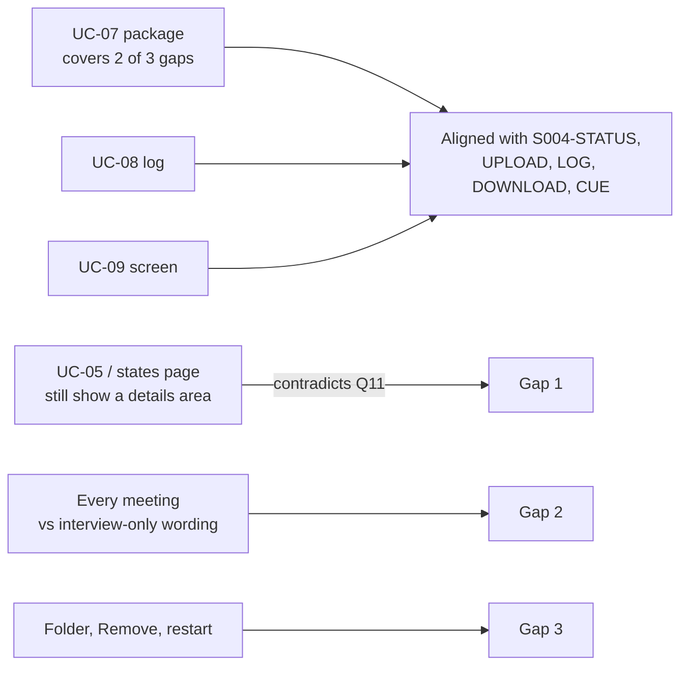

# SPRINT-004 through its interactions: first-pass use-case review

Pablo, the only actor, loads a package, watches a new screen in meetings and later downloads a log. This independent first-pass review checks the nine commitments of the [SPRINT-004 brief](../07-planning/03.15-sprint-004-review-brief.md) against the use-case package. It was written before any other stage's SPRINT-004 report.

*The new pages fit the plan; two older pages and one corner of the package do not.*

## Baseline and sources

Sprint proposed, none active, so no `.asdg/sprint.json`. Baseline: [plan 03.14](../07-planning/03.14-sprint-004-working-plan.md) `9eed53db…`, the brief (`f287d715…`), Git HEAD `7d06df187a041a65b646d8d573acbbc2eeea0c87`, 19 November 2026. Read, not run; no code was opened.
Relied on, hashes recomputed today: `01-system-model.md` `ede3d953…`, `01.4` `9de2cb15…`, `01.5` `09e245eb…`, `01.5.1` `251cbbc5…`, `01.6` `8472b1c7…`, `01.7` `d0992c08…`, `01.8` `546d51a1…`, `01.9` `0e3b3ca3…`; 08 [screen specification](../08-low-level-design/03.7-sprint-004-screen-specification.md) `eb8741b0…`, states `157252ca…`, decision record `72c3c228…`.

## The nine commitments

| ID | Stage 03 view | Finding |
| --- | --- | --- |
| S004-STATUS | UC-07 step 1 and the status row | Covered |
| S004-UPLOAD | UC-07: replace, refused, skipped, Stop, Remove, second upload, while listening | Covered except Gap 3 |
| S004-LOG | UC-08 flow and failures | Covered; Gap 4 |
| S004-DOWNLOAD | UC-08 download during, after, before any session | Covered; Gap 4 |
| S004-SCREEN | UC-09 six situations | Covered; Gap 1 |
| S004-CUE | UC-09 "Manual cue", keys G, L, S, Esc | Covered; Gap 5 |
| S004-GUARD | Traces to UC-04 "no clear question heard"; the idle pause is invisible to Pablo | No change |
| S004-STATEMENTS | Stage 03 pages only point to the statements | No change |
| S004-CARRY | UC-04 and UC-05 already say a pause sets Focus and Confirm is optional | Covered; wording follows Gap 1 |

## Missing, contradictory or ambiguous

1. **Details area.** Pablo's 19 November decisions (record Q11, brief) say the model is no longer asked for details and the screen shows three bullets. `01.5` and `01.5.1` still describe a details area, scrolling inside itself, and the Shown state holds "points and details". `01.9` still lists the details as open, and its open line also lists the cue word and "What I hear", which Q2 and Q12 decided.
2. **Every meeting.** The brief's scope is every meeting; Stage 03 is written for interviews ("interview preparation package", UC-01 to UC-03, "other meeting types come later") and Purpose must agree first.
3. **Folder, Remove and restart.** UC-07 says upload replaces the folder package for this run, but not whether Remove brings the folder package back at the next Start, what the status shows after a service restart (uploads are in memory only), or whether Remove is allowed while listening.
4. **Which logs.** Download gives "the current or last" session; an earlier one is only in `poc/logs/`. UC-08 says so only by implication. Also, Pablo gets no signal if `poc/logs/` is not Git-ignored (brief tension 1).
5. **Cue key corners.** Not stated: a second key during the 10-second hold, a key pressed with focus on a button, and whether a new question resets the hold.
6. **Two state lists.** The seven answer states and 08's screen states are different lists; the page check must say which it covers.
7. **Diagram.** `system-use-cases.puml` and its images do not show UC-06 to UC-09; PlantUML is not installed here.

## Required amendments, none applied

- **A1** (`01.5`, `01.5.1`, `01.9`, `01.4`): remove the details area and use three bullets; update the Shown and General rows, the scroll rule and "one request" wording; close the decided items in `01.9`; say the Focus and Live cards are the question and the candidate line.
- **A2** (`01-system-model.md`, `01.5`, `01.7`, README): say "preparation package" and "meeting"; keep UC-01 to UC-03 as interview scenarios with other meeting types reusing the same flow. After 02.
- **A3** (`01.7`): Remove disabled while listening (default); after Remove the folder package stays cleared until the service restarts; after a restart the status shows the folder package or "No package"; Remove applies to what is loaded now.
- **A4** (`01.8`): one sentence that the button gives the current or last session and older logs are files in `poc/logs/`; for the missing Git-ignore the default is that the log is still written and the status line says so, pending 05.
- **A5** (`01.9`): the latest key wins and restarts the 10 seconds; keys do nothing while a button has focus and Space is used (08 SC-3); a new question does not end a hold.
- **A6** (`01.5.1`): name the seven answer states as the page-check list and link 08's screen states beside it.
- **A7:** redraw the diagram once a PlantUML tool exists, or Pablo accepts a text-only model for now.
- **Effects:** 04 re-words the page check and the Shown state; 05 confirms the folder/Remove rule and the Git-ignore signal; 08 aligns its states; 02 must accept "every meeting" first.

## Verdict

**CHANGE_REQUIRED.** The new scenarios fit the plan; A1 and A2 are decided and mechanical, and A3 to A5 have defaults that need only Pablo's nod. Not established: that any behavior works, since nothing was run.

This is a first-pass draft; it approves nothing. Return to the [stage index](README.md).
