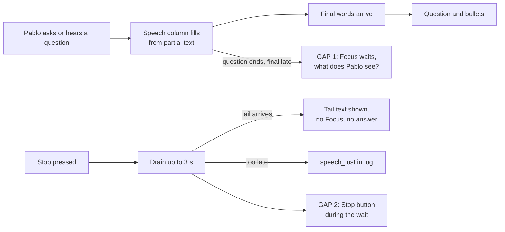

# SPRINT-005 use cases, first pass: a faster Alice

Pablo answers a live question and presses Stop. This first-pass report asks, as Use Cases, who does what and what Pablo can see. It reviews the [brief](../07-planning/03.20-sprint-005-review-brief.md) against the [use-case package](README.md). A draft of 22 November 2026; it approves nothing.

*Concept: the two places where the new rules touch what Pablo sees and the pages do not yet say so.*

## Baseline and sources

Brief SHA-256 `e9f5613ad213a23e6686f4f126e757155ee8cdc0492f9113a50c099e648b2029`; `.asdg/sprint.json` `f17247ac…721c`, matching; Git HEAD `673c3bd7d465d5ecf809ba92734d49b625f78c7c`, branch `sprint-05`. Read, not run: the plan 03.18, 08's [rules](../08-low-level-design/03.11-sprint-005-response-time-rules.md) and [checks](../08-low-level-design/03.11.1-s005-checks-and-open-items.md), 04's [measurement plan](../04-benchmarks-and-eval-strategy/03.14-sprint-005-measurement-plan.md), and my UC-04, UC-08 and UC-09. I did not open 09's analysis or any private log.

## Commitments from the Stage 03 view

| ID | Finding |
| --- | --- |
| S005-FINAL | No new actor or step. Pablo sees the same Question and bullets, possibly a little later after a pause that ends before the final words: **Gap 1** |
| S005-WASTE, S005-SMALLER | Service-internal; nothing Pablo sees changes. No use-case change |
| S005-TIME | The outcome of UC-04 and UC-05 is unchanged; only the wait shortens. Measured by 04 |
| S005-QUALITY | Pablo marks answers yes or no after each; this is a test activity, not a product use case. No change |
| S005-STOP | UC-08 step 4 says the log is complete after Stop but not what happens to words in flight: **Gaps 2 and 3** |
| S005-CARRY | One live session and the statement check: for 04 and 05, not Stage 03 |

## Gaps

1. **Question over, final words not yet in.** Today a partial text can start the reader; under RT5-1 the Focus waits for the final item. UC-04 says nothing of this wait. Recommended: the speech column keeps showing his words, the Focus and Live stay as they were until the final words arrive, and no message is added.
2. **Stop is not instant.** RT5-6 waits up to 3 s for the tail. UC-09 has no "stopping" state: whether the button shows it, whether Start is disabled meanwhile, and whether the page shows the tail. Recommended: Stop shows "Stopping…", Start stays disabled until the session ends, and the tail appears in the speech column only.
3. **Words lost at Stop.** If the tail is late, `speech_lost` goes only to the log. Pablo does not learn it on the page. Recommended: one short line on the page, "Last words not captured", because a lost last question is otherwise invisible. This is a UI addition, and the sprint's scope says no new UI, so it needs Pablo's decision.
4. **Tail never answered.** RT5-6 gives the tail no Focus and no answer. Correct for a stop, but UC-04's "last known" rule should say a question spoken just before Stop is shown in the speech column, not as Focus. Wording only.
5. **Log events.** UC-08's evaluation line lists pauses, questions, Focus and answers; `model_call`, `question_timing` and `speech_lost` carry numbers only and no text. Recommended: name them in UC-08 without changing its privacy outcome. 05 owns the version 1 log question.

## Required amendments, none applied

- **A1** (UC-04): add the wait in Gap 1 and the tail rule in Gap 4.
- **A2** (UC-08, UC-09): add the three event names, the "Stopping" state and the drain exception; the 30-minute limit and a disconnect lose the tail the same way.
- **A3**: Gap 3 needs Pablo's yes or no; default if no: log only, and say so in UC-08.

## Downstream and order

04 needs before-runs on the old code, and the log fields land only with coding, so Coding owns the order: logging first, measured before-runs, then behaviour. 08 should record the "Stopping" state in its screen specification if A2 is accepted. 04 should add to its checks that Stop with a late tail leaves the log and page as described.

## Verdict

**CHANGE_REQUIRED.** The scenarios hold and the speed change is invisible to Pablo, but the Stop wait, the lost tail and the final-words wait are not in the use cases. Return to the [stage index](README.md).
