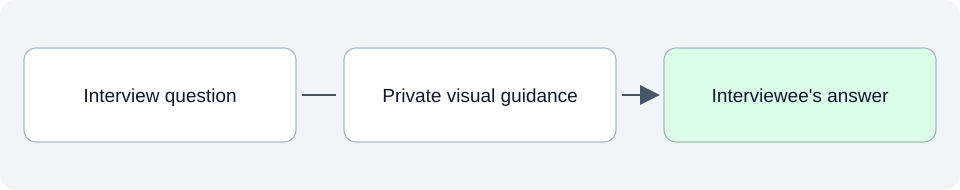

# System model and use cases: how help would work

This folder turns the product's purpose into understandable interactions: who participates, what happens during an exchange and what the user should experience.

## SpeakerCoach today

The saved model describes one interview-coaching use case with three answer scenarios. These are intended behaviors from the 20 October 2026 discussion, not proof that the current application implements them.

The illustrations depict a desired experience. The system overview explains actors, boundaries and shared behavior without choosing a technical meeting integration.

## What belongs here as we develop

The scenarios help us discuss interruptions, overlapping speech, changing questions and cues that arrive too late. They give evaluation and design concrete behavior to work from.

## Explore

- [System overview and UML model](01-system-model.md).
- [Direct question](01.1-direct-question.md): pause, reflect and answer.
- [Open question](01.2-open-question.md): develop an answer and stay focused.
- [Experience question](01.3-experience-question.md): recall and tell a relevant story.

Read files in order: **01 Intended**, **02 Current**, **03 Planned**. Additional topics use dotted numbers such as `01.1` or `03.2`; release and sprint plans identify their horizon in the filename and text.
See the [folder guide](../../../asdg/00-governance/docs/stage-layout.md) for consolidation at cycle closeout. Return to [project documentation](../README.md).
