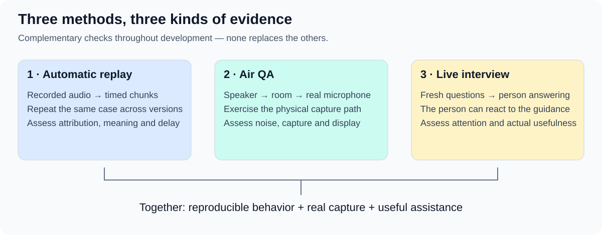

# How we will evaluate SpeakerCoach

SpeakerCoach must understand an unfolding conversation and help a person without interrupting their thinking. We need different evidence for each.

## Three complementary ways to learn

| Method | How it works | What we learn |
| --- | --- | --- |
| **Automatic replay** | Feed a recorded conversation progressively through the product at normal speed. | Whether speaker attribution, question handling and coaching improve or regress across versions. |
| **Air QA** | Play a recording aloud, or interview on another device, while the app listens through its real microphone. | Whether capture, room conditions and the visible experience work together. |
| **Live interview** | A person answers fresh questions while receiving guidance. | Whether the guidance is understandable, timely and helpful without distracting them. |

Replay is a permanent development tool, not a one-off demonstration. Air QA and live trials complement it throughout development.
A recorded answer cannot react to new coaching: replay alone cannot demonstrate improved answering.

## Test the conversation as it unfolds

The replay controller may hold the complete recording; analysis receives only audio whose playback time has arrived.
Timed chunks preserve pauses and overlap. “Word by word” means progressive delivery, not word-sized files or a prepared transcript.
Replay and microphone input should join the same downstream processing path at a documented boundary; its technical design remains open.
No analysis component—including transcription, retrieval and coaching—may access future audio, private transcripts, evaluator labels or reference answers.
List permitted background explicitly and keep it constant across comparisons. A voice sample must be independently recorded and reveal no future case speech.
Enforce the boundary through delivery and resource access, then inspect both access and timing evidence. An instruction not to look ahead is insufficient.

## Build a small collection that lasts

Begin with **one recording**, then grow toward the user-selected target of **ten varied recordings**.
Version cases and retain configurations, delivered-input timelines, outputs, errors and evaluation results so comparisons can be explained.
Live sessions recorded with agreement and recording enabled become candidate cases; they join the benchmark only after review.
The [collection guide](01.1-benchmark-collection.md) explains coverage and admission.

## Decide what success means

Use the [evaluation scorecard](01.2-evaluation-criteria.md) to assess attribution, question handling, coaching, timing, reliability and usefulness.
The first candidate feature is [keeping the interviewer's question visible](../02-purpose/03-planned-improvements.md). Future answer hints have separate criteria.
First demonstrate valid progressive replay; then assess feature quality; use real answering to assess benefit. These are separate conclusions.
Numeric thresholds and the detailed first-case protocol remain [pilot proposals](03-release-single-recording-evaluation.md), not approved product policy.

## Basis and status

Reorganized from the [original strategy draft](sources/strategy-draft-0.1.md) and subsequent review discussions.
Replay, Air QA, live validation and the ten-recording target reflect the user's selected direction; detailed scoring and protocols are proposals.
No benchmark execution or measured result is established by these documents. See [current evidence](02-evidence-and-reconciliation.md).
[Review index](README.md)
