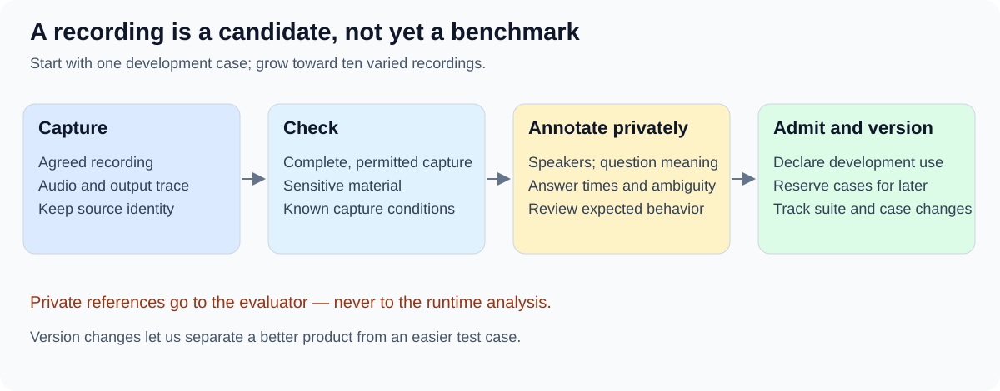

# A benchmark collection we can trust

The target is ten varied interview recordings, beginning with one development case. Ten recordings are a coverage goal, not a dataset we already have.

## Choose useful variety

| Cover across the collection | Why it matters |
| --- | --- |
| Direct, open and experience questions | The [three intended answer scenarios](../03-system-model-and-use-cases/01-system-model.md) need different support. |
| Multipart questions and genuine follow-ups | The coach must retain all important meaning and replace the question at the right time. |
| Restatements, pauses, interruptions and overlap | User speech and ambiguity must not cause confident false updates. |
| Short and long answers; varied speakers | Long interviewee answers must not hide errors on brief interviewer turns. |
| Different rooms, microphones and background noise | Clear direct replay does not establish reliable physical capture. |

The first recording need not cover everything. Record gaps rather than inventing coverage.
Several questions in one recording provide multiple observations, not independent conversations.

## Admit a case deliberately

| Case record | Contents |
| --- | --- |
| Identity and use | Identifier, version, original audio digest, capture conditions, permission and intended evaluation use. |
| Allowed runtime input | Audio delivered progressively, fixed product configuration and declared background. |
| Private evaluator reference | Checked transcript, speakers, question meaning and boundaries, answer intervals and ambiguous spans. |
| Review and expectations | Annotator, review status, expected behavior and checks that can be scored reliably. |

Evaluator references remain outside runtime access. Resolve uncertain annotations or exclude the affected score explicitly.
Retain originals and version annotation or membership changes so a dataset change is distinguishable from a product change.
Identify cases used for tuning; keep a stable regression core and reserve some cases for later checks. The allocation remains undecided.
Repeated replay does not restore a known case's independence.

## Let real use supply candidates

When recording is agreed and enabled, the intended product captures audio and its output trace alongside assistance without intentionally delaying it.
Check capture completeness, permitted use, sensitive material, labels and suitability before admitting a session.
A saved recording is one candidate data point; it neither retrains a model nor proves the coach was correct.
This recording behavior remains a proposal requiring system-model review; it is not implemented merely because the strategy describes it.

Based on the [source draft](sources/strategy-draft-0.1.md). Admission details and reserved-case allocation remain proposals.
[Strategy](01-evaluation-strategy.md) · [Scorecard](01.2-evaluation-criteria.md) · [First case](03-release-single-recording-evaluation.md)
