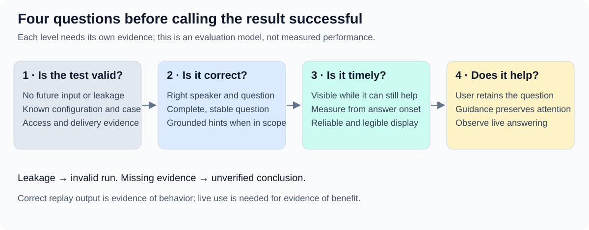

# Evaluation criteria: correct, timely and useful

A good result is more than an accurate transcript. Alice.Good.Meetings must retain the right question, offer trustworthy help at a useful moment and preserve the speaker's attention.

## The scorecard

| Criterion | What success looks like | Evidence and failure examples |
| --- | --- | --- |
| **Speaker attribution** | Distinguishes interviewer from interviewee and expresses uncertainty when needed. | Reviewed speech labels, scored separately for each participant; a user's restatement must not become a new interviewer question. |
| **Question handling** | Captures every required part, stays visible during the answer and changes only on a genuine follow-up. | Meaning-unit comparison and visible display history; missing a subquestion, inventing a requirement or blanking during a pause is a failure. |
| **Proposed answer** | A card of at most three short bullet points addresses every part of the Focus question; the details area below supports those points. Both belong to the current Focus question and state nothing about Pablo that the declared preparation package does not contain. | Human review of each answer against the Focus question and the package; an invented or unsupported statement about him, an answer left from an earlier question, or a card that must be read rather than glanced at fails. |
| **Details area** | The text below the cards is legible, scrolls only inside its own area and supports the bullets. Every statement about Pablo in it is found in the declared preparation package. | Rendered-page check and human review against the package, as for the bullets. Unreadable or clipped text, a statement the package lacks, or details left from an earlier question fails. |
| **No benchmark material** | The request to the answer generator holds only its declared inputs, and the package holds no benchmark material. | Assertion on the request body in a test; a recorded file list and digests of the package, checked against `eval-data/`. Any recording, transcript, evaluator label or reference answer in either makes the run **invalid**. |
| **Timing** | Correct guidance appears while it can still help. | Visible-display time relative to question end, answer start and answer end; late but accurate output is not timely help. |
| **Reliability and readability** | Processes input without unexplained gaps or failures; the cue, Focus question, Live question and bullet card pass the glance check below. | Report the service tests and the scripted page check as two results, since either can pass alone. Input/output traces, errors and rendered UI; crashes, clipped text or unnecessary rewriting are failures. |
| **Attention and usefulness** | The user retains the question and answers without the display derailing their thought. | Air QA checks presentation; live answering supplies user reports and observed confusion, requests for repetition or distraction. Replay cannot establish benefit. |

## Establish test validity before scoring quality

Future input or private-reference leakage makes a run **invalid**, not merely low quality.
Missing delivery, resource-access or output evidence makes the affected conclusion **unverified**.
Keep case versions, configurations, permitted context and scoring rules fixed across comparisons.
Automate observable timing, input coverage and error checks. Start semantic assessment with reviewed examples and human judgment; validate any later automated judge before relying on it.

## Record an explanation, not just a number

For semantic criteria: **pass** means complete and supported; **partial** means useful but incomplete; **fail** means wrong, missed, invented or stale.
Report ambiguous cases separately and assess conservative handling and recovery; do not demand words that are inaudible.
For each question, retain its case/run ID, expected meaning, observed display, timestamps, result, reviewer and reason.
Report all runs and participant denominators. Aggregate averages must not hide a missed question, a bad repeat or a disadvantaged speaker.

## The glance check

Four elements must be readable at a glance: the GOOD / LAND IT / STOP cue, the Focus question, the Live question and the bullet card.
Layout part: in a desktop browser window on a second screen and with the longest expected content, all four are fully visible without scrolling, unclipped, not overlapped, and no smaller than on the page at revision `7d60c0f`.
Human part: after one brief look while answering, Pablo can name the cue, the Focus question and the gist of the bullets; each is recorded yes or no. No glance time is set: one user, self-report and no eye tracking cannot support one.
The details area is reference text, read on demand and not held to a glance. It must stay legible and scroll only inside itself, and it may never shrink, cover or move the four elements.
"Up to three" comes from [UC-01](../03-system-model-and-use-cases/01.1-direct-question.md), step 4. Pablo accepted three defaults on 16 November 2026, as relayed by 00 Governance: at most three bullets, details read on demand and not at a glance, and a desktop window on a second screen as the viewing surface. He may change any of them at the preview or the specification review; the length of a bullet is fixed from the approved preview.

## Assess usefulness with real answering

A proposed small live comparison uses fresh comparable questions with and without question display, varying order where practical.
After each answer, ask whether the question stayed clear, whether a cue helped and whether looking at it interrupted thinking; retain concrete examples.
For a proposed answer, also ask whether the bullets fitted the question, whether they helped him organize his own answer instead of reading one out, and whether anything said about him was untrue.
Observe requests to repeat the question and loss of focus alongside the user's report. A small trial supports local learning, not a broad causal claim.
The live rubric and pass rule were decided by Pablo on 18 November 2026 and are in the [live session page](03.6.1-sprint-003-live-session.md); no success rate is required, and do not manufacture a benefit score from replay accuracy.

The source draft establishes these evaluation dimensions. This operational rubric elaborates them for review; the proposed-answer row and the glance check were added on 16 November 2026 for SPRINT-003, and the details-area and no-benchmark-material rows on 17 November 2026 (amendment N3). On 18 November 2026 Pablo decided the live pass rule and that he alone judges statements about himself, as relayed by 00 Governance. The pages are drafts with no approval recorded.
The [pilot measurements](03.1-release-measurements-and-thresholds.md) retain provisional numeric gates separately.
[Source](sources/strategy-draft-0.1.md) · [Strategy](01-evaluation-strategy.md) · [Review index](README.md)
