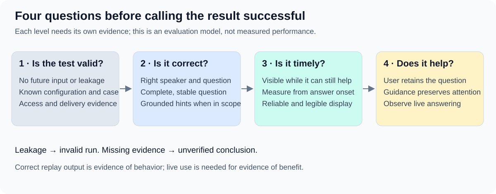

# Evaluation criteria: correct, timely and useful

A good result is more than an accurate transcript. SpeakerCoach must retain the right question, offer trustworthy help at a useful moment and preserve the speaker's attention.

## The scorecard

| Criterion | What success looks like | Evidence and failure examples |
| --- | --- | --- |
| **Speaker attribution** | Distinguishes interviewer from interviewee and expresses uncertainty when needed. | Reviewed speech labels, scored separately for each participant; a user's restatement must not become a new interviewer question. |
| **Question handling** | Captures every required part, stays visible during the answer and changes only on a genuine follow-up. | Meaning-unit comparison and visible display history; missing a subquestion, inventing a requirement or blanking during a pause is a failure. |
| **Coaching quality** | Future hints are relevant, brief and grounded in permitted facts available at that moment. | Human review of each cue and supporting context; invented achievements, unsupported advice or stale cues fail. Not a gate for the first question-display feature. |
| **Timing** | Correct guidance appears while it can still help. | Visible-display time relative to question end, answer start and answer end; late but accurate output is not timely help. |
| **Reliability and readability** | Processes input without unexplained gaps or failures; displays stable, legible text. | Input/output traces, errors and rendered UI; crashes, clipped text or unnecessary rewriting are failures. |
| **Attention and usefulness** | The user retains the question and answers without the display derailing their thought. | Air QA checks presentation; live answering supplies user reports and observed confusion, requests for repetition or distraction. Replay cannot establish benefit. |

## Establish test validity before scoring quality

Future input or private-reference leakage makes a run **invalid**, not merely low quality.
Missing delivery, resource-access or output evidence makes the affected conclusion **unverified**.
Keep case versions, configurations, permitted context and scoring rules fixed across comparisons.
Automate observable timing, input coverage and error checks. Start semantic assessment with reviewed examples and human judgment; validate any later automated judge before relying on it.

## Record an explanation, not just a number

For semantic criteria: **pass** means complete and supported; **partial** means useful but incomplete; **fail** means wrong, missed, invented or stale.
Report ambiguous cases separately and assess conservative handling and recovery; do not demand words that are inaudible.
For each question, retain its case/run ID, expected meaning, observed display, timestamps, result, reviewer and reason.
Report all runs and participant denominators. Aggregate averages must not hide a missed question, a bad repeat or a disadvantaged speaker.

## Assess usefulness with real answering

A proposed small live comparison uses fresh comparable questions with and without question display, varying order where practical.
After each answer, ask whether the question stayed clear, whether a cue helped and whether looking at it interrupted thinking; retain concrete examples.
Observe requests to repeat the question and loss of focus alongside the user's report. A small trial supports local learning, not a broad causal claim.
The live rubric and any required success rate remain to be agreed; do not manufacture a benefit score from replay accuracy.

The source draft establishes these evaluation dimensions. This operational rubric elaborates them for review.
The [pilot measurements](03.1-release-measurements-and-thresholds.md) retain provisional numeric gates separately.
[Source](sources/strategy-draft-0.1.md) · [Strategy](01-evaluation-strategy.md) · [Review index](README.md)
