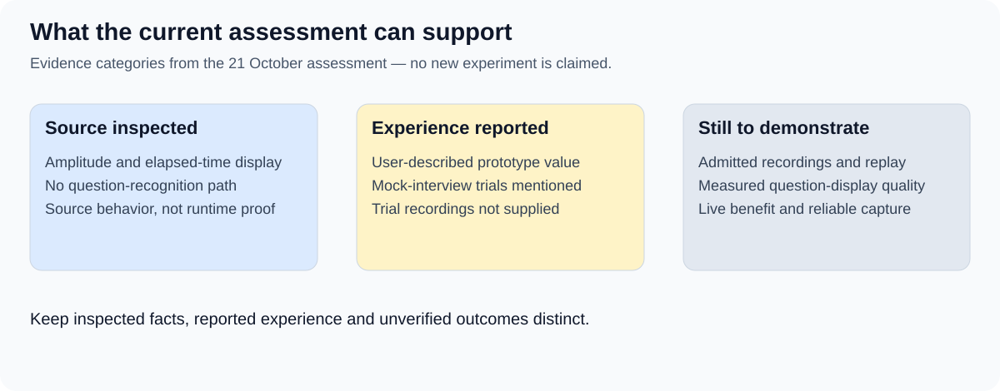

# Current evidence and reconciliation

Assessment of Speaker Coach’s local working tree and documentation on 21 October 2026; no deployed build or runtime behavior was tested.
The embedded CLI reports accepted, current Purpose and use-case reviews. Stage 04 had no registered evidence at the start of this documentation update.
The new Stage 04 package is a draft for review; its existence does not establish acceptance or measured product capability.

## What the accepted baselines cover

| Source | Existing coverage | Contribution of the new discussion |
| --- | --- | --- |
| [Purpose](../02-purpose/01-purpose.md) | Focus, recall, clear answers and attention-preserving visual support. | An enduring evaluation strategy for testing those outcomes. |
| [Next improvement](../02-purpose/03-planned-improvements.md) | Speaker distinction and question capture, multipart fidelity, persistence and distraction questions. | Repeatable cases, private annotations, timing measurements and comparisons. |
| [Use-case model](../03-system-model-and-use-cases/01-system-model.md) | Direct, open and experience flows, brief grounded cues, follow-ups and uncertainty. | Coverage goals for a versioned suite and later cue evaluation. |
| [Current capability report](../02-purpose/02-current-capabilities.md) | User-reported value from duration signals and disruption from spoken coaching. | Separation of replay evidence, physical Air QA and live usefulness evidence. |

No conflict with the accepted purpose was found. Question display remains the first candidate feature within a broader strategy that also covers eventual hints.
The collection target is ten recordings, each containing multiple question events. The earlier suggestion of twelve questions used a different unit and did not define the recording count.

## Source-inspected application behavior

The inspected [app.js](../../../app.js) uses microphone amplitude, elapsed time and silence gaps to drive green, yellow and red states; transition thresholds are 25 and 35 seconds.
This is sound-level activity detection, not identification of User’s speech. Interviewer speech or other sound can contribute to the detected activity.
The inspected [index.html](../../../index.html) contains the color panel, controls and debug display.
Neither inspected file implements transcription, speaker identity recognition, question display, answer hints, session storage or an automatic replay harness.
These are source observations, not proof of running behavior, deployment or user outcomes. Source hashes are retained with the documentation modification receipts.

## Reported experience and unavailable evidence

The supplied draft reports completed mock-interview trials. Their audio, configurations and results were not supplied for this assessment.
No recording has been selected or annotated as SC-B001; no benchmark or Air QA run was executed here.
The permanent harness, ten-case suite, simultaneous live recording and measured performance remain intended outcomes.
ASDG structure verification passed. The sprint is inactive; there is no release or implementation commitment for this proposal.

## Candidate intake update — 24 October 2026

The preceding observations describe the 21 October assessment. User has now supplied [mock-interview-0.mp3](../../../eval-data/mock-interview-0.mp3) as candidate SC-B001 and reports two participants recorded over air through an iPhone microphone.
Local metadata inspection found 14 minutes 32.620 seconds of stereo MP3 audio at 44.1 kHz. A full local decode completed without reported errors; this does not establish speech quality, transcription accuracy or application behavior.
The [candidate card](03.3-first-recording-case.md) records the intake and remaining references. The application source still has no transcription, speaker identification or replay harness; no such evaluation ran here.
The current CLI reports Purpose and use-case reviews as stale after document changes; their acceptance status described above is historical. The sprint remains inactive, and this intake changes no workflow decisions.

## Scope changes and decisions

Recording live sessions and admitting them to an evaluation collection extend the accepted use cases and need documentation review.
No-look-ahead covers every analysis component, not only the final coach; offline preprocessing of future audio would invalidate a replay.
Exact versus shortened question text, speaker enrollment, thresholds, the dataset split and cue timing remain proposed or unresolved.
Candidates and concrete decisions are collected in [review decisions](03.2-release-alternatives-and-review-decisions.md).

Source: [Archived strategy draft 0.1](sources/strategy-draft-0.1.md), supplied by User on 21 October, plus this chat’s explicit strategy statement and subsequent review.
The archive preserves the supplied file byte for byte, including its original modification marker. Its digest and original path are retained in the modification receipts; reported results remain unverified.
The subsequent reviewer comments informed the distinction between feasibility and feature quality, an optional manual comparison, participant-level reporting and answer-relative timing. These refinements remain proposals for User review.
[Review index](README.md) · [First evaluation](03-release-single-recording-evaluation.md)
